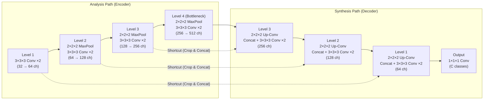

# 3D U-Net

**3D U-Net**은 Özgün Çiçek 등이 MICCAI 2016 논문(*"3D U-Net: Learning Dense Volumetric Segmentation from Sparse Annotation"*)에서 제안한 **3차원 볼륨 밀집 예측(Dense Volumetric Prediction)용 인코더-디코더(Encoder–Decoder) 신경망 아키텍처**다. 기존 2D U-Net(Ronneberger et al., 2015)의 모든 2차원 연산을 3차원 연산으로 확장하여 단면 내부뿐 아니라 인접 단면 간의 3D 공간 문맥(Volumetric context)을 함께 학습하며, 일부 단면만 주석된 **희소 주석([[Sparse annotation|Sparse annotation]])**만으로도 전체 3D 볼륨의 분할(Segmentation)을 end-to-end로 학습할 수 있도록 설계되었다.

---

## 1. 원문 논문 및 핵심 레퍼런스

### 원문 논문 서지 정보 (Original Paper)
- **논문 제목**: *3D U-Net: Learning Dense Volumetric Segmentation from Sparse Annotation*
- **저자**: Özgün Çiçek, Ahmed Abdulkadir, Soeren S. Lienkamp, Thomas Brox, Olaf Ronneberger
- **학술대회**: *Medical Image Computing and Computer-Assisted Intervention (MICCAI 2016)*, LNCS vol. 9901, pp. 424–432 (2016)
- **DOI**: [10.1007/978-3-319-46723-8_49](https://doi.org/10.1007/978-3-319-46723-8_49)
- **arXiv**: [arXiv:1606.06650](https://arxiv.org/abs/1606.06650)
- **공식 프로젝트 페이지**: [University of Freiburg - 3D U-Net](https://lmb.informatik.uni-freiburg.de/resources/opensource/unet.en.html)

### 선행 및 후속 핵심 레퍼런스
- **선행 기반 (2D U-Net)**: Ronneberger, O., Fischer, P., & Brox, T. (2015). *U-Net: Convolutional Networks for Biomedical Image Segmentation*. MICCAI 2015, pp. 234–241. ([arXiv:1505.04597](https://arxiv.org/abs/1505.04597))
- **병목 방지 설계 참고 (Inception v3)**: Szegedy, C. et al. (2016). *Rethinking the Inception Architecture for Computer Vision*. CVPR 2016. (Max pooling 직전에 채널 수를 2배로 늘려 표현 병목(Bottleneck)을 피하는 설계 채택)
- **배치 정규화 (Batch Normalization)**: Ioffe, S., & Szegedy, C. (2015). *Batch Normalization: Accelerating Deep Network Training by Reducing Internal Covariate Shift*. ICML 2015.
- **후속 표준화 프레임워크 (nnU-Net)**: Isensee, F. et al. (2021). *nnU-Net: a self-configuring method for deep learning-based biomedical image segmentation*. Nature Methods, 18(2), 203–211.

---

## 2. 네트워크 아키텍처 (Network Architecture)

3D U-Net은 크게 문맥 정보를 압축·추출하는 **분석 경로(Analysis / Contracting Path, Encoder)**와 정밀한 공간 해상도를 복원하는 **합성 경로(Synthesis / Expanding Path, Decoder)**로 구성되며, 각 경로는 **4단계의 해상도(Resolution steps)**를 가진다.

### 주요 구조적 특징
1. **3D 연산으로의 전면 확장**:
   - **Analysis Path (Encoder)**: 각 해상도 단계마다 두 번의 $3 \times 3 \times 3$ 3D Convolution(각 연산 뒤 Batch Normalization + ReLU 적용)을 수행한 뒤, stride 2의 $2 \times 2 \times 2$ 3D Max Pooling으로 공간 크기를 절반씩 축소한다.
   - **Synthesis Path (Decoder)**: 각 단계마다 stride 2의 $2 \times 2 \times 2$ 3D Up-convolution(Transposed Convolution)으로 해상도를 2배 확대한 뒤, 동일 해상도 인코더의 특징 맵을 이어 붙이고(Concatenation), 두 번의 $3 \times 3 \times 3$ 3D Convolution(+ BN + ReLU)을 수행한다.
   - **출력층**: 마지막 단계에서 $1 \times 1 \times 1$ Convolution을 통해 채널 수를 최종 분류할 클래스(Label) 수(원문 실험에서는 3개)로 줄인다.
2. **병목(Bottleneck) 방지용 채널 확장**:
   - Szegedy et al. (2016)의 제안에 따라, 정보 손실 병목을 막기 위해 **Max Pooling을 수행하기 직전 컨볼루션에서 이미 피처 채널 수를 2배로 증가**시킨다 (예: Level 1에서 $32 \to 64$, Level 2에서 $64 \to 128$, Level 3에서 $128 \to 256$, Bottleneck에서 $256 \to 512$).
3. **Shortcut (Skip) Connection을 통한 고해상도 위치 정보 복원**:
   - 다운샘플링을 거치며 넓어진 수용 영역(Receptive field)의 전역 문맥 정보와 인코더의 초기 고해상도 경계·위치 특징을 결합하여 얇은 구조나 세밀한 경계가 뭉개지는 것을 방지한다.
4. **Valid Padding과 Seamless Tiling**:
   - 패딩 없는(Valid) 컨볼루션을 사용하므로 입력 타일 크기는 $132 \times 132 \times 116$ 복셀이고 출력 분할 맵 크기는 $44 \times 44 \times 28$ 복셀이다.
   - 복셀 크기가 $1.76 \times 1.76 \times 2.04\,\mu\text{m}^3$일 때 출력 복셀 하나당 수용 영역(Receptive field)은 약 $155 \times 155 \times 180\,\mu\text{m}^3$에 달해 주변 3D 문맥을 충분히 포착하며, 큰 볼륨도 타일 단위로 이어 붙여(Seamless tiling) 메모리 한계 없이 추론할 수 있다.
   - 원문 모델의 총 학습 파라미터 수는 **19,069,955개**(약 1,907만 개)다.

---

## 3. 핵심 학습 기법 (Training & Learning Mechanisms)

### ① 희소 주석([[Sparse annotation]])을 위한 가중 손실 함수 (Weighted Softmax Loss)
3D 볼륨 전체를 슬라이스마다 수작업으로 분할하는 것은 비효율적이므로, 직교하는 세 평면(`xy`, `xz`, `yz`)에서 소수의 단면만 주석하고 나머지는 `unlabeled` 상태로 둔다.
- **Unlabeled Voxel 마스킹**: 가중 소프트맥스 교차 엔트로피(Weighted Softmax Cross-Entropy Loss)에서 **주석되지 않은(`unlabeled`) 복셀의 가중치(Weight)를 $0$으로 설정**한다.
- 역전파(Backpropagation) 시 오차 기울기(Gradient)는 주석된 복셀에서만 계산되지만, 3D 컨볼루션 커널이 볼륨 전체에 공유되므로 네트워크는 주석되지 않은 3D 영역까지 밀집 분할(Dense segmentation)하도록 일반화된다.
- **클래스 불균형 보정**: 배경(Background)처럼 빈도가 높은 클래스의 가중치는 낮추고, 세뇨관 내부(Inner tubule)처럼 면적이 작은 관심 구조의 가중치는 높여 학습 균형을 맞춘다.

### ② 3D 실시간 데이터 증강 (On-the-fly 3D Elastic Deformation)
학습 볼륨 수가 극히 적더라도(원문에서는 볼륨 2~3개) 과적합(Overfitting)을 막기 위해 매 학습 반복마다 실시간으로 3D 증강을 수행한다.
- 회전(Rotation), 크기 변환(Scaling), 명암 변환(Gray-value augmentation)과 더불어 **부드러운 3D 탄성 변형(Smooth dense elastic deformation)**을 데이터와 정답 레이블 모두에 적용한다.
- $32 \times 32 \times 32$ 복셀 간격의 제어점 격자(Grid)에서 표준편차 $\sigma = 4$인 정규분포로 변위 벡터를 샘플링한 뒤 **3차 B-스플라인 보간(B-spline interpolation)**으로 매끄러운 3D 변형장을 생성한다. 생체 조직의 자연스러운 형태 변이를 모사하는 데 핵심적인 역할을 한다.

### ③ 배치 정규화 (Batch Normalization) 운용
- 수렴 속도를 높이기 위해 각 ReLU 활성화 함수 앞에 Batch Normalization(BN)을 배치했다.
- 메모리 제약으로 인해 `batch size = 1`로 학습했으며, 표본 볼륨 수가 매우 적었기 때문에 추론(Test) 시에도 전체 학습 통계량(Global statistics) 대신 **현재 배치의 통계량(Current batch statistics)**을 사용하는 것이 반자동 시나리오에서 가장 높은 성능을 보였다.

---

## 4. 두 가지 응용 시나리오 및 원문 실험 결과

원문에서는 [[Xenopus kidney dataset]](아프리카발톱개구리 배아 신장 공초점 현미경 3D 볼륨 3개)을 대상으로 두 가지 실용적 시나리오를 검증했다([[2D U-Net vs 3D U-Net]] 참고).

| 응용 시나리오 | 설명 | 3D U-Net (BN 미사용) | 3D U-Net (BN 사용) | 2D U-Net (BN 사용) | 시사점 |
| :--- | :--- | :---: | :---: | :---: | :--- |
| **1. 반자동 분할 (Semi-automated)** | 분할할 대상 볼륨마다 사용자가 소수의 단면을 주석하면, 네트워크가 나머지 전체 볼륨을 조밀하게 분할 (3-fold CV) | `0.842` | **`0.863`** | `0.796` | 3D 문맥 활용 시 2D 대비 평균 IoU `+0.067` 향상 |
| **2. 완전 자동 분할 (Fully automated)** | 주석된 대표 볼륨들(2개)로 학습한 뒤, 전혀 주석이 없는 새로운 볼륨(1개)을 자동 분할 (Leave-one-out) | **`0.723`** | `0.704` | `0.547` | 미지의 볼륨 일반화에서 3D 구조가 2D 대비 `+0.176` 압도적 우위 |

- **주석 단면 수에 따른 성능 변화**: 세 직교 방향(`yz`, `xz`, `xy`)에 각각 1장씩만 주석한 경우(전체 복셀의 약 `2.5%`) 평균 IoU가 `0.331~0.483`이었으나, `(5, 5, 3)`장(전체 복셀의 약 `8.9%`)만 주석해도 IoU가 `0.849~0.872`까지 급격히 상승하여 높은 주석 효율성을 입증했다.

---

## 5. 의의 및 타 도메인 확장 (3D Shape Completion 등)

- **생의학 영상 분할의 표준 백본**: 3D U-Net은 CT, MRI, 현미경 볼륨 등 3차원 의료/생물 영상 분할에서 가장 널리 쓰이는 기본 아키텍처가 되었으며, 이후 V-Net, Residual 3D U-Net, nnU-Net 등의 직계 기반이 되었다.
- **3D 형상 완성(3D Shape Completion) 및 복셀 점유 예측으로의 확장**:
  - 입력과 출력이 동일한 3D 복셀 격자 좌표계를 공유할 때, 인코더는 다중 스케일(Multi-scale)에서 전역적인 형상 문맥(Global shape prior)을 압축하고, 디코더는 이를 복셀 단위의 점유 확률(Occupancy probability)로 복원하며, Skip connection은 관측된 부분의 정밀한 경계·구멍·두께 정보를 보존한다([[3. Research/STR/0. 인덱스/2. 문헌/STR-Wiki/3D U-Net|STR-Wiki: 3D U-Net]] 참고).

---

## 쟁점 및 불확실성

- **메모리 및 계산 비용**: 3D 컨볼루션과 3차원 특징 맵 저장으로 인해 2D 네트워크 대비 GPU 메모리 소모와 연산량이 급증하므로, 고해상도 볼륨 전체를 한 번에 넣기 어렵고 타일링(Patch/Tile 분할)이나 다운샘플링이 요구되는 경우가 많다.
- **소수 볼륨 학습 시 정규화(BN) 불안정성**: 원문의 완전 자동(Fully automated) 실험에서 BN을 사용했을 때 3개 중 1개 볼륨에서 성능이 크게 하락(`0.723 → 0.704`)했다. 볼륨 간 도메인 차이(Intensity/Contrast 분포 변화)가 클 때 `batch size = 1` 환경의 BN은 불안정할 수 있으며, 이후 연구들에서는 Instance Normalization이나 Group Normalization이 대안으로 자주 채택된다.
- **희소 주석의 선택 편향**: 주석되지 않은 복셀의 손실 가중치를 $0$으로 두는 방식은 주석 비용을 크게 줄여주지만, 사용자가 주석 단면을 편향되게 선택할 경우 학습된 모델 역시 해당 단면의 특성에 편향될 수 있다.

---

## 연결

- [[Çiçek et al. (2016) - 3D U-Net|Çiçek et al. (2016) — 상세 출처 기록]] — 3D U-Net을 최초로 제안한 원문 논문의 상세 정리
- [[Çiçek et al. (2016) - 3D U-Net 요약|Çiçek et al. (2016) — 논문 요약]] — 핵심 기여 및 실험 결과 요약
- [[Sparse annotation|Sparse annotation]] — 미표기 복셀의 loss weight를 0으로 두어 일부 단면 레이블만으로 3D 볼륨을 학습하는 기법
- [[2D U-Net vs 3D U-Net|2D U-Net vs 3D U-Net]] — 2D 단면 기반 접근과 3D 볼륨 기반 접근의 구조 및 정량 성능 비교
- [[Xenopus kidney dataset|Xenopus kidney dataset]] — 원문 논문에서 사용한 3차원 공초점 현미경 데이터셋
- [[Sparse supervision 기반 volumetric segmentation|Sparse supervision 기반 volumetric segmentation]] — 희소 감독 기반 3D 분할에 관한 위키 종합(Synthesis)
- [[3. Research/STR/0. 인덱스/2. 문헌/STR-Wiki/3D U-Net|STR-Wiki: 3D U-Net]] — 3D 형상 복원(Shape Completion) 관점에서의 3D U-Net 분석

## 근거

- [[Çiçek 등 - 2016 - 3D U-Net Learning Dense Volumetric Segmentation from Sparse Annotation.pdf|원문 PDF (Çiçek et al., MICCAI 2016)]]
- [[61_Çiçek et al. 2016_3D U-Net - Learning Dense Volumetric Segmentation from Sparse Annotation|Çiçek et al. (2016) 섹션별 영한대조 번역 노트]]
