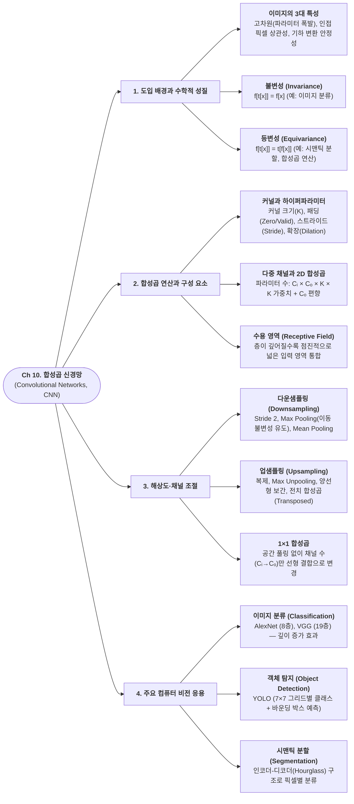

## 🗺️ Chapter 10 한눈에 보기 (Mindmap)

---

## 0. 왜 이미지를 처리할 때 완전 연결(FC) 네트워크 대신 CNN이 필요한가?
이미지 데이터는 일반 완전 연결 신경망(MLP)으로 처리하기에 부적합한 **3가지 고유한 특성** 을 가짐:
1. **초고차원성 (High-dimensionality):** 일반적인 분류용 이미지($224 \times 224$ RGB)는 입력 차원이 $224 \times 224 \times 3 = 150,528$차원임. 은닉층이 입력보다 크다면 단 1개 층의 가중치만 해도 $150,528^2 \approx 220$억 개가 넘어 메모리, 연산량, 필요 학습 데이터 측면에서 비현실적임.
2. **인접 픽셀 간의 통계적 연관성 (Local spatial correlation):** 가까운 픽셀들은 서로 밀접하게 연관되어 있지만, 완전 연결 네트워크는 '가깝다'는 공간 개념이 전혀 없음 (모든 이미지의 픽셀 순서를 똑같이 무작위로 뒤섞어도 완전 연결 신경망은 아무 차이 없이 똑같이 학습함).
3. **기하학적 변환에 대한 안정성 (Stability under geometric transformations):** 나무 이미지를 왼쪽으로 몇 픽셀 평행이동(translation)시켜도 여전히 나무 이미지임. 하지만 픽셀 위치가 바뀌면 모든 입력 변수가 달라지므로, 완전 연결 네트워크는 화면의 **모든 위치마다 나무 패턴을 각각 따로 학습** 해야 하는 극심한 비효율이 발생함.

> 💡 **해결책 — 합성곱 층 (Convolutional Layers):** 전체 이미지에 걸쳐 **동일한 가중치 파라미터를 공유(parameter sharing)** 하면서 각 **국소 영역(local region)** 을 독립적으로 처리함. 이를 통해 파라미터 수를 획기적으로 줄이고, 인접 픽셀의 공간 관계를 활용하며, 위치마다 패턴을 재학습할 필요가 없는 **합성곱 신경망(CNN)** 을 구축함.

---

## 10.1 불변성과 등변성 (Invariance and Equivariance, Figure 10.1)
변환 연산을 $t[\mathbf{x}]$ (예: 이미지의 평행이동, 회전, 반전 등)라 할 때 함수 $f[\mathbf{x}]$의 두 가지 핵심 대칭 성질:

1. **불변성 (Invariance):** 입력에 변환 $t[\bullet]$가 가해져도 **함수의 출력이 전혀 변하지 않고 동일하게 유지** 되는 성질:
   $$f\big[t[\mathbf{x}]\big] = f[\mathbf{x}]$$
   - **적용 태스크:** **이미지 분류 (Image Classification)** 네트워크는 이미지가 평행이동, 회전, 반전되더라도 동일한 객체 카테고리를 출력해야 하므로 변환에 대해 **불변(invariant)** 해야 함 (Figure 10.1a–b).
2. **등변성 / 공변성 (Equivariance / Covariance):** 입력에 변환 $t[\bullet]$가 가해지면 **함수의 출력도 입력과 똑같은 방식으로 변환** 되는 성질:
   $$f\big[t[\mathbf{x}]\big] = t\big[f[\mathbf{x}]\big]$$
   - **적용 태스크:** 픽셀 단위로 객체 클래스를 분류하는 **시맨틱 분할 (Semantic Segmentation)** 네트워크는 입력 이미지가 이동하면 출력 분할 맵도 똑같이 이동해야 하므로 변환에 대해 **등변(equivariant)** 해야 함 (Figure 10.1c–f).
   - **CNN의 작동 원리:** CNN을 구성하는 **합성곱 층(Convolutional layer)은 평행이동에 대해 등변성(equivariance)** 을 가지며, 여기에 **풀링(Pooling) 메커니즘을 결합하여 평행이동에 대한 부분적 불변성(invariance)** 을 유도함.

---

## 10.2 1차원 입력을 위한 합성곱 신경망 (Convolutional Networks for 1D Inputs)

### ① 1D 합성곱 연산 (1D Convolution Operation, Figure 10.2)
- 입력 벡터 $\mathbf{x}$의 각 위치 $i$에서 주변 인접 입력들의 가중합으로 출력 $z_i$를 계산하되, **모든 위치에서 동일한 가중치 벡터 $\boldsymbol{\omega}$** 를 사용함.
- 이 공유 가중치 벡터 $\boldsymbol{\omega}$를 **합성곱 커널(Convolution kernel)** 또는 **필터(Filter)** 라 부르고, 가중합을 취하는 구간의 길이를 **커널 크기(Kernel size, $K$)** 라 함 (예: 커널 크기 $K=3$일 때):
  $$z_i = \omega_1 x_{i-1} + \omega_2 x_i + \omega_3 x_{i+1}$$
  - *(참고: 수학적으로 엄밀하게는 커널 가중치의 좌우를 뒤집지 않고 그대로 곱해 더하므로 합성곱이 아니라 **교차 상관(Cross-correlation)** 이지만, 머신러닝에서는 관례상 이를 모두 합성곱이라 부름).*
- 이 연산은 평행이동에 대해 **등변성(equivariant)** 을 만족함 (입력 $\mathbf{x}$가 이동하면 출력 $\mathbf{z}$도 똑같이 이동함 — Problem 10.1).

### ② 패딩 (Padding): 경계 처리 방식 2가지 (Figure 10.2c–d)
첫 번째 원소($x_1$)나 마지막 원소에서는 커널이 입력 범위를 벗어나므로 이를 처리하는 두 가지 방법:
1. **제로 패딩 (Zero Padding / "Same"):** 입력 범위 바깥의 값들을 모두 $0$으로 간주하고 가장자리를 $0$으로 채워 연산함 (스트라이드가 1일 때 **입력과 출력의 공간 크기가 동일하게 유지됨**).
2. **유효 합성곱 (Valid Convolution):** 커널이 입력 범위 안에 완전히 들어맞는 위치에서만 출력을 계산하고 가장자리는 버림 (경계에 인위적인 정보를 넣지 않는 장점이 있으나, 층을 거칠수록 **표현의 크기가 점점 줄어듦**).

### ③ 스트라이드, 커널 크기, 확장 비율 (Stride, Kernel Size, and Dilation, Figure 10.3)
- **스트라이드 (Stride, 보폭):** 커널을 한 칸씩 이동하며 모든 위치에서 계산하면 `Stride = 1`이며, 커널을 두 칸씩 건너뛰며 계산하면 `Stride = 2`가 되어 **출력의 공간 크기가 절반으로 줄어듦** (Figure 10.3a–b).
- **커널 크기 (Kernel Size):** 더 넓은 영역의 정보를 한 번에 통합하기 위해 커널 크기를 $5, 7$ 등으로 늘릴 수 있으며(보통 현재 위치를 중심으로 대칭이 되도록 **홀수** 사용), 단점은 학습할 가중치 수가 늘어남 (Figure 10.3c).
- **확장 합성곱 (Dilated / Atrous Convolution):** 가중치 개수를 늘리지 않고도 넓은 영역의 정보를 통합하기 위해 **커널 가중치들 사이에 $0$을 일정 간격으로 끼워 넣는(구멍을 뚫는) 방식** (Figure 10.3d). 가중치 사이에 끼워 넣는 $0$의 개수가 **확장 비율(Dilation rate)** 을 결정함.

### ④ 합성곱 층과 완전 연결 층의 관계 (Figure 10.4)
- 합성곱 결과에 스칼라 편향 $\beta$를 더하고 활성화 함수 $a[\bullet]$를 통과시키면 하나의 **합성곱 층(Convolutional layer)** 이 됨:
  $$h_i = a\big[\beta + \omega_1 x_{i-1} + \omega_2 x_i + \omega_3 x_{i+1}\big] = a\left[\beta + \sum_{j=1}^{3} \omega_j x_{i+j-2}\right]$$
- **완전 연결 층의 특수한 형태 (Special Case):** 입력 $D$개, 출력 $D$개인 완전 연결 층은 $D^2$개의 가중치와 $D$개의 편향을 쓰지만, 커널 크기 3인 합성곱 층은 단 **3개의 가중치와 1개의 편향** 만 사용함. 완전 연결 층의 가중치 행렬 $\boldsymbol{\Omega}$에서 **대부분의 원소를 $0$으로 고정(희소 연결, sparse connections)하고 대각선 방향의 원소들을 동일한 값으로 묶어주면(가중치 공유, weight sharing — 토플리츠/순환 행렬 구조)** 합성곱 층을 완벽히 똑같이 재현할 수 있음!

### ⑤ 다중 채널 (Channels / Feature Maps, Figure 10.5)
- 단일 합성곱만 수행하면 인접 입력이 평균화되고 ReLU에 의해 음수가 잘려 정보가 손실되므로, 서로 다른 커널 가중치와 편향을 가진 **여러 개의 합성곱을 병렬로 수행** 하여 각각을 하나의 **특징 맵(Feature map)** 또는 **채널(Channel)** 로 저장함.
- **다중 채널 합성곱의 파라미터 수 계산 (핵심 공식):**
  - 입력 층의 채널 수가 $C_i$, 커널 크기가 $K$일 때, 다음 층의 **출력 채널 1개** 를 만들기 위해서는 모든 입력 채널 $C_i$개와 커널 위치 $K$개에 걸친 가중합을 수행하므로 **$C_i \times K$개의 가중치 행렬** 과 **단 1개의 편향** 이 필요함.
  - 따라서 총 $C_o$개의 출력 채널을 생성하는 1D 합성곱 층에 필요한 전체 파라미터 수는:
    $$\text{가중치(Weights) 수} = C_i \times C_o \times K, \quad \text{편향(Biases) 수} = C_o$$

### ⑥ 수용 영역 (Receptive Fields, Figure 10.6)
- 신경망 내 특정 은닉 유닛의 **수용 영역(Receptive field)** 이란 그 은닉 유닛의 값에 영향을 미치는 **원본 입력(Original input)의 영역 크기** 를 뜻함.
- 예: 커널 크기 $K=3$, 스트라이드 $1$인 합성곱 층을 연속으로 쌓으면 1층 유닛의 수용 영역은 $3$, 2층은 $5$, 3층은 $7$로 층이 깊어질수록 수용 영역이 점진적으로 넓어져 마침내 입력 전체의 정보를 통합하게 됨 (스트라이드가 2 이상이거나 확장 합성곱을 쓰면 수용 영역이 훨씬 빠르게 넓어짐 — Problem 10.9~10.11).

### ⑦ MNIST-1D 실험과 귀납적 편향(Inductive Bias)의 위력 (Figure 10.7 ~ 10.8)
- MNIST-1D 데이터셋($I=4,000$)에 대해 동일한 은닉층 수(3층)와 은닉 유닛 수($285, 135, 60$개)를 가진 **CNN(파라미터 2,050개)** 과 **완전 연결 네트워크(파라미터 150,185개)** 를 학습시켜 비교함.
- 두 모델 모두 학습 에러는 $0\%$에 도달하지만, **테스트 에러는 완전 연결 네트워크가 $\sim 40\%$인 반면 CNN은 $\sim 17\%$로 압도적으로 우수함**!
- **이유:** 완전 연결 네트워크는 CNN을 포함하는 더 큰 함수 집합이므로 이론적으로는 CNN과 똑같은 가중치를 학습할 수 있음에도 실제로는 그렇게 하지 못함. CNN은 **"모든 공간 위치를 동일한 방식으로 처리해야 한다(평행이동 등변성)"** 는 사전 지식을 아키텍처에 강제함으로써 타당한 함수들만 탐색하도록 만드는 **우월한 귀납적 편향(Inductive bias)** 을 가지기 때문임 (완전 연결 네트워크가 표현할 수 있는 비합리적인 해들에 무한대의 정규화 페널티를 부여한 것과 같음).

---

## 10.3 2차원 입력을 위한 합성곱 신경망 (Convolutional Networks for 2D Inputs)
2D 이미지 데이터를 처리할 때는 커널 역시 $K \times K$ 크기의 2차원 격자(또는 입력 채널 $C_i$까지 포함한 $C_i \times K \times K$ 크기의 3차원 텐서)가 됨 (Figure 10.9 ~ 10.10).

- **단일 채널 2D 합성곱 수식 ($3 \times 3$ 커널):**
  $$h_{ij} = a\left[ \beta + \sum_{m=1}^{3} \sum_{n=1}^{3} \omega_{mn} x_{i+m-2, j+n-2} \right]$$
- **다중 채널 2D 합성곱의 파라미터 수 계산 (예: RGB 이미지는 $C_i = 3$):**
  - 커널 크기가 $K \times K$, 입력 채널 수가 $C_i$, 출력 채널 수가 $C_o$일 때:
    $$\text{가중치(Weights) 수} = C_i \times C_o \times K \times K, \quad \text{편향(Biases) 수} = C_o$$
  - 각 출력 채널은 $C_i \times K \times K$ 크기의 3D 커널로 입력 텐서를 가로·세로로 슬라이딩하며 내적하고 스칼라 편향 1개를 더해 2D 특징 맵을 만들며, 이를 $C_o$개의 서로 다른 커널로 반복해 쌓으면 $H \times W \times C_o$ 크기의 3D 출력 텐서가 생성됨.

---

## 10.4 다운샘플링, 업샘플링, 그리고 $1 \times 1$ 합성곱 (Downsampling & Upsampling)

### ① 다운샘플링 (Downsampling — 공간 해상도 축소, Figure 10.11)
수용 영역을 빠르게 넓히고 연산량을 줄이기 위해 각 채널별로 공간 해상도(가로·세로)를 보통 절반($1/2$)으로 줄이는 3가지 방법 (채널 수는 그대로 유지됨):
1. **서브샘플링 / 스트라이드 2 합성곱 (Sub-sampling / Stride 2):** 한 칸씩 건너뛰며 값을 샘플링함 (합성곱 연산 시 `Stride = 2`를 쓰면 중간 값을 아예 계산하지 않고 합성곱과 동시에 수행됨).
2. **맥스 풀링 (Max Pooling):** $2 \times 2$ 블록 내에서 **가장 큰 최댓값(maximum)** 만 남김. 입력이 1픽셀 정도 미세하게 이동해도 블록 내 최댓값은 그대로 유지되는 경우가 많아 **평행이동에 대한 국소적 불변성(translation invariance)** 을 부여함.
3. **평균 풀링 (Mean / Average Pooling):** $2 \times 2$ 블록 내 4개 값의 평균을 출력함.

### ② 업샘플링 (Upsampling — 공간 해상도 확대, Figure 10.12 ~ 10.13)
시맨틱 분할이나 이미지 생성처럼 **출력 역시 고해상도 이미지** 여야 할 때 공간 해상도를 다시 2배로 키우는 4가지 방법:
1. **단순 복제 (Duplication / Nearest Neighbor):** 각 위치의 값을 $2 \times 2$의 4칸에 그대로 복사함.
2. **맥스 언풀링 (Max Unpooling):** 이전에 맥스 풀링을 수행할 때 최댓값이 원래 있었던 위치 인덱스를 기억해 두었다가, 업샘플링 시 그 원래 위치로만 값을 되돌려 보내고 나머지는 $0$으로 채움 (Figure 10.12b).
3. **양선형 보간 (Bilinear Interpolation):** 인접한 샘플 값들 사이를 선형 보간하여 빈칸을 부드럽게 채움.
4. **전치 합성곱 (Transposed Convolution, Figure 10.13):**
   - 스트라이드 2 다운샘플링 합성곱이 "3개의 입력에 가중치를 곱해 1개의 출력을 만드는 과정"(출력 수 $=$ 입력 수의 절반)이라면, 전치 합성곱은 반대로 **"1개의 입력이 가중치를 통해 3개의 출력 위치에 값을 뿌려주는(기여하는) 과정"** 으로 출력 수가 입력의 2배가 됨.
   - 이를 완전 연결 가중치 행렬로 표현하면 정확히 **스트라이드 2 다운샘플링 합성곱 가중치 행렬의 전치 행렬($\boldsymbol{\Omega}^T$)** 형태를 가짐 (학습 가능한 업샘플링 연산).

### ③ 채널 수 변경하기: $1 \times 1$ 합성곱 ($1 \times 1$ Convolution, Figure 10.14)
- 공간적인 풀링이나 주변 픽셀 통합 없이 **오직 채널 수($C_i \rightarrow C_o$)만 변경** 하고 싶을 때 **커널 크기가 $1 \times 1$인 합성곱** 을 사용함.
- 각 공간 위치 $(i, j)$마다 그 위치에 있는 $C_i$개의 채널 값들을 가중합하고 편향과 활성화 함수를 적용하여 새 채널을 만들며, 가중치 크기는 **$1 \times 1 \times C_i \times C_o$** 가 됨.
- 이는 모든 공간 위치 $(i, j)$마다 채널 벡터에 대해 **동일한 완전 연결 신경망(MLP)을 독립적으로 실행** 하는 것과 완전히 같음 (Network-in-Network).

---

## 10.5 주요 컴퓨터 비전 응용 아키텍처 (Applications)

### ① 이미지 분류 (Image Classification): AlexNet과 VGG
**ImageNet 데이터셋** (128만 장 학습 이미지, 1,000개 클래스, $224 \times 224$ RGB 입력)을 통해 발전한 대표 아키텍처:
- **AlexNet (Krizhevsky et al., 2012 — Figure 10.16):**
  - 총 **8개 층** (합성곱 5층 + 완전 연결 3층, ReLU 활성화) 및 약 **6,000만 개 파라미터** (대부분 마지막 FC 층에 집중).
  - 구조: $11 \times 11$ 커널(Stride 4, 96채널) $\rightarrow$ MaxPool $\rightarrow$ $5 \times 5$ 커널(256채널) $\rightarrow$ MaxPool $\rightarrow$ 3개의 $3 \times 3$ 합성곱 층($13 \times 13 \times 256$) $\rightarrow$ 크기 43,264 벡터로 평탄화(Flatten) $\rightarrow$ FC(4096) $\rightarrow$ FC(4096) $\rightarrow$ FC(1000) + Softmax.
  - 데이터 증강(2048배), 테스트 시 5개 크롭+반전 앙상블, 모멘텀 SGD, 드롭아웃, 가중치 감쇠($L_2$)를 결합하여 Top-5 에러율을 기존 $\sim 25\%$에서 **$16.4\%$** 로 낮추며 현대 딥러닝 시대를 개막함.
- **VGG 네트워크 (Simonyan & Zisserman, 2014 — Figure 10.17):**
  - 모든 합성곱을 **$3 \times 3$ 커널** 로 통일하고 맥스 풀링으로 공간 크기를 절반씩 줄일 때마다 **채널 수를 2배씩($64 \rightarrow 128 \rightarrow 256 \rightarrow 512$) 늘리는** 규칙적인 설계를 도입함.
  - 깊이를 **19개 층** (파라미터 1억 4,400만 개)으로 깊게 쌓아 ImageNet Top-5 에러율을 **$6.8\%$** 까지 크게 낮춤으로써 **네트워크의 깊이(Depth)가 성능에 결정적임** 을 입증함.

### ② 객체 탐지 (Object Detection): YOLO (You Only Look Once, Figure 10.18)
이미지 안에 있는 여러 객체의 종류를 식별하고 각각의 위치(바운딩 박스)를 찾아내는 태스크:
- **단일 패스(Proposal-free) 구조:** $448 \times 448$ RGB 이미지를 24개의 합성곱 층과 2개의 완전 연결 층에 한 번만 통과시켜 전체 이미지를 **$7 \times 7$ 그리드 셀** 로 나누어 동시에 예측함.
- **그리드 셀별 출력:** 각 셀마다 ① 어떤 객체 클래스가 존재하는지(클래스 확률)와 ② 정해진 개수(2개)의 **바운딩 박스 파라미터 5개** (중심 좌표 $x, y$, 박스의 폭 $w$과 높이 $h$, 예측된 박스와 실제 정답 박스의 겹침 정도를 추정하는 신뢰도 **Confidence**)를 직접 출력함.
- 추론 후에는 신뢰도가 낮은 박스를 버리고, 같은 객체를 가리키는 중복 박스들을 억제(Non-maximum suppression)하여 가장 확실한 박스만 남김.

### ③ 시맨틱 분할 (Semantic Segmentation): 인코더-디코더 네트워크 (Noh et al., 2015 — Figure 10.19)
이미지의 모든 픽셀마다 어떤 객체 클래스(예: 21개 클래스)에 속하는지 레이블을 할당하는 태스크:
- **인코더-디코더 (Encoder-Decoder) / 모래시계 (Hourglass) 구조:**
  1. **인코더 (Encoder — 다운샘플링):** VGG 기반의 13개 합성곱 층과 맥스 풀링을 거쳐 $224 \times 224$ 이미지를 $14 \times 14$로 줄인 뒤 FC 층을 통해 이미지 전체 문맥을 담은 크기 $4096$의 1D 표현으로 압축함.
  2. **디코더 (Decoder — 업샘플링):** 이를 다시 $7 \times 7 \times 512$로 재구성한 뒤, 인코더의 거울상(mirror image) 구조로 **맥스 언풀링(Max unpooling)** 과 **전치 합성곱(Deconvolution / Transposed convolution)** 층을 번갈아 적용하여 원래 해상도인 $224 \times 224$로 복원함.
  3. 마지막에 $1 \times 1$ 합성곱으로 21개 채널을 만들고 각 픽셀마다 소프트맥스를 적용해 $224 \times 224 \times 21$의 픽셀별 클래스 확률 맵을 출력함.

---

## 10.6 참고 노트 (Notes) 및 연습문제 핵심 포인트

### ① 다양한 합성곱 변형과 경량화 기법
- **인셉션 블록 (Inception Block — GoogLeNet, Szegedy et al., 2017):** 한 층에서 여러 다른 크기의 커널($1 \times 1, 3 \times 3, 5 \times 5$)을 병렬 경로로 동시에 적용한 뒤 합쳐서 네트워크가 스스로 적절한 필터 스케일을 학습하게 함.
- **파라미터 절감을 위한 합성곱 변형 (커널 $K \times K$, 입출력 채널 $C$ 기준 일반 합성곱 파라미터 수 $= K^2 C^2$):**
  1. **깊이별 합성곱 (Depthwise / Channel-separate Convolution — MobileNet 등):** 채널 간 섞임 없이 각 채널마다 독립적인 $K \times K$ 필터를 따로 적용하여 파라미터 수를 **$K^2 C$** 로 줄임 (이후 보통 $1 \times 1$ 합성곱과 결합).
  2. **그룹 합성곱 (Grouped Convolution — ResNeXt, 초기 AlexNet):** 채널을 여러 그룹으로 나누어 그룹 안에서만 합성곱 수행.
  3. **분리 가능 합성곱 (Separable Convolution):** 2D 커널을 두 1D 벡터의 외적으로 근사하여 채널당 $2K$개의 가중치로 처리.
- **기타 특수 합성곱:** 인페인팅 시 마스킹 영역을 고려하는 **부분 합성곱(Partial convolution)**, 이전 층에서 마스크를 학습하는 **게이트 합성곱(Gated convolution)**, 전역 공간 풀링 정보로 채널별 중요도 가중치를 재조정하는 **Squeeze-and-Excitation (SE) 네트워크**, 격자 위치 오프셋 자체를 학습하는 **변형 가능 합성곱(Deformable convolution)**.
- **전치 합성곱의 부작용과 대안:** 전치 합성곱은 출력에 격자무늬 아티팩트(**Checkerboard artifacts**, Odena et al., 2016)를 만들 수 있어 주의가 필요하며, 대안으로 채널 수를 $s^2$배 늘린 뒤 픽셀을 재배열해 해상도를 $s$배 키우는 **PixelShuffle** 이나, 에일리어싱을 막고 평행이동 불변성을 높이는 **Max-Blur-Pooling** 등이 사용됨.

### ② CNN에서의 정규화 및 시각화 기법
- **Spatial Dropout & Cutout:** 일반 드롭아웃은 CNN에서 효과가 떨어지는데, 인접 픽셀끼리 상관성이 매우 높아 픽셀 하나를 꺼도 바로 옆 픽셀을 통해 동일한 정보가 전달되기 때문임. 따라서 CNN에서는 아예 **특징 맵(채널) 전체를 통째로 드롭** 하는 **Spatial Dropout** 이나 입력 이미지의 사각형 패치 영역을 가리는 **Cutout** 을 사용함.
- **CNN 내부 시각화 4대 기법:**
  1. 노이즈 이미지에서 시작해 특정 은닉 유닛의 활성화를 최대화하도록 입력 이미지를 경사 상승법으로 최적화 (Erhan et al., 2009).
  2. 관심 있는 은닉 유닛 하나만 남기고 나머지를 $0$으로 둔 뒤 디코더로 입력 재구성 (Zeiler & Fergus, 2014).
  3. 특정 층 전체의 활성화 값과 자연 이미지 통계를 동시에 만족하는 입력 이미지를 역산하는 **네트워크 역전(Network inversion)**.
  4. **네트워크 해부 (Network Dissection, Bau et al., 2017):** 색상·질감·객체 레이블이 알려진 이미지들을 순전파시켜 각 은닉 유닛의 상관관계를 측정 ($\rightarrow$ **초기 층은 색상과 질감(texture), 깊은 후반부 층은 객체 종류(object type)와 높은 상관관계** 를 보임).

### ③ 주요 연습문제 (Problems) 핵심 공식 및 포인트
- **Problem 10.9 ~ 10.11 (수용 영역 크기 계산 점화식):**
  - 모든 층이 커널 크기 $K$, 스트라이드 $1$, 확장 비율 $1$일 때 $L$번째 층의 수용 영역 크기는 매 층마다 $K-1$씩 늘어나므로:
    $$R_L = 1 + L(K - 1) \quad (\text{예: } K=3, L=3 \implies 1 + 3 \times 2 = 7 \text{ / } K=7, L=3 \implies 1 + 3 \times 6 = 19)$$
  - 일반적인 층 $l$의 커널 크기가 $K_l$, 확장 비율(가중치 사이 $0$의 개수 $+1$ 간격 기준 유효 스텝)을 고려한 유효 커널 폭이 $K'_l$, 이전 층까지의 누적 스트라이드 곱이 $S_{l-1} = \prod_{m=1}^{l-1} s_m$일 때 수용 영역은 $R_l = R_{l-1} + (K'_l - 1) \cdot S_{l-1}$로 증가함.
- **Problem 10.19 (2D 합성곱 층의 He 초기화):** 입력 채널이 $C_1$, 출력 채널이 $C_2$이고 커널 크기가 $3 \times 3$인 2D 합성곱 층에서 각 출력 유닛 하나를 계산할 때 합산되는 입력 항의 개수($D_h$, Fan-in)는 이미지 전체 크기가 아니라 **$D_h = C_1 \times 3 \times 3 = 9 C_1$** 개임! 따라서 순전파 기준 He 초기화 가중치 분산은 **$\sigma_\Omega^2 = \frac{2}{9 C_1}$** (역전파 기준은 $\frac{2}{9 C_2}$)로 설정해야 함.
