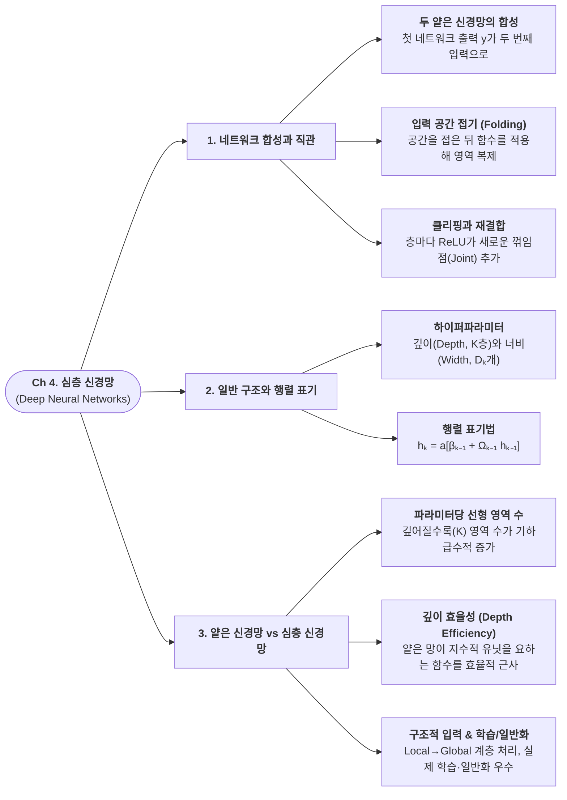

## 🗺️ Chapter 4 한눈에 보기 (Mindmap)

---

## 0. 왜 심층 신경망(Deep Neural Networks)인가?
- **얕은 신경망의 한계:** Chapter 3의 보편 근사 정리에 의해 은닉층이 1개인 얕은 신경망도 은닉 유닛만 충분하면 어떤 연속 함수든 근사할 수 있지만, 특정 함수들은 필요한 은닉 유닛의 수가 ** 비현실적으로 거대해짐**.
- **심층 신경망의 강점:** 은닉층을 2개 이상 쌓은 심층 신경망은 ** 동일한 파라미터 개수(budget)로도 얕은 신경망보다 훨씬 더 많은 선형 영역(linear regions)을 생성**할 수 있어, 실용적인 관점에서 훨씬 폭넓은 함수 집합을 효율적으로 표현함.

---

## 4.1 신경망 합성하기 (Composing Neural Networks)
심층 신경망의 작동 원리를 이해하기 위해, 먼저 은닉 유닛이 3개인 **두 개의 얕은 신경망을 직렬로 연결(합성)** 하는 경우를 살펴봄 (Figure 4.1).

### ① 두 얕은 신경망의 연결
1. **첫 번째 네트워크 ($x \rightarrow y$):**
   $$h_1 = a[\theta_{10} + \theta_{11}x], \quad h_2 = a[\theta_{20} + \theta_{21}x], \quad h_3 = a[\theta_{30} + \theta_{31}x]$$
   $$y = \phi_0 + \phi_1 h_1 + \phi_2 h_2 + \phi_3 h_3$$
2. **두 번째 네트워크 ($y \rightarrow y'$):** 첫 번째 네트워크의 스칼라 출력 $y$를 입력으로 받음.
   $$h'_1 = a[\theta'_{10} + \theta'_{11}y], \quad h'_2 = a[\theta'_{20} + \theta'_{21}y], \quad h'_3 = a[\theta'_{30} + \theta'_{31}y]$$
   $$y' = \phi'_0 + \phi'_1 h'_1 + \phi'_2 h'_2 + \phi'_3 h'_3$$

### ② 합성으로 인한 선형 영역의 증폭 원리
- 은닉 유닛 총 6개($3+3$)를 한 층에 나란히 배치한 **얕은 신경망** 은 최대 $6 + 1 = 7$개의 선형 영역만 만들 수 있음.
- 반면 두 네트워크를 **합성** 하면:
  - 첫 번째 네트워크가 $x \in [-1, 1]$ 구간에서 기울기의 부호가 교차하는(오르락내리락하는) 3개의 선형 구간을 만들어 모두 동일한 출력 범위 $y \in [-1, 1]$로 매핑함.
  - 서로 다른 3개의 입력 $x$가 동일한 $y$ 값을 갖게 되므로, 두 번째 네트워크가 $y \in [-1, 1]$ 위에서 정의한 3개의 선형 영역 함수가 **3번 복제(크기 조정 및 좌우 반전)** 되어 총 **$3 \times 3 = 9$개의 선형 영역** 이 생성됨 (Figure 4.1d).
- **핵심 비유 — 입력 공간 접기 (Folding Input Space, Figure 4.3):**
  - 첫 번째 네트워크는 입력 공간 $x$를 종이처럼 **겹쳐서 접는(folding)** 역할을 하여 여러 입력 지점이 같은 위치에 포개지게 만듦.
  - 두 번째 네트워크는 접힌 공간 위에 함수를 적용하며, 이를 다시 펼치면(unfolding) 접혔던 모든 구간마다 해당 함수가 복제되어 나타남. (2차원 이상의 고차원 입력에서도 동일하게 평면을 접고 분할하며 영역 수가 곱셈으로 증가함, Figure 4.2).

---

## 4.2 네트워크 합성에서 심층 신경망으로 (From Composing to Deep Networks)
두 얕은 신경망을 합성한 구조는 사실 **은닉층이 2개인 심층 신경망의 특수한 경우(Special case)** 임.

- 첫 번째 네트워크의 출력 계산식 $y = \phi_0 + \phi_1 h_1 + \phi_2 h_2 + \phi_3 h_3$는 **선형 함수** 이고, 두 번째 네트워크의 활성화 전(pre-activation) 계산식 $\theta'_{d0} + \theta'_{d1}y$ 역시 **선형 함수** 임.
- **선형 함수에 선형 함수를 대입하면 또 다른 하나의 선형 함수** 가 되므로, $y$를 두 번째 식에 직접 대입하여 중간 변수 $y$를 소거할 수 있음:
  $$h'_1 = a[\theta'_{10} + \theta'_{11}y] = a[(\theta'_{10} + \theta'_{11}\phi_0) + \theta'_{11}\phi_1 h_1 + \theta'_{11}\phi_2 h_2 + \theta'_{11}\phi_3 h_3]$$
- 이를 새로운 파라미터 $\psi_{\bullet\bullet}$로 치환하면 일반적인 2층 심층 신경망의 두 번째 은닉층 수식이 됨:
  $$h'_1 = a[\psi_{10} + \psi_{11}h_1 + \psi_{12}h_2 + \psi_{13}h_3]$$
  $$h'_2 = a[\psi_{20} + \psi_{21}h_1 + \psi_{22}h_2 + \psi_{23}h_3]$$
  $$h'_3 = a[\psi_{30} + \psi_{31}h_1 + \psi_{32}h_2 + \psi_{33}h_3]$$
- **일반 2층 심층 신경망이 더 표현력이 넓은 이유:**
  - 두 네트워크를 단순히 합성했을 때는 9개의 기울기 파라미터($\psi_{11}, \dots, \psi_{33}$)가 두 벡터의 외적 $[\theta'_{11}, \theta'_{21}, \theta'_{31}]^T [\phi_1, \phi_2, \phi_3]$ 형태로 제약(자유도 6)되지만, 일반 심층 신경망에서는 9개의 파라미터가 **서로 독립적인 임의의 값** 을 자유롭게 가질 수 있음.

---

## 4.3 심층 신경망의 작동 방식과 하이퍼파라미터 (Deep Neural Networks)

### ① 층별 연산에 대한 또 다른 관점: 클리핑과 재결합 (Figure 4.5)
1. **1층 은닉 유닛 계산:** 입력 $x$의 선형 함수들을 ReLU로 잘라내어 $h_1, h_2, h_3$ 생성.
2. **2층 Pre-activation 계산:** $h_1, h_2, h_3$의 서로 다른 선형 결합 3개를 만듦 $\rightarrow$ 이는 ** 꺾임점(joints) 위치를 공유하는 3개의 조각별 선형 함수**(다변량 출력 얕은 신경망)를 만든 것과 같음.
3. **2층 ReLU 적용:** 이 3개의 조각별 선형 함수를 다시 ReLU로 $0$ 아래를 잘라냄으로써 각 함수에 ** 새로운 꺾임점(joints)들을 추가**함.
4. **최종 출력 결합:** 새롭게 꺾인 함수들을 가중합하여 최종 출력 $y'$ 생성.

> 💡 **두 가지 관점의 요약:** 각 층을 **"입력 공간을 접는 과정(Folding)"** 으로 보거나(출력 구간의 대칭성/의존성 강조), **"조각별 선형 함수를 만들고 다시 클리핑하여 새 꺾임점을 추가하는 과정"** 으로 볼 수 있음(새 영역 생성 강조).

### ② 하이퍼파라미터 (Hyperparameters)
- **용어 정의:**
  - **너비 (Width):** 각 은닉층에 포함된 은닉 유닛의 개수 ($D_1, D_2, \dots, D_K$).
  - **깊이 (Depth):** 신경망의 은닉층(hidden layers) 개수 ($K$).
  - **용량 (Capacity):** 네트워크 내 전체 은닉 유닛의 총합.
- **파라미터 vs 하이퍼파라미터:**
  - 가중치와 편향(기울기와 절편)은 학습을 통해 찾는 **파라미터(Parameters)** 인 반면, 층의 수 $K$나 각 층의 유닛 수 $D_k$처럼 **학습을 시작하기 전에 미리 결정하는 값** 을 **하이퍼파라미터(Hyperparameters)** 라고 함.
  - 고정된 하이퍼파라미터가 하나의 '함수 집합(family of functions)'을 정의하므로, 하이퍼파라미터까지 고려하면 신경망은 **'함수 집합들의 집합(family of families of functions)'** 을 나타냄.

---

## 4.4 행렬 표기법과 일반식 (Matrix Notation & General Formulation)
심층 신경망은 **선형 변환(행렬 곱 + 편향 덧셈)** 과 **비선형 활성화 함수** 가 교대로 반복되는 구조이므로 행렬과 벡터로 간결하게 표기할 수 있음.

### ① $K$층 심층 신경망의 일반식
- **표기 규칙:**
  - $\mathbf{h}_k$: $k$번째 은닉층의 은닉 유닛 벡터 (크기 $D_k \times 1$)
  - $\boldsymbol{\beta}_{k-1}$: $k$번째 층으로 들어가는 편향(bias) 벡터 (크기 $D_k \times 1$)
  - $\boldsymbol{\Omega}_{k-1}$: $(k-1)$번째 층에서 $k$번째 층으로 가는 가중치(weight) 행렬 (크기 $D_k \times D_{k-1}$)
- **순전파(Feed-forward) 방정식:**
  $$\mathbf{h}_1 = \mathbf{a}[\boldsymbol{\beta}_0 + \boldsymbol{\Omega}_0 \mathbf{x}]$$
  $$\mathbf{h}_2 = \mathbf{a}[\boldsymbol{\beta}_1 + \boldsymbol{\Omega}_1 \mathbf{h}_1]$$
  $$\mathbf{h}_3 = \mathbf{a}[\boldsymbol{\beta}_2 + \boldsymbol{\Omega}_2 \mathbf{h}_2]$$
  $$\vdots$$
  $$\mathbf{h}_K = \mathbf{a}[\boldsymbol{\beta}_{K-1} + \boldsymbol{\Omega}_{K-1} \mathbf{h}_{K-1}]$$
  $$\mathbf{y} = \boldsymbol{\beta}_K + \boldsymbol{\Omega}_K \mathbf{h}_K$$
- **단일 합성 함수 표현:**
  $$\mathbf{y} = \boldsymbol{\beta}_K + \boldsymbol{\Omega}_K \mathbf{a}\Big[ \boldsymbol{\beta}_{K-1} + \boldsymbol{\Omega}_{K-1} \mathbf{a}\big[ \dots \boldsymbol{\beta}_1 + \boldsymbol{\Omega}_1 \mathbf{a}[\boldsymbol{\beta}_0 + \boldsymbol{\Omega}_0 \mathbf{x}] \dots \big] \Big]$$
- **행렬/벡터 차원 정리 (입력 $\mathbb{R}^{D_i}$, 출력 $\mathbb{R}^{D_o}$):**
  - 첫 가중치 행렬 $\boldsymbol{\Omega}_0$: $D_1 \times D_i$, 편향 $\boldsymbol{\beta}_0$: $D_1 \times 1$
  - 중간 가중치 행렬 $\boldsymbol{\Omega}_k$: $D_{k+1} \times D_k$, 편향 $\boldsymbol{\beta}_k$: $D_{k+1} \times 1$
  - 출력 가중치 행렬 $\boldsymbol{\Omega}_K$: $D_o \times D_K$, 편향 $\boldsymbol{\beta}_K$: $D_o \times 1$

---

## 4.5 얕은 신경망 vs 심층 신경망 비교 (Shallow vs. Deep Neural Networks)

### ① 함수 근사 능력 (Ability to Approximate Different Functions)
- 2층 심층 신경망에서 두 번째 층이 항등 함수(identity function) 역할을 하도록 설정하면 1층 얕은 신경망과 완전히 동일해짐.
- 따라서 심층 신경망 역시 충분한 용량이 주어지면 **어떤 연속 함수든 임의의 정밀도로 근사 가능** 함.

### ② 파라미터당 선형 영역의 개수 (Number of Linear Regions per Parameter)
- 1차원 입출력($D_i=1, D_o=1$) 기준 비교:
  - **얕은 신경망 (유닛 $D$개):** 파라미터 **$3D + 1$개** 로 최대 **$D + 1$개** 의 선형 영역 생성.
  - **심층 신경망 ($K$개 층, 각 층 유닛 $D$개):** 파라미터 **$3D + 1 + (K-1)D(D+1)$개** 로 최대 **$(D + 1)^K$개** 의 선형 영역 생성 (지수적 증가!).
- **예시 (Figure 4.7):**
  - $D_i=1, K=5, D=10$일 때: 불과 **471개** 의 파라미터로 **161,051개** 의 선형 영역 생성.
  - $D_i=10, K=5, D=50$일 때: **10,801개** 의 파라미터로 **$10^{134}$개 이상** 의 선형 영역 생성.
- **주의할 점 (의존성과 대칭성):** 심층 신경망이 엄청나게 많은 선형 영역을 만들지만, 파라미터 수 자체가 적기 때문에 이 영역들이 모두 독립적으로 움직이는 것은 아니며 공간 접기(folding)로 인한 ** 복잡한 대칭성과 의존성**을 공유함. 따라서 실제 세계의 함수가 비슷한 대칭성을 가지거나 단순한 함수들의 합성 구조를 가질 때 이점이 극대화됨.

### ③ 깊이 효율성 (Depth Efficiency)
- 심층 신경망으로는 적은 수의 유닛으로 쉽게 근사할 수 있지만, **얕은 신경망으로 동일한 근사 정확도를 내려면 기하급수적으로(exponentially) 많은 은닉 유닛이 필요한 함수들** 이 존재함. 이를 신경망의 **깊이 효율성(Depth efficiency)** 이라 부름.

### ④ 거대하고 구조화된 입력 처리 (Large, Structured Inputs)
- 이미지(약 $10^6$ 픽셀)처럼 거대하고 공간 구조가 있는 입력에 완전 연결(FC) 네트워크를 쓰면 파라미터 수가 감당할 수 없이 커지며, 이미지의 모든 위치마다 객체 인식 법칙을 따로 학습하는 비효율이 발생함.
- 국소 영역(local regions)을 병렬로 먼저 처리한 뒤 점진적으로 넓은 영역(global)으로 정보를 통합하는 **다단계(Local-to-Global) 계층 처리** 는 반드시 여러 개의 층(깊이)을 통해서만 구현할 수 있음 (Chapter 10 합성곱 신경망의 핵심 원리).

### ⑤ 학습 용이성과 일반화 (Training and Generalization)
- 경험적으로 **적당히 깊은(moderately deep) 신경망이 얕은 신경망보다 학습(fitting)하기 더 쉬움** (과매개변수화된 깊은 모델이 찾기 쉬운 대등한 해들을 많이 가졌기 때문으로 추정). 단, 층이 너무 깊어지면 다시 학습이 어려워지는데 이를 해결하는 기법들(잔차 연결 등)은 Chapter 11에서 다룸.
- 또한 심층 신경망이 새로운 데이터에 대한 **일반화(Generalization) 성능도 더 뛰어남**. 실제 대부분의 태스크에서 최고 성능은 수십~수백 개의 층을 가진 네트워크에서 달성됨 (이유는 Chapter 20에서 심층 분석).

---

## 4.6 참고 노트 (Notes) 및 연습문제 핵심 포인트

### ① 현대 딥러닝 부흥의 4대 요인
- "Deep learning"이라는 용어는 Dechter (1986)가 처음 사용했으나 오랫동안 학습의 어려움으로 정체되어 있었음.
- Krizhevsky et al. (2012, AlexNet)의 이미지 분류 혁신으로 현대 딥러닝 시대가 열렸으며, 이는 **① 대규모 학습 데이터셋, ② 컴퓨팅 연산력(GPU) 향상, ③ ReLU 활성화 함수 사용, ④ 확률적 경사 하강법(SGD)** 이라는 4가지 요소가 결합된 결과임.

### ② 심층 신경망의 최대 선형 영역 개수 공식 (Zaslavsky & Montúfar)
- 전체 은닉 유닛 총합이 $D_{\text{total}}$일 때 선형 영역 수의 상한은 $2^{D_{\text{total}}}$개임.
- 입력 차원 $D_i$, 총 $K$개 층, 각 층의 은닉 유닛 수 $D$가 $D_i$의 정수배일 때 최대 선형 영역 수 $N_r$은 정확히 다음과 같음:
  $$N_r = \left( \frac{D}{D_i} + 1 \right)^{D_i(K-1)} \sum_{j=0}^{D_i} \binom{D}{j}$$
  - 앞의 곱 항은 처음 $K-1$개 층이 입력 공간을 반복해서 접는(folding) 효과를 나타내며, 뒤의 이항 계수 합은 마지막 $K$번째 층(얕은 신경망과 동일)이 초평면으로 공간을 분할하는 효과를 나타냄.

### ③ 보편 근사 정리의 '깊이 버전' (Depth Version of UAT) & 너비 효율성
- **깊이 버전 보편 근사 정리 (Lu et al., 2017):** 각 층의 너비(은닉 유닛 수)가 최소 **$D_i + 4$개** 로 고정되어 있어도, **층(Depth)을 충분히 깊게 쌓으면** 임의의 $D_i$차원 르베그 적분 가능 함수를 원하는 정밀도로 근사할 수 있음.
- **너비 효율성 (Width Efficiency):** 반대로 넓고 얕은 신경망을 좁고 깊은 신경망으로 표현하려면 다항식( 또는 선형) 수준의 깊이 증가만 필요하여, 깊이를 줄일 때 너비가 '지수적'으로 폭발하는 깊이 효율성에 비해 제약이 훨씬 덜함 ($\rightarrow$ ** 너비보다 깊이가 훨씬 중요함**).

### ④ 주요 연습문제 (Problems) 포인트
- **Problem 4.3 (심층 신경망에서의 가중치 스케일 불변성):** ReLU의 양의 동차성($\text{ReLU}[\lambda z] = \lambda \text{ReLU}[z]$, $\lambda > 0$)에 의해, 각 층의 가중치 행렬 $\boldsymbol{\Omega}_k$를 임의의 양수 배율 $\lambda_k$로 스케일링하더라도 편향 $\boldsymbol{\beta}_k$를 적절히 보정하고 마지막에 $\prod \lambda_k$를 곱해주면 출력이 완전히 동일함.
- **Problem 4.6 (깊이 vs 너비 증가 시 파라미터 증가량):** $D_i=1, D_o=1, K=10, D=10$인 네트워크에서
  - **깊이($K$)를 1 늘릴 때:** $D \times D$ 가중치 행렬 1개가 추가되므로 가중치 **$100$개** 증가.
  - **너비($D$)를 1 늘릴 때:** 첫 층($+1$), 중간 9개 층($11^2 - 10^2 = 21$개씩 $\times 9 = 189$), 출력층($+1$)으로 총 가중치 **$191$개** 증가 ($\rightarrow$ 층이 깊을수록 너비를 1 늘리는 것이 파라미터 수를 더 많이 증가시킴).
