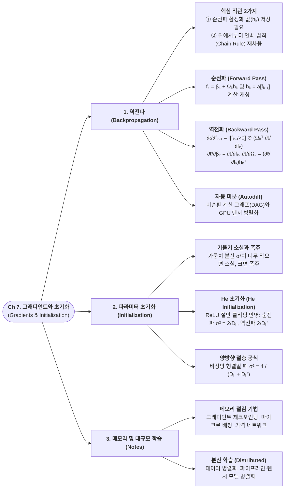

## 🗺️ Chapter 7 한눈에 보기 (Mindmap)

---

## 0. 왜 그래디언트 계산과 초기화가 신경망의 핵심 문제인가?
Chapter 6에서 다룬 최적화 알고리즘(SGD, Adam 등)은 매 스텝마다 모든 파라미터에 대한 손실의 그래디언트를 필요로 함. 이를 심층 신경망에 적용할 때 두 가지 중대한 문제가 발생함:
1. **효율적인 그래디언트 계산 문제:** 현대의 거대 모델은 최대 $\sim 10^{12}$개(1조 개)의 파라미터를 가지며, 매 반복(iteration)마다 배치 내 모든 데이터에 대해 이 미분값들을 빠짐없이 계산해야 함 $\rightarrow$ **역전파(Backpropagation)** 알고리즘으로 해결.
2. **파라미터 초기화(Initialization) 문제:** 학습을 시작하기 전 가중치와 편향을 신중하게 초기화하지 않으면, 순전파의 출력값이나 역전파의 그래디언트가 기하급수적으로 작아져 $0$이 되거나(**기울기 소실, Vanishing gradient**) 무한대로 커져(** 기울기 폭주, Exploding gradient**) 학습 자체가 불가능해짐 $\rightarrow$ **He 초기화** 등으로 해결.

---

## 7.1 ~ 7.2 문제 정의와 역전파의 2가지 핵심 직관 (Computing Derivatives)

### ① 문제 정의
3개의 은닉층을 가진 심층 신경망 $\mathbf{f}[\mathbf{x}, \boldsymbol{\phi}]$와 개별 데이터 손실 $\ell_i$를 고려할 때:
$$\mathbf{h}_1 = \mathbf{a}[\boldsymbol{\beta}_0 + \boldsymbol{\Omega}_0 \mathbf{x}], \quad \mathbf{h}_2 = \mathbf{a}[\boldsymbol{\beta}_1 + \boldsymbol{\Omega}_1 \mathbf{h}_1], \quad \mathbf{h}_3 = \mathbf{a}[\boldsymbol{\beta}_2 + \boldsymbol{\Omega}_2 \mathbf{h}_2], \quad \mathbf{f}[\mathbf{x}, \boldsymbol{\phi}] = \boldsymbol{\beta}_3 + \boldsymbol{\Omega}_3 \mathbf{h}_3$$
SGD 업데이트 $\boldsymbol{\phi}_{t+1} \leftarrow \boldsymbol{\phi}_t - \alpha \sum_{i \in \mathcal{B}_t} \frac{\partial \ell_i[\boldsymbol{\phi}_t]}{\partial \boldsymbol{\phi}}$를 수행하려면 모든 층 $k \in \{0, 1, \dots, K\}$의 편향 벡터와 가중치 행렬에 대한 편미분 **$\frac{\partial \ell_i}{\partial \boldsymbol{\beta}_k}$** 와 **$\frac{\partial \ell_i}{\partial \boldsymbol{\Omega}_k}$** 를 구해야 함.

### ② 역전파(Backpropagation)의 2가지 핵심 직관
- **관찰 1 (순전파 활성화 값 저장의 필요성, Figure 7.1):**
  - 각 가중치($\boldsymbol{\Omega}_k$의 원소)는 출발지(source) 은닉 유닛의 활성화 값에 곱해져 다음 층 목적지(destination) 유닛에 더해짐.
  - 따라서 가중치를 아주 조금 바꿨을 때 발생하는 효과는 **출발지 은닉 유닛의 활성화 값 크기에 비례하여 증폭되거나 감쇠됨**.
  - 즉, 가중치의 미분을 구하려면 먼저 네트워크에 데이터를 통과시켜 모든 은닉 유닛의 중간 계산값(활성화 값)을 계산하고 메모리에 **저장(캐싱)** 해 두어야 하며, 이를 **순전파(Forward pass)** 라 함.
- **관찰 2 (연쇄적인 파급 효과와 계산의 재사용, Figure 7.2):**
  - 앞쪽 층의 가중치나 편향을 조금 바꾸면, 그 다음 층의 은닉 유닛이 바뀌고 $\rightarrow$ 그 다음 층이 바뀌고 $\rightarrow$ 최종 출력과 손실 $\ell_i$까지 물결처럼 연쇄 파급 효과(ripple effect)가 일어남.
  - 따라서 특정 파라미터 변화가 손실에 미치는 영향을 알기 위해서는 **뒤따르는 모든 은닉층들이 각각 그 다음 층과 손실을 어떻게 변화시키는지** 알아야 함.
  - 이 뒤쪽 층들의 변화율은 앞쪽의 다른 파라미터들을 미분할 때도 **똑같이 반복해서 사용됨**. 따라서 네트워크의 **맨 끝(출력층)에서부터 역방향으로(Backward pass)** 미분을 계산해 내려오면 이미 계산한 값을 그대로 재사용할 수 있어 중복 연산을 완벽히 제거할 수 있음!

---

## 7.3 스칼라 장난감 예제로 보는 역전파 (Toy Example)
행렬 미분으로 넘어가기 전, 8개의 스칼라 파라미터 $\boldsymbol{\phi} = \{\beta_0, \omega_0, \beta_1, \omega_1, \beta_2, \omega_2, \beta_3, \omega_3\}$를 가진 합성 함수로 역전파의 원리를 살펴봄:
$$f[x, \boldsymbol{\phi}] = \beta_3 + \omega_3 \cdot \cos\Big[ \beta_2 + \omega_2 \cdot \exp\big[ \beta_1 + \omega_1 \cdot \sin[\beta_0 + \omega_0 \cdot x] \big] \Big], \quad \ell_i = (f[x_i, \boldsymbol{\phi}] - y_i)^2$$
이를 직접 손으로 미분하면(예: $\partial \ell_i / \partial \omega_0$) 수식이 매우 길고 복잡해지며 동일한 $\exp[\bullet]$ 항을 여러 번 중복 계산하게 됨. 역전파는 이를 다음 3단계로 단순화함:

1. **순전파 (Forward Pass, Figure 7.3):** 중간 변수 $f_k$와 $h_k$를 순서대로 계산하고 값을 모두 저장함:
   $$f_0 = \beta_0 + \omega_0 x_i \rightarrow h_1 = \sin[f_0] \rightarrow f_1 = \beta_1 + \omega_1 h_1 \rightarrow h_2 = \exp[f_1] \rightarrow f_2 = \beta_2 + \omega_2 h_2 \rightarrow h_3 = \cos[f_2] \rightarrow f_3 = \beta_3 + \omega_3 h_3 \rightarrow \ell_i = (f_3 - y_i)^2$$
2. **역전파 #1 (중간 변수들에 대한 미분, Figure 7.4):** 끝에서부터 역순으로 **연쇄 법칙(Chain Rule)** 을 적용해 괄호 안의 이전 계산 결과를 재사용하며 곱해 나감:
   $$\frac{\partial \ell_i}{\partial f_3} = 2(f_3 - y_i)$$
   $$\frac{\partial \ell_i}{\partial h_3} = \frac{\partial f_3}{\partial h_3} \left(\frac{\partial \ell_i}{\partial f_3}\right) \longrightarrow \frac{\partial \ell_i}{\partial f_2} = \frac{\partial h_3}{\partial f_2} \left(\frac{\partial f_3}{\partial h_3}\frac{\partial \ell_i}{\partial f_3}\right) \longrightarrow \cdots \longrightarrow \frac{\partial \ell_i}{\partial f_0} = \frac{\partial h_1}{\partial f_0} \left(\frac{\partial f_1}{\partial h_1}\cdots\frac{\partial \ell_i}{\partial f_3}\right)$$
   - 각 단계에서 새로 곱해지는 국소 미분 항($\partial f_k / \partial h_k = \omega_k$, $\partial h_3 / \partial f_2 = -\sin[f_2]$ 등)은 매우 단순함.
3. **역전파 #2 (파라미터 $\beta_k, \omega_k$에 대한 미분, Figure 7.5):** $f_k = \beta_k + \omega_k h_k$이므로 연쇄 법칙에 의해 순전파 때 저장해 둔 $h_k$를 곱하기만 하면 끝남:
   $$\frac{\partial \ell_i}{\partial \beta_k} = \frac{\partial f_k}{\partial \beta_k}\frac{\partial \ell_i}{\partial f_k} = 1 \cdot \frac{\partial \ell_i}{\partial f_k}, \quad \frac{\partial \ell_i}{\partial \omega_k} = \frac{\partial f_k}{\partial \omega_k}\frac{\partial \ell_i}{\partial f_k} = h_k \cdot \frac{\partial \ell_i}{\partial f_k} \quad (\text{단, } k=0\text{일 때는 } x_i \cdot \frac{\partial \ell_i}{\partial f_0})$$

---

## 7.4 심층 신경망의 역전파 알고리즘 (Backpropagation Algorithm)
이제 중간 변수 $\mathbf{f}_k, \mathbf{h}_k$와 편향 $\boldsymbol{\beta}_k$가 **벡터** 이고, 가중치 $\boldsymbol{\Omega}_k$가 **행렬** 이며, 활성화 함수가 **ReLU** 인 일반적인 $K$층 심층 신경망으로 확장함.

### ① 순전파 (Forward Pass)
입력 $\mathbf{x}_i$로부터 각 층의 활성화 전 값(pre-activation) $\mathbf{f}_k$와 활성화 값(activation) $\mathbf{h}_k$를 순차적으로 계산하고 **모두 메모리에 저장** 함:
$$\mathbf{f}_0 = \boldsymbol{\beta}_0 + \boldsymbol{\Omega}_0 \mathbf{x}_i$$
$$\mathbf{h}_k = \mathbf{a}[\mathbf{f}_{k-1}] \quad (k \in \{1, 2, \dots, K\})$$
$$\mathbf{f}_k = \boldsymbol{\beta}_k + \boldsymbol{\Omega}_k \mathbf{h}_k \quad (k \in \{1, 2, \dots, K\})$$
$$\ell_i = l[\mathbf{f}_K, \mathbf{y}_i]$$

### ② 역전파 #1: Pre-activation 벡터 $\mathbf{f}_k$에 대한 미분과 행렬 미분 원리
출력층 손실 미분 $\frac{\partial \ell_i}{\partial \mathbf{f}_K}$에서 출발하여 다변수 연쇄 법칙으로 $\frac{\partial \ell_i}{\partial \mathbf{f}_{k-1}}$을 역방향 계산함:
$$\frac{\partial \ell_i}{\partial \mathbf{f}_{k-1}} = \frac{\partial \mathbf{h}_k}{\partial \mathbf{f}_{k-1}} \frac{\partial \mathbf{f}_k}{\partial \mathbf{h}_k} \frac{\partial \ell_i}{\partial \mathbf{f}_k}$$
우변의 각 항은 행렬 미분(Matrix calculus)에 의해 매우 간결하게 정리됨:
1. **선형 변환의 미분 ($\frac{\partial \mathbf{f}_k}{\partial \mathbf{h}_k} = \boldsymbol{\Omega}_k^T$):**
   - $\mathbf{f}_k = \boldsymbol{\beta}_k + \boldsymbol{\Omega}_k \mathbf{h}_k$를 $\mathbf{h}_k$에 대해 미분하면 가중치 행렬의 **전치 행렬(Transpose) $\boldsymbol{\Omega}_k^T$** 가 됨 (차원: $D_k \times D_{k+1}$).
2. **ReLU 활성화 함수의 미분 ($\frac{\partial \mathbf{h}_k}{\partial \mathbf{f}_{k-1}} \rightarrow \mathbb{I}[\mathbf{f}_{k-1} > 0] \odot$):**
   - ReLU 함수는 입력이 $0$보다 작으면 기울기가 $0$이고, $0$보다 크면 기울기가 $1$인 계단 함수(지시 함수, Indicator function)를 도함수로 가짐 (Figure 7.6).
   - 각 은닉 유닛은 자기 자신의 pre-activation에만 의존하므로 야코비안 행렬 $\frac{\partial \mathbf{h}_k}{\partial \mathbf{f}_{k-1}}$은 대각 원소가 $0$ 또는 $1$인 대각 행렬이 됨.
   - 대각 행렬을 곱하는 대신, 대각 성분만 추출한 지시 벡터 **$\mathbb{I}[\mathbf{f}_{k-1} > 0]$** ($\mathbf{f}_{k-1} > 0$인 위치는 $1$, 나머지는 $0$)을 사용하여 **원소별 곱셈(Pointwise multiplication, $\odot$)** 을 수행하면 훨씬 효율적임!
- **Pre-activation 역전파 점화식:**
  $$\frac{\partial \ell_i}{\partial \mathbf{f}_{k-1}} = \mathbb{I}[\mathbf{f}_{k-1} > 0] \odot \left( \boldsymbol{\Omega}_k^T \frac{\partial \ell_i}{\partial \mathbf{f}_k} \right) \quad (k \in \{K, K-1, \dots, 1\})$$
  - 즉, 역전파는 뒤에서 앞으로 오면서 **① 가중치 전치 행렬 $\boldsymbol{\Omega}_k^T$를 곱하고, ② 순전파 때 저장해 둔 $\mathbf{f}_{k-1}$이 음수였던 위치들을 $0$으로 마스킹(thresholding)** 하는 두 연산을 교대로 반복하는 과정임!

### ③ 역전파 #2: 편향 $\boldsymbol{\beta}_k$와 가중치 행렬 $\boldsymbol{\Omega}_k$에 대한 미분
$\frac{\partial \ell_i}{\partial \mathbf{f}_k}$가 구해지면 각 층의 파라미터 미분은 즉시 계산됨 ($k \in \{K, K-1, \dots, 1\}$):
- **편향 벡터 미분:**
  $$\frac{\partial \ell_i}{\partial \boldsymbol{\beta}_k} = \frac{\partial \ell_i}{\partial \mathbf{f}_k} \quad \left(\text{첫 층: } \frac{\partial \ell_i}{\partial \boldsymbol{\beta}_0} = \frac{\partial \ell_i}{\partial \mathbf{f}_0}\right)$$
- **가중치 행렬 미분 (외적 형태):**
  $$\frac{\partial \ell_i}{\partial \boldsymbol{\Omega}_k} = \frac{\partial \ell_i}{\partial \mathbf{f}_k} \mathbf{h}_k^T \quad \left(\text{첫 층: } \frac{\partial \ell_i}{\partial \boldsymbol{\Omega}_0} = \frac{\partial \ell_i}{\partial \mathbf{f}_0} \mathbf{x}_i^T\right)$$
  - 열벡터 $\frac{\partial \ell_i}{\partial \mathbf{f}_k}$ (크기 $D_{k+1} \times 1$)와 순전파 때 저장해 둔 행벡터 $\mathbf{h}_k^T$ (크기 $1 \times D_k$)의 곱(외적)으로, $\boldsymbol{\Omega}_k$와 정확히 같은 크기($D_{k+1} \times D_k$)의 그래디언트 행렬이 생성됨.

### ④ 계산 효율성 vs 메모리 병목, 그리고 자동 미분 (Algorithmic Differentiation)
- **연산량 vs 메모리:** 역전파의 가장 무거운 연산은 순전파($\boldsymbol{\Omega}_k$)와 역전파($\boldsymbol{\Omega}_k^T$)에서의 단순 행렬 곱셈뿐이어서 **연산적으로는 극도로 효율적** 이지만, 순전파의 모든 중간 변수($\mathbf{f}_k, \mathbf{h}_k$)를 배치 내 모든 데이터에 대해 저장해야 하므로 **메모리 소모가 매우 크다** 는 단점이 있음.
- **자동 미분 (Algorithmic Differentiation)과 텐서(Tensor) 병렬화:**
  - PyTorch나 TensorFlow 같은 현대 프레임워크에서는 각 기본 연산(선형 변환, ReLU, 손실 함수 등)이 자신의 도함수를 알고 있어 `loss.backward()` 한 줄로 **비순환 계산 그래프(Acyclic computational graph, 분기 구조 포함)** 의 역전파를 자동 수행함.
  - GPU의 대규모 병렬 연산을 활용하기 위해 배치 내 모든 데이터를 하나의 다차원 **텐서(Tensor)** (예: 1D 데이터 배치는 2D 텐서, 3D RGB 이미지 배치는 `Batch × Height × Width × Channel`의 4D 텐서)로 묶어 한꺼번에 순전파·역전파를 병렬 처리함.

---

## 7.5 파라미터 초기화 (Parameter Initialization)

### ① 왜 초기화가 잘못되면 학습이 실패하는가?
순전파 식 $\mathbf{f}_k = \boldsymbol{\beta}_k + \boldsymbol{\Omega}_k \mathbf{a}[\mathbf{f}_{k-1}]$에서 편향 $\boldsymbol{\beta}_k = \mathbf{0}$으로 두고, 가중치 $\boldsymbol{\Omega}_k$를 평균 $0$, 분산 $\sigma^2$인 정규분포로 초기화할 때:
- **분산 $\sigma^2$이 너무 작을 때 (예: $10^{-5}$):** 작은 가중치들이 곱해지고 ReLU가 음수 절반을 $0$으로 잘라내면서 층을 거칠수록 $\mathbf{f}_k$의 크기가 기하급수적으로 작아져 $0$으로 소멸함.
- **분산 $\sigma^2$이 너무 클 때 (예: $10^5$):** 큰 가중치들이 더해지면서 층을 거칠수록 $\mathbf{f}_k$의 크기가 기하급수적으로 폭주하여 부동소수점 표현 한계(오버플로우)를 넘어섬.
- 역전파에서도 매 층마다 $\boldsymbol{\Omega}_k^T$가 반복해서 곱해지므로 똑같은 현상이 발생함:
  - **기울기 소실 문제 (Vanishing Gradient Problem):** 앞쪽 층으로 갈수록 그래디언트가 $0$에 가까워져 파라미터가 전혀 업데이트되지 않음.
  - **기울기 폭주 문제 (Exploding Gradient Problem):** 앞쪽 층으로 갈수록 그래디언트가 천문학적으로 커져 업데이트가 발산하고 불안정해짐.

### ② 순전파를 위한 He 초기화 유도 (Initialization for Forward Pass)
인접한 두 층의 pre-activation $\mathbf{f}$ (차원 $D_h$, 각 원소의 분산 $\sigma_f^2$)와 $\mathbf{f}'$ (차원 $D_{h'}$, 분산 $\sigma_{f'}^2$) 사이의 연산 $\mathbf{h} = \mathbf{a}[\mathbf{f}]$, $\mathbf{f}' = \boldsymbol{\beta} + \boldsymbol{\Omega}\mathbf{h}$를 분석함.
- **가정:** 편향 $\beta_i = 0$, 가중치 $\Omega_{ij} \sim \mathcal{N}(0, \sigma_\Omega^2)$, 그리고 $h_j$와 $\Omega_{ij}$는 서로 독립이며 $f_j$의 분포는 $0$을 중심으로 대칭임.
1. **다음 층 $\mathbf{f}'$의 기댓값 (평균):**
   $$\mathbb{E}[f'_i] = \mathbb{E}[\beta_i] + \sum_{j=1}^{D_h} \mathbb{E}[\Omega_{ij}] \mathbb{E}[h_j] = 0 + \sum_{j=1}^{D_h} 0 \cdot \mathbb{E}[h_j] = 0$$
2. **다음 층 $\mathbf{f}'$의 분산 ($\sigma_{f'}^2$):**
   $$\sigma_{f'}^2 = \mathbb{E}[f'^2_i] - \mathbb{E}[f'_i]^2 = \sum_{j=1}^{D_h} \mathbb{E}[\Omega_{ij}^2] \mathbb{E}[h_j^2] = \sigma_\Omega^2 \sum_{j=1}^{D_h} \mathbb{E}[h_j^2]$$
3. **ReLU 클리핑에 의한 분산 반감 반영 (Problem 7.14):**
   - $f_j$가 평균 $0$을 중심으로 대칭이므로, ReLU($h_j = \max(0, f_j)$)를 통과하면 음수 절반이 $0$으로 잘려 나가 $2$차 모멘트 $\mathbb{E}[h_j^2]$는 원래 분산 $\sigma_f^2$의 **정확히 절반($\frac{1}{2}\sigma_f^2$)** 이 됨!
   - 이를 대입하면:
     $$\sigma_{f'}^2 = \sigma_\Omega^2 \sum_{j=1}^{D_h} \frac{\sigma_f^2}{2} = \frac{1}{2} D_h \sigma_\Omega^2 \sigma_f^2$$
4. **순전파 He 초기화 (He Initialization) 공식:**
   - 층을 통과해도 분산이 일정하게 유지되려면($\sigma_{f'}^2 = \sigma_f^2$), 계수 $\frac{1}{2} D_h \sigma_\Omega^2 = 1$이어야 하므로:
     $$\sigma_\Omega^2 = \frac{2}{D_h} \quad (\text{단, } D_h\text{는 가중치가 적용되는 입력 층의 차원 / Fan-in})$$

### ③ 역전파를 위한 초기화 및 양방향 절충 공식 (Figure 7.7)
- **역전파 기준:** 역전파에서는 전치 행렬 $\boldsymbol{\Omega}^T$가 곱해져 출력 층의 유닛 개수 $D_{h'}$개만큼 합산되므로, 그래디언트 분산을 일정하게 유지하려면 출력 차원($D_{h'}$, Fan-out)을 기준으로 설정해야 함:
  $$\sigma_\Omega^2 = \frac{2}{D_{h'}}$$
- **양방향 절충 공식 (비정방 가중치 행렬 $D_h \neq D_{h'}$일 때):**
  - 두 층의 은닉 유닛 수가 다르면 두 식을 동시에 만족할 수 없으므로, 평균 차원 $(D_h + D_{h'}) / 2$를 대입한 절충안을 사용함:
    $$\sigma_\Omega^2 = \frac{4}{D_h + D_{h'}}$$
- **실험적 검증 (Figure 7.7):** 50층 신경망($D_h = 100$)에서 He 초기화($\sigma_\Omega^2 = 2/100 = 0.02$)를 사용하면 50층 내내 순전파 활성화 분산과 역전파 그래디언트 분산이 모두 일정하게 유지되지만, $0.02$보다 조금만 크거나 작아도 로그 스케일에서 직선으로(즉, 지수적으로) 폭주하거나 소실됨.

---

## 7.6 PyTorch 학습 코드 구조 요약 (Example Training Code, Figure 7.8)
복잡한 역전파와 초기화 이론이 실제 PyTorch 코드에서는 단 몇 줄로 간결하게 구현됨:
- **모델 정의:** `nn.Sequential(nn.Linear(D_i, D_k), nn.ReLU(), ...)`
- **He 초기화 적용:** `nn.init.kaiming_uniform(layer.weight)` 및 `layer.bias.data.fill_(0.0)`
- **손실 함수 및 옵티마이저:** `criterion = nn.MSELoss()`, `optimizer = torch.optim.SGD(..., lr=0.1, momentum=0.9)`, `scheduler = StepLR(...)`
- **배치 학습 루프 4단계:**
  1. `optimizer.zero_grad()` : 이전 스텝의 그래디언트 초기화
  2. `pred = model(x_batch)` & `loss = criterion(pred, y_batch)` : **순전파 (Forward pass)**
  3. `loss.backward()` : **역전파 (Backward pass — 모든 파라미터의 그래디언트 자동 계산)**
  4. `optimizer.step()` : 계산된 그래디언트로 파라미터 업데이트

---

## 7.7 참고 노트 (Notes) 및 연습문제 핵심 포인트

### ① 역전파의 역사와 자동 미분의 두 가지 모드
- **역사:** 계산 그래프에서 부분 미분을 재사용하는 아이디어는 Werbos (1974), LeCun (1985) 등에 의해 여러 번 발견되었으며, **Rumelhart, Hinton, Williams (1986)** 가 "Backpropagation"이라는 용어를 대중화하며 다층 신경망 연구의 부흥을 이끌었음.
- **역방향 모드 vs 순방향 모드 자동 미분 (Problem 7.12 vs 7.13):**
  - **역방향 모드 (Reverse-mode algorithmic differentiation = 역전파):** 출력($y$ 또는 손실 $\ell$)에서 출발하여 입력/파라미터 방향으로 $\frac{\partial y}{\partial f_k}$를 누적함. **출력이 1개(스칼라 손실)이고 입력/파라미터가 수백만 개인 신경망에서 단 한 번의 패스로 모든 파라미터의 미분을 구할 수 있어 압도적으로 유리함.**
  - **순방향 모드 (Forward-mode algorithmic differentiation):** 입력($x$)에서 출발하여 출력 방향으로 $\frac{\partial f_k}{\partial x}$를 누적함. 입력 변수가 적고 출력 차원이 매우 클 때만 유리함.

### ② 초기화 기법의 발전 (Xavier vs He, SELU, BatchNorm)
- **Xavier / Glorot 초기화 (Glorot & Bengio, 2010):** ReLU의 절반 클리핑 효과를 고려하지 않은 초기화($\sigma_\Omega^2 = \frac{1}{D_h}$ 또는 $\frac{2}{D_h + D_{h'}}$)로, He 초기화와 정확히 **2배 차이** 가 남 (주로 Sigmoid, $\tanh$ 등에 적합).
- **데이터 기반 초기화 및 정규화:** 가중치를 직교 행렬(orthonormal)로 초기화하고 실제 데이터 배치를 통과시켜 분산을 $1$로 맞추는 **LSUV**, 스케일과 오프셋을 학습하는 **ActNorm**, 매 스텝마다 배치의 분산을 정규화하는 **BatchNorm(배치 정규화, Ch 11)**, 잔차 신경망/트랜스포머 전용 초기화인 **Fixup / TFixup** 등이 있음.

### ③ 메모리 절감 기법 3가지 (Reducing Memory Requirements)
1. **그래디언트 체크포인팅 (Gradient Checkpointing, Problem 7.11):** 순전파 때 모든 층의 활성화 값을 저장하지 않고 매 $N$번째 층(체크포인트)에만 저장함. 역전파 때는 가장 가까운 앞쪽 체크포인트에서부터 순전파를 다시 실행해 누락된 중간 활성화 값을 즉석에서 재계산함 ($\rightarrow$ **순전파 연산을 2번 하는 대가로 메모리를 획기적으로 절감**, 예: 50층 네트워크에서 10층마다 저장하면 최대 14개 층의 활성화만 메모리에 유지하면 됨).
2. **마이크로 배칭 (Micro-batching):** 배치를 더 작은 마이크로 배치들로 쪼개어 순전파·역전파를 수행하고 그래디언트를 누적(accumulate)한 뒤 한 번에 파라미터를 업데이트함.
3. **가역 네트워크 (Reversible Networks, Ch 16):** 현재 층의 활성화 값으로부터 이전 층의 활성화 값을 역산할 수 있도록 아키텍처를 설계하여 순전파 캐싱 메모리를 완전히 없앰.

### ④ 대규모 분산 학습의 3가지 병렬화 (Distributed Training)
단일 프로세서(GPU)의 메모리나 시간 한계를 넘는 거대 모델을 학습하기 위한 3대 병렬화 기법:
- **데이터 병렬화 (Data Parallelism):** 각 노드가 **모델 전체의 복사본** 을 가지고 서로 다른 미니배치 부분집합을 처리한 뒤 그래디언트를 모아서 동기화(**Synchronous**)하거나 비동기(** Asynchronous**, 예: Hogwild!)로 업데이트함.
- **파이프라인 모델 병렬화 (Pipeline Model Parallelism):** 모델이 너무 커서 한 노드에 들어가지 않을 때, **서로 다른 층(layers)들을 서로 다른 노드에 나누어 배치** 하고 마이크로 배치를 파이프라인처럼 순차 전달함.
- **텐서 모델 병렬화 (Tensor Model Parallelism):** **단일 신경망 층 내부의 행렬 곱셈 연산 자체** 를 여러 노드에 쪼개어 분산 처리함 (예: 1조 파라미터 언어 모델을 3,072개 GPU에서 학습할 때 위 세 가지를 모두 결합함).

### ⑤ 주요 연습문제 (Problems) 포인트
- **Problem 7.5 (이진 분류 BCE 손실의 로짓 미분):** $\ell_i = -(1-y_i)\log[1-\text{sig}[f_i]] - y_i\log[\text{sig}[f_i]]$를 네트워크 출력 $f_i$에 대해 미분하고 정리하면 놀랍도록 깔끔하게 **$\frac{\partial \ell_i}{\partial f_i} = \text{sig}[f_i] - y_i$** (예측 확률 $-$ 정답 레이블)가 도출됨!
- **Problem 7.7 ~ 7.8 (활성화 함수 도함수와 학습 가능성):**
  - **로지스틱 시그모이드:** $\frac{\partial \text{sig}[z]}{\partial z} = \text{sig}[z](1 - \text{sig}[z])$. 입력 $z$가 큰 양수이거나 큰 음수이면 미분값이 $0$으로 수렴(포화)하여 그래디언트가 소실됨.
  - **헤비사이드 계단 함수(Heaviside) & 구형 함수(Rectangular):** 불연속점을 제외한 모든 곳에서 기울기(도함수)가 아예 **$0$** 이므로 역전파 시 그래디언트가 완전히 $0$이 되어 경사 기반 최적화가 원천적으로 불가능함.
- **Problem 7.14 (대칭 분포의 ReLU 통과 후 2차 모멘트 증명):** 평균이 $0$이고 $0$에 대해 대칭인 확률 밀도 함수 $p(f)$ (분산 $\sigma_f^2 = \int_{-\infty}^{\infty} f^2 p(f)df$)를 ReLU에 통과시키면 음수 구간($f < 0$)은 모두 $0$이 되므로:
  $$\mathbb{E}[h^2] = \int_{-\infty}^{0} 0^2 \cdot p(f)df + \int_{0}^{\infty} f^2 p(f)df = \frac{1}{2}\int_{-\infty}^{\infty} f^2 p(f)df = \frac{\sigma_f^2}{2}$$
