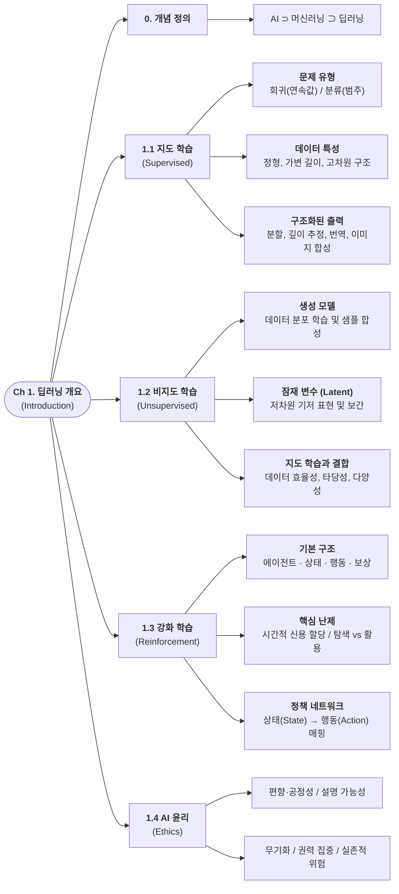

## 🗺️ Chapter 1 한눈에 보기 (Mindmap)



---

## 0. AI, 머신러닝, 딥러닝의 관계 (Overview)
- **인공지능 (Artificial Intelligence, AI):** 지능적 행동을 시뮬레이션하는 시스템을 구축하는 분야로, 논리(logic), 탐색(search), 확률적 추론(probabilistic reasoning) 등 폭넓은 접근법을 포함함.
- **머신러닝 (Machine Learning, ML):** 관측된 데이터에 수학적 모델을 피팅(fitting)하여 의사결정을 학습하는 AI의 하위 분야. 크게 **지도 학습(Supervised)**, **비지도 학습(Unsupervised)**, **강화 학습(Reinforcement)**의 3가지 영역으로 나뉨.
- **딥러닝 (Deep Learning):** 머신러닝 모델의 일종인 **심층 신경망(Deep Neural Network)**을 데이터에 피팅하는 것. 자연어 처리(번역), 컴퓨터 비전(이미지 검색), 음성 인식 등 현재 세 영역 모두에서 가장 강력하고 실용적인 성능을 냄.


---
- AI의 정의로 지능적 행동을 시뮬레이션 한다고 표현함. 다른 책에서는 흉내내거나 모사한다고 하였었음. 
## 1.1 지도 학습 (Supervised Learning)
입력 데이터(Input)를 출력 예측값(Output prediction)으로 매핑(mapping)하는 모델을 정의하고 학습하는 방식.

### ① 회귀와 분류 문제 (Regression & Classification)
실세계의 입력(문장, 소리, 이미지 등)을 숫자 벡터로 인코딩하여 모델에 넣으면, 모델은 출력 벡터를 반환하고 이를 다시 실세계의 예측으로 변환함.
- **회귀 (Regression):** 연속적인 숫자(continuous number)를 예측하는 문제.
  - *단변량 회귀:* 주택의 면적·침실 수로 '주택 가격' 1개를 예측.
  - *다변량 회귀 (Multivariate Regression):* 분자의 화학 구조로 '녹는점'과 '끓는점' 등 2개 이상의 연속값을 예측.
- **분류 (Classification):** 입력을 특정 카테고리(범주)에 할당하는 문제로, 각 카테고리에 속할 확률을 출력.
  - *이진 분류 (Binary Classification):* 2개의 범주 중 하나로 분류 (예: 식당 리뷰의 긍정/부정 예측).
  - *다중 클래스 분류 (Multiclass Classification):* $N > 2$개의 범주 중 하나로 분류 (예: 오디오 클립의 음악 장르 분류, 이미지 속 객체 분류).

### ② 입력 데이터의 특성 (Inputs)
- **정형/테이블 데이터 (Tabular Data):** 고정 길이 벡터이며 내부 구조(internal structure)가 없음. 입력 요소의 순서를 바꿔서 새로 학습해도 예측 결과가 동일함 (예: 주택 가격 예측의 특성값).
- **가변 길이 및 순서 의존 데이터:** 텍스트와 같이 길이가 가변적이며 **순서(order)**가 중요함 (예: *"my wife ate the chicken"* $\neq$ *"the chicken ate my wife"*). 단어 사전(vocabulary) 인덱스 등으로 수치 인코딩이 필요함.
- **고차원 및 구조적 데이터:**
  - *오디오/이미지:* 매우 고차원이며(예: 10초 오디오 = 441,000개 정수), 이미지는 인접 픽셀 간 연관성이 높은 **2차원 공간 구조**를 가짐.
  - *그래프/기하학적 데이터:* 분자 구조처럼 원자 수와 연결 방식(geometric structure)이 가변적인 데이터.

### ③ 머신러닝 모델과 학습 (Machine Learning Models & Training)
- **모델 (Model):** 입력과 출력 사이의 가능한 관계들의 집합(family of mathematical equations)을 나타내는 수학 방정식.
- **학습/피팅 (Training / Fitting):** 정답이 레이블링된 입출력 쌍인 **학습 데이터(Training data)**가 교사(supervisor) 역할을 하며, 가능한 방정식들 중 학습 데이터를 가장 정확하게 설명하는 특정 방정식(곡선)을 탐색하는 과정.

### ④ 심층 신경망 (Deep Neural Networks)
- 입출력 간의 매우 광범위한 관계 집합을 표현할 수 있으면서도, 학습 데이터에 맞는 최적의 관계를 탐색하기 쉬운 수학적 방정식.
- 거대하고, 길이가 가변적이며, 다양한 내부 구조를 가진 입출력을 모두 처리할 수 있음.

### ⑤ 구조화된 출력 (Structured Outputs)
출력값 자체도 고차원이거나 복잡한 내부 구조·문법(grammar)을 가질 수 있음.
- **입력과 구조가 밀접한 경우:**
  - *시맨틱 분할 (Semantic Segmentation):* 이미지의 모든 픽셀에 대해 객체(예: 소 vs 배경) 여부를 분류하는 다변량 이진 분류.
  - *단안 깊이 추정 (Monocular Depth Estimation):* 거리 이미지의 각 픽셀별 깊이(depth)를 예측하는 다변량 회귀.
- **출력이 독자적인 복잡한 구조/문법을 가지는 경우:** 음성 받아쓰기(Audio transcription), 기계 번역(Translation), 텍스트-이미지 합성(Image synthesis).
  - *어려운 이유 2가지:*
    1. **모호성 (Ambiguity):** 하나의 입력에 대응하는 올바른 출력이 여러 개일 수 있음 (예: 같은 문장의 여러 번역, 같은 캡션에 맞는 여러 이미지).
    2. **출력의 문법 (Grammar):** 단어들의 임의 조합이 모두 올바른 문장이 아니듯, 출력 공간 자체의 유효한 통계적 구조(문법)를 지켜야 함.

---

## 1.2 비지도 학습 (Unsupervised Learning)
출력 레이블(정답) 없이 입력 데이터만으로 모델을 구축하며, 데이터의 **내부 구조를 이해하거나 기술(describe)**하는 것이 목적.

### ① 생성 모델 (Generative Models)
- **개념:** 학습 데이터와 통계적으로 구별할 수 없는 새로운 데이터 샘플을 합성(synthesize)하는 모델. 데이터의 확률 분포를 명시적으로 모델링하여 샘플링하거나, 분포를 명시하지 않고 생성 메커니즘만 학습함.
- **조건부 생성 (Conditional Generation):** 일부 출력이 미리 정해진 제약 조건 하에 데이터를 생성하는 방식.
  - *예시:* 이미지 인페인팅(Inpainting, 가려진 부분 복원), 텍스트 완성(Text completion, GPT-3 등).
- **주의점:** 현대 텍스트 생성 모델은 질문에 답하며 지능적인 것처럼 보이지만, 실제로는 언어의 **통계적 특성(statistics)**만 알 뿐 답변의 의미를 이해하는 것은 아님.

### ② 잠재 변수 (Latent Variables)
- **저차원성:** 실제 의미 있는 문장이나 자연스러운 이미지는 무작위 단어/픽셀 조합 전체 공간 중 극히 일부에 불과함 (예: 사람의 표정 변화는 약 42개의 안면 근육 변수로 설명 가능).
- **생성 원리:** 데이터를 더 적은 수의 기저 변수인 **잠재 변수(Latent variables)**로 설명함. 잠재 변수는 설계상 단순한 확률 분포를 가지며, 여기서 샘플링한 뒤 딥러닝 모델을 통해 고차원 데이터 공간으로 매핑하여 새 데이터를 생성함.
- **보간 (Interpolation):** 두 실제 데이터의 잠재 변수 표현을 찾아 그 사이 값을 선형 보간한 뒤 데이터 공간으로 매핑하면, 두 이미지의 특성이 자연스럽게 섞인 중간 이미지들을 생성할 수 있음.

### ③ 지도 학습과 비지도 학습의 연결 (Connecting Supervised & Unsupervised Learning)
텍스트 캡션으로 이미지를 생성하는 문제처럼 출력이 구조화된 지도 학습에서, 입력을 출력으로 직접 매핑하는 대신 **[텍스트 잠재 변수 $\rightarrow$ 이미지 잠재 변수]**로 매핑하면 3가지 이점이 있음:
1. **데이터 효율성:** 입출력이 저차원이므로 매핑 학습에 필요한 텍스트/이미지 쌍의 수가 줄어듦.
2. **그럴듯한 출력 보장:** 합리적인 잠재 변수 값은 항상 그럴듯한(plausible) 이미지로 매핑됨.
3. **다양성 (다중 출력 생성):** 잠재 변수 간 매핑이나 이미지 생성 과정에 무작위성(randomness)을 부여하여, 하나의 캡션에 부합하는 여러 장의 다양한 이미지를 생성할 수 있음 (예: DALL·E-2).

---

## 1.3 강화 학습 (Reinforcement Learning)
- **기본 구조:** 환경(World)에 존재하는 **에이전트(Agent)**가 매 타임 스텝마다 **행동(Action)**을 취함 $\rightarrow$ 환경의 **상태(State)**가 (비결정론적으로) 변화함 $\rightarrow$ **보상(Reward)**이 주어짐.
- **목표:** 평균적으로 높은 보상을 얻는 행동을 선택하도록 학습하는 것.
- **핵심 난제 2가지:**
  1. **시간적 신용 할당 문제 (Temporal Credit Assignment Problem):** 보상이 행동을 취한 시점보다 한참 뒤에 발생할 수 있어(예: 체스 게임 종료 시점의 승리 보상, 로봇의 체크포인트 도달), 과거의 수많은 행동 중 어떤 행동이 보상에 기여했는지 파악하기 어려움.
  2. **탐색과 활용의 트레이드오프 (Exploration-Exploitation Trade-off):** 이미 알고 있는 적당한 보상 전략을 계속 사용할 것인지(**활용, Exploitation** - 예: 로봇이 옆으로 누워 한 발로 밀며 이동), 아니면 더 나은 보상을 찾기 위해 새로운 행동을 시도할 것인지(**탐색, Exploration** - 예: 두 발로 균형 잡고 걷기 시도) 사이의 균형 문제.
- **딥러닝의 적용 - 정책 네트워크 (Policy Network):** 관측된 환경의 상태(State, 예: 로봇 센서 값, 체스판 상태)를 행동(Action, 예: 관절 움직임, 체스 수)으로 매핑하는 함수를 심층 신경망으로 구축.

---

## 1.4 딥러닝과 윤리 (Ethics)
AI는 전기, 내연기관, 인터넷에 버금가는 파급력을 지니며, 과학자/엔지니어의 지나친 낙관주의를 경계하고 다음 5가지 주요 윤리적 문제를 성찰해야 함.

- **편향과 공정성 (Bias and Fairness):** 과거 데이터를 학습한 시스템은 역사적 편향을 그대로 재생산하거나 심화시킴 (예: 여성의 연봉을 낮게 예측, 저해상도 얼굴 복원 시 유색인종을 백인처럼 변환, 변호사 이미지 생성 시 남성만 생성).
- **설명 가능성 (Explainability):** 수십억 개의 파라미터를 가진 딥러닝 모델은 의사결정 과정을 인간이 완전히 이해하기 불가능함. 특정 결정의 이유를 설명하는 '국소적 설명(local explanation)' 연구(Explainable AI)가 있으나, 복잡한 모델의 완전한 투명성 확보 여부는 미지수.
- **AI의 무기화 (Weaponizing AI):** 모든 주요 기술과 마찬가지로 AI 또한 군사적 목적 및 전쟁에 광범위하게 배치되고 있음.
- **권력 집중 (Concentrating Power):** 거대 기업들이 막대한 이익을 위해 AI에 투자하며 소수 조직에 권력이 집중됨. 업무 자동화는 특히 저임금·저숙련 노동자의 생계에 불균형적인 타격을 줄 수 있음.
- **실존적 위험 (Existential Risk):** 인간보다 뛰어나고 확장 가능한 시스템을 구축할 때 통제력을 상실하거나 그 동기를 이해하지 못할 위험.
- **기타 우려 및 과학자의 책임:** 감시, 허위정보, 프라이버시 침해, 금융 시장 조작, AI 학습 에너지 소비로 인한 기후 변화 악화 등. 연구자와 엔지니어는 자본주의가 주도하는 AI 개발에서 법적·사회적 안전망이 뒤처진다는 점을 인식하고, 기업의 '윤리 세탁(ethics-washing)' 여부를 비판적으로 검토해야 함.

---

## 1.5 ~ 1.7 책의 구조 및 활용법 (Book Structure & How to Read)
- **책의 구성 (Structure of Book):**
  - *Chapters 2–9:* 지도 학습 파이프라인 (얕은/깊은 신경망, 손실 함수, 학습, 성능 측정 및 정규화).
  - *Chapters 10–13:* 핵심 아키텍처 (CNN, ResNet, Transformer, GNN).
  - *Chapters 14–18:* 비지도 학습 및 4대 심층 생성 모델 (GAN, VAE, Normalizing Flows, Diffusion Models).
  - *Chapter 19:* 심층 강화 학습 입문.
  - *Chapter 20:* 딥러닝의 이론적 미해결 질문들 (왜 학습이 잘 되는가, 일반화, 과매개변수화, Double descent, Grokking, Lottery tickets 등).
  - *Chapter 21:* 딥러닝과 윤리 심화.
- **학습 가이드 (How to Read):**
  - 각 챕터는 **본문(Main text)**, 역사적 맥락과 참고문헌을 담은 **노트(Notes)**, 그리고 이해를 돕는 **연습문제(Problems)** 및 웹사이트의 **Python 실습 노트북(Notebooks)**으로 구성됨.
  - 부록(Appendix A~C)을 통해 표기법(Notation), 수학적 개념, 확률 기초를 참조할 수 있음.

---

## 💻 실습: Notebook 1.1 -- Background Mathematics

> [!NOTE] 표기법 핵심 포인트
> 이 책에서는 선형 방정식을 $y = \beta + \omega x$ 형태로 표기합니다.
> - **$\beta$ (Beta, 편향/절편, Bias / y-intercept):** 입력 $x=0$일 때의 기본 오프셋 값
> - **$\omega$ (Omega, 가중치/기울기, Weight / slope):** 입력 $x$에 곱해지는 기울기

### 1. 1차원 선형 함수 (1D Linear Function)
- **수식:** $y = \beta + \omega x$
- **목표 (TODO):**
  1. 1D 선형 방정식 `y = beta + omega * x` 구현하기
  2. $y$축과 $y=10$에서 만나고($(0, 10)$), $x$축과 $x=5$에서 만나는($(5, 0)$) 직선 만들기
     - $x=0$일 때 $y=10 \implies \beta = 10.0$
     - $x=5$일 때 $0 = 10 + 5\omega \implies \omega = -2.0$

```python
import numpy as np
import matplotlib.pyplot as plt

def linear_function_1D(x, beta, omega):
    # 1D 선형 방정식: y = beta(절편) + omega(기울기) * x
    y = beta + omega * x
    return y

x = np.arange(0.0, 10.0, 0.01)
beta = 10.0
omega = -2.0
y = linear_function_1D(x, beta, omega)
```

![[UDL_Ch01_1D_linear.png]]

---

### 2. 2차원 선형 함수 (2D Linear Function)
- **수식:** $y = \beta + \omega_1 x_1 + \omega_2 x_2$
- **시각화 의미:** $(x_1, x_2)$ 2차원 평면 위의 각 점에서 계산된 $y$값을 **색상(히트맵, 밝을수록 큰 값)** 과 **등고선(contour lines, 같은 $y$값을 잇는 선)** 으로 표현함.
- **파라미터 변화 실험 (TODO):**
  1. **기본값 ($\beta=0, \omega_1=1.0, \omega_2=-0.5$):** $y = x_1 - 0.5x_2$. $x_1$이 커질수록 밝아지고, $x_2$가 커질수록 어두워지는 대각선 등고선 형태.
  2. **$\omega_1 = 0$일 때 ($y = -0.5x_2$):** $x_1$의 영향이 사라지고 음수 기울기($-0.5$)만 남아, $x_2$가 증가할수록 값이 **음수**로 감소(어두워짐)하며 등고선은 **가로선(수평선)** 이 됨.
  3. **$\omega_2 = 0$일 때 ($y = x_1$):** $x_2$의 영향이 사라지고 양수 기울기($1.0$)만 남아, $x_1$이 증가할수록 값이 **양수**로 증가(밝아짐)하며 등고선은 **세로선(수직선)** 이 됨.
  4. **$\beta = -5$일 때 ($y = -5 + x_1 - 0.5x_2$):** 등고선의 기울기(간격과 방향)는 그대로 유지되면서 모든 $y$값이 $5$만큼 작아지므로 **전반적으로 어두워짐**(등고선이 오른쪽 아래로 평행이동).

```python
def linear_function_2D(x1, x2, beta, omega1, omega2):
    # 2D 선형 방정식: y = beta + omega1 * x1 + omega2 * x2
    y = beta + omega1 * x1 + omega2 * x2
    return y
```

![[UDL_Ch01_2D_linear.png]]

---

### 3. 다차원 선형 함수와 행렬/벡터 표기법 (3D Linear Function & Matrix Form)
- **수식 (입력 3개 $\rightarrow$ 출력 2개):**
  $$\begin{bmatrix} y_1 \\ y_2 \end{bmatrix} = \begin{bmatrix} \beta_1 \\ \beta_2 \end{bmatrix} + \begin{bmatrix} \omega_{11} & \omega_{12} & \omega_{13} \\ \omega_{21} & \omega_{22} & \omega_{23} \end{bmatrix} \begin{bmatrix} x_1 \\ x_2 \\ x_3 \end{bmatrix} \iff \mathbf{y} = \boldsymbol{\beta} + \boldsymbol{\Omega}\mathbf{x}$$
- **행렬 크기(Shape) 규칙:** 입력이 $D_i$개이고 출력이 $D_o$개일 때, 가중치 행렬 $\boldsymbol{\Omega}$의 크기는 항상 **`(출력 개수 × 입력 개수)` = $(D_o \times D_i)$**가 됨.
  - $(D_o \times D_i) \cdot (D_i \times 1) = (D_o \times 1)$

```python
# 1) 3D 단일 선형 함수 정의
def linear_function_3D(x1, x2, x3, beta, omega1, omega2, omega3):
    return beta + omega1 * x1 + omega2 * x2 + omega3 * x3

# 2) 벡터/행렬 연산 (입력 3개 -> 출력 2개: Omega는 2x3 행렬)
beta_vec = np.array([[beta1], [beta2]])                              # (2, 1)
omega_mat = np.array([[omega11, omega12, omega13],
                      [omega21, omega22, omega23]])                  # (2, 3)
x_vec = np.array([[x1], [x2], [x3]])                                 # (3, 1)

y_vec = beta_vec + np.matmul(omega_mat, x_vec)                       # (2, 1) -> y1 = -4.500, y2 = 2.900
```

- **Questions 풀이:**
  1. **3차원 입력 선형 함수의 시각화와 원점 $(0,0,0)$에서의 값:**
     - **시각화:** 입력 $(x_1, x_2, x_3)$만으로도 이미 3차원 공간을 차지하므로, 출력 $y$까지 높이로 그리려면 4차원이 필요함. 하지만 3차원 공간의 각 좌표에 **색상(열지도)이나 등위면(3D 등고선 평면)** 을 입히는 방식으로 3차원 공간까지는 시각화가 가능함!
     - **원점 $(0,0,0)$의 값:** $x_1 = x_2 = x_3 = 0$을 대입하면 $y = \beta + 0 + 0 + 0 = \beta$ (**절편 $\beta$**).
  2. **입력 2개($x_1, x_2$)로 선형 방정식 3개($y_1, y_2, y_3$)를 계산할 때 (3행 2열, $3 \times 2$ 행렬):**
     $$\begin{bmatrix} y_1 \\ y_2 \\ y_3 \end{bmatrix}_{3 \times 1} = \begin{bmatrix} \beta_1 \\ \beta_2 \\ \beta_3 \end{bmatrix}_{3 \times 1} + \begin{bmatrix} \omega_{11} & \omega_{12} \\ \omega_{21} & \omega_{22} \\ \omega_{31} & \omega_{32} \end{bmatrix}_{3 \times 2} \begin{bmatrix} x_1 \\ x_2 \end{bmatrix}_{2 \times 1}$$

```python
# Question 2 코드: 입력 2개(x1, x2) -> 출력 3개(y1, y2, y3)
b_vec = np.array([[1.0], [-0.5], [0.2]])               # (3, 1)
w_mat = np.array([[2.0, -1.0], [0.5, 1.5], [-1.2, 0.8]]) # (3, 2) -> 3행 2열!
x_vec = np.array([[3.0], [2.0]])                       # (2, 1)

y_vec = b_vec + np.matmul(w_mat, x_vec)                # 결과: y1=5.0, y2=4.0, y3=-1.8
```
