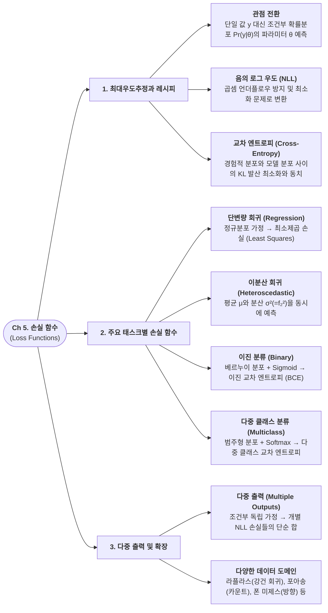

## 🗺️ Chapter 5 한눈에 보기 (Mindmap)

---

## 0. 왜 손실 함수(Loss Functions)의 설계 원리가 필요한가?
- **기존 관점:** Chapter 2~4에서는 모델 $f[\mathbf{x}, \boldsymbol{\phi}]$가 출력 예측값 $\mathbf{y}$를 직접 계산하고, 회귀 문제에서 오차 제곱합인 **최소제곱 손실(Least-squares loss)** 을 당연하게 사용했음.
- **5장의 목표:**
  1. 실수 출력($y \in \mathbb{R}$)에 대해 왜 최소제곱 손실이 이론적으로 정당화되는지 증명함.
  2. 이진 분류($y \in \{0, 1\}$), 다중 클래스 분류($y \in \{1, 2, \dots, K\}$), 카운트, 방향 등 **임의의 예측 도메인에 맞는 손실 함수를 체계적으로 구축하는 일반 프레임워크(레시피)** 를 제시함.

---

## 5.1 최대우도추정 (Maximum Likelihood)

### ① 관점의 전환: 출력의 확률 분포 예측하기 (Figure 5.1)
- 신경망 모델 $f[\mathbf{x}, \boldsymbol{\phi}]$가 출력 $\mathbf{y}$를 직접 내놓는 대신, 입력 $\mathbf{x}$가 주어졌을 때 가능한 출력 $\mathbf{y}$에 대한 **조건부 확률 분포 $\Pr(\mathbf{y}|\mathbf{x})$** 를 계산한다고 관점을 바꿈.
- **구현 방법:**
  1. 출력 도메인 $\mathbf{y}$ 위에서 정의된 매개변수 확률 분포(parametric distribution) $\Pr(\mathbf{y}|\boldsymbol{\theta})$를 선택함.
  2. 신경망 모델이 입력 $\mathbf{x}_i$로부터 그 분포의 파라미터 $\boldsymbol{\theta}_i = f[\mathbf{x}_i, \boldsymbol{\phi}]$를 계산하도록 설정함.
  - *예시:* 실수 $y \in \mathbb{R}$를 예측할 때 단변량 정규분포 $\Pr(y|\mu, \sigma^2)$를 선택하고, 신경망이 평균 $\mu = f[\mathbf{x}, \boldsymbol{\phi}]$를 예측하게 함.

### ② 최대우도 기준 (Maximum Likelihood Criterion)
- 각 학습 입력 $\mathbf{x}_i$로부터 계산된 확률 분포 $\Pr(\mathbf{y}_i|\boldsymbol{\theta}_i) = \Pr(\mathbf{y}_i|f[\mathbf{x}_i, \boldsymbol{\phi}])$ 아래에서, 실제 관측된 학습 정답 $\mathbf{y}_i$가 나타날 확률(우도, likelihood)이 높아지도록 모델 파라미터 $\boldsymbol{\phi}$를 선택함.
- **i.i.d. 가정 (독립 항등 분포, Independent and Identically Distributed):**
  1. **항등 분포 (Identically distributed):** 모든 데이터 포인트에 대해 출력 확률 분포의 형태가 동일함.
  2. **조건부 독립 (Conditionally independent):** 각 데이터의 조건부 분포 $\Pr(\mathbf{y}_i|\mathbf{x}_i)$가 서로 독립이므로, 전체 학습 데이터셋의 결합 우도(joint likelihood)는 개별 우도들의 **곱(product)** 으로 분해됨:
     $$\Pr(\mathbf{y}_1, \mathbf{y}_2, \dots, \mathbf{y}_I | \mathbf{x}_1, \mathbf{x}_2, \dots, \mathbf{x}_I) = \prod_{i=1}^{I} \Pr(\mathbf{y}_i|\mathbf{x}_i)$$
- 따라서 최적의 파라미터 $\hat{\boldsymbol{\phi}}$는 전체 우도를 최대화함:
  $$\hat{\boldsymbol{\phi}} = \underset{\boldsymbol{\phi}}{\text{argmax}} \left[ \prod_{i=1}^{I} \Pr(\mathbf{y}_i | f[\mathbf{x}_i, \boldsymbol{\phi}]) \right]$$
  - *(참고: 조건부 확률 $\Pr(z|\psi)$는 $z$의 함수로 보면 합이 $1$이 되는 확률 분포이지만, 파라미터 $\psi$의 함수로 보면 합이 $1$이 될 필요가 없는 **우도(Likelihood)** 라고 부름.)*

### ③ 로그 우도 최대화 (Maximizing Log-Likelihood)
- **곱셈의 문제점:** 개별 확률/밀도 항 $\Pr(\mathbf{y}_i|f[\mathbf{x}_i, \boldsymbol{\phi}])$이 작은 값일 때 수천~수만 개를 곱하면 값이 극도로 작아져 컴퓨터의 유한 정밀도 연산에서 **언더플로우(underflow)** 문제가 발생함.
- **로그 변환 (Figure 5.2):** 로그 함수 $\log[\bullet]$는 **단조 증가 함수(monotonically increasing function)** ($z > z' \implies \log[z] > \log[z']$)이므로, 원래 함수를 최대화하는 위치($\hat{\boldsymbol{\phi}}$)와 로그를 씌운 함수를 최대화하는 위치는 완전히 동일함.
- 로그의 성질에 의해 **곱셈($\prod$)이 덧셈($\sum$)으로 변환** 되어 수치적으로 안전하게 계산할 수 있음:
  $$\hat{\boldsymbol{\phi}} = \underset{\boldsymbol{\phi}}{\text{argmax}} \left[ \log \left[ \prod_{i=1}^{I} \Pr(\mathbf{y}_i | f[\mathbf{x}_i, \boldsymbol{\phi}]) \right] \right] = \underset{\boldsymbol{\phi}}{\text{argmax}} \left[ \sum_{i=1}^{I} \log \Big[ \Pr(\mathbf{y}_i | f[\mathbf{x}_i, \boldsymbol{\phi}]) \Big] \right]$$

### ④ 음의 로그 우도 최소화 (Minimizing Negative Log-Likelihood, NLL)
- 머신러닝의 관례상 모델 학습은 손실 함수를 **최소화(minimization)** 하는 형태로 정식화함.
- 로그 우도에 $-1$을 곱해 최대화 문제를 최소화 문제로 바꾼 것이 **음의 로그 우도(Negative Log-Likelihood, NLL) 손실 함수** 임:
  $$\hat{\boldsymbol{\phi}} = \underset{\boldsymbol{\phi}}{\text{argmin}} \left[ - \sum_{i=1}^{I} \log \Big[ \Pr(\mathbf{y}_i | f[\mathbf{x}_i, \boldsymbol{\phi}]) \Big] \right] = \underset{\boldsymbol{\phi}}{\text{argmin}} \big[ L[\boldsymbol{\phi}] \big]$$

### ⑤ 추론 (Inference)
- 학습된 모델은 새로운 입력 $\mathbf{x}$에 대해 출력 분포 $\Pr(\mathbf{y}|f[\mathbf{x}, \hat{\boldsymbol{\phi}}])$를 예측함.
- 단일 점 추정값(point estimate) $\hat{\mathbf{y}}$가 필요할 때는 예측된 분포에서 **가장 확률(밀도)이 높은 최빈값(maximum)** 을 반환함:
  $$\hat{\mathbf{y}} = \underset{\mathbf{y}}{\text{argmax}} \Big[ \Pr(\mathbf{y} | f[\mathbf{x}, \hat{\boldsymbol{\phi}}]) \Big]$$

---

## 5.2 손실 함수 구축 4단계 레시피 (Recipe for Constructing Loss Functions)
1. **확률 분포 선택:** 예측 출력 $\mathbf{y}$의 도메인(실수, 이진값, 범주 등)에 적합한 확률 분포 $\Pr(\mathbf{y}|\boldsymbol{\theta})$를 선택함.
2. **네트워크로 파라미터 예측:** 머신러닝 모델이 그 분포의 파라미터 중 하나 이상을 계산하도록 $\boldsymbol{\theta} = f[\mathbf{x}, \boldsymbol{\phi}]$로 설정함.
3. **NLL 최소화 학습:** 학습 데이터셋 $\{\mathbf{x}_i, \mathbf{y}_i\}$에서 음의 로그 우도 손실 함수 $L[\boldsymbol{\phi}] = -\sum_{i=1}^I \log[\Pr(\mathbf{y}_i|f[\mathbf{x}_i, \boldsymbol{\phi}])]$를 최소화하는 $\hat{\boldsymbol{\phi}}$를 찾음.
4. **추론 수행:** 새로운 테스트 입력 $\mathbf{x}$에 대해 전체 분포 $\Pr(\mathbf{y}|f[\mathbf{x}, \hat{\boldsymbol{\phi}}])$를 반환하거나 분포의 최댓값 위치 $\hat{\mathbf{y}}$를 반환함.

---

## 5.3 예제 1: 단변량 회귀 (Univariate Regression)

### ① 정규분포 선택과 최소제곱 손실(Least-Squares Loss) 유도
- **목표:** 입력 $\mathbf{x}$로부터 단일 실수 출력 $y \in \mathbb{R}$ 예측.
- **1단계 (분포 선택):** 실수 전체에서 정의되는 **단변량 정규분포(Univariate Normal / Gaussian Distribution)** 선택 (파라미터: 평균 $\mu$, 분산 $\sigma^2$):
  $$\Pr(y | \mu, \sigma^2) = \frac{1}{\sqrt{2\pi\sigma^2}} \exp\left[ -\frac{(y - \mu)^2}{2\sigma^2} \right]$$
- **2단계 (파라미터 매핑):** 분산 $\sigma^2$은 고정 상수로 두고, 신경망이 **평균 $\mu = f[\mathbf{x}, \boldsymbol{\phi}]$** 를 예측하도록 설정함.
- **3단계 (NLL 손실 전개):**
  $$\begin{aligned}
  \hat{\boldsymbol{\phi}} &= \underset{\boldsymbol{\phi}}{\text{argmin}} \left[ -\sum_{i=1}^{I} \log \left[ \frac{1}{\sqrt{2\pi\sigma^2}} \exp\left[ -\frac{(y_i - f[\mathbf{x}_i, \boldsymbol{\phi}])^2}{2\sigma^2} \right] \right] \right] \\
  &= \underset{\boldsymbol{\phi}}{\text{argmin}} \left[ -\sum_{i=1}^{I} \left( \log\left[\frac{1}{\sqrt{2\pi\sigma^2}}\right] - \frac{(y_i - f[\mathbf{x}_i, \boldsymbol{\phi}])^2}{2\sigma^2} \right) \right] \\
  &= \underset{\boldsymbol{\phi}}{\text{argmin}} \left[ \sum_{i=1}^{I} \frac{(y_i - f[\mathbf{x}_i, \boldsymbol{\phi}])^2}{2\sigma^2} \right] = \underset{\boldsymbol{\phi}}{\text{argmin}} \left[ \sum_{i=1}^{I} (y_i - f[\mathbf{x}_i, \boldsymbol{\phi}])^2 \right]
  \end{aligned}$$
  - 첫 번째 로그 항은 $\boldsymbol{\phi}$와 무관한 상수이므로 제거되고, 분모 $2\sigma^2$ 역시 최솟값의 위치에 영향을 주지 않는 양의 상수 스케일이므로 제거됨.
  - **결론:** Chapter 2의 **최소제곱 손실 함수 $L[\boldsymbol{\phi}] = \sum_{i=1}^I (y_i - f[\mathbf{x}_i, \boldsymbol{\phi}])^2$** 는 **"예측 오차가 서로 독립이며 평균이 $\mu = f[\mathbf{x}_i, \boldsymbol{\phi}]$인 정규분포를 따른다"** 는 가정으로부터 자연스럽게 유도됨 (Figure 5.4).
- **4단계 (추론):** 정규분포의 최댓값(최빈값)은 평균 $\mu$에서 발생하므로 점 추정값은 그대로 $\hat{y} = f[\mathbf{x}, \hat{\boldsymbol{\phi}}]$가 됨.

### ② 분산 추정 및 이분산 회귀 (Heteroscedastic Regression)
- **등분산 회귀 (Homoscedastic Regression):** 데이터의 불확실성(분산 $\sigma^2$)이 입력 위치와 무관하게 어디서나 일정하다고 가정하는 모델. 필요시 식 (5.9)를 $\boldsymbol{\phi}$와 $\sigma^2$에 대해 동시에 최소화하여 예측의 불확실성 $\hat{\sigma}^2$까지 함께 학습할 수 있음.
- **이분산 회귀 (Heteroscedastic Regression, Figure 5.5):** 입력 데이터 $\mathbf{x}$의 구간에 따라 예측의 불확실성(분산)이 달라지는 현실적인 상황을 모델링함.
  - 신경망이 2개의 출력 $f_1[\mathbf{x}, \boldsymbol{\phi}]$와 $f_2[\mathbf{x}, \boldsymbol{\phi}]$를 내놓도록 설계함.
  - 분산 $\sigma^2$은 반드시 **양수(positive)** 여야 하므로, 두 번째 출력을 제곱(squaring)하여 분산으로 사용함:
    $$\mu = f_1[\mathbf{x}, \boldsymbol{\phi}], \quad \sigma^2 = f_2[\mathbf{x}, \boldsymbol{\phi}]^2$$
  - **이분산 손실 함수:**
    $$\hat{\boldsymbol{\phi}} = \underset{\boldsymbol{\phi}}{\text{argmin}} \left[ -\sum_{i=1}^{I} \left( \log\left[ \frac{1}{\sqrt{2\pi f_2[\mathbf{x}_i, \boldsymbol{\phi}]^2}} \right] - \frac{(y_i - f_1[\mathbf{x}_i, \boldsymbol{\phi}])^2}{2 f_2[\mathbf{x}_i, \boldsymbol{\phi}]^2} \right) \right]$$

---

## 5.4 예제 2: 이진 분류 (Binary Classification)
입력 $\mathbf{x}$를 두 개의 이산 클래스 레이블 $y \in \{0, 1\}$ 중 하나로 분류하는 문제 (예: 리뷰 긍정/부정, MRI 종양 유무).

1. **확률 분포 선택 — 베르누이 분포 (Bernoulli Distribution, Figure 5.6):**
   - 도메인 $y \in \{0, 1\}$ 위에서 정의되며, $y=1$이 관측될 확률을 나타내는 단일 파라미터 $\lambda \in [0, 1]$을 가짐:
     $$\Pr(y | \lambda) = \begin{cases} 1 - \lambda & y = 0 \\ \lambda & y = 1 \end{cases} \quad \Longleftrightarrow \quad \Pr(y | \lambda) = (1 - \lambda)^{1-y} \cdot \lambda^y$$
2. **로지스틱 시그모이드 함수 (Logistic Sigmoid Function, Figure 5.7):**
   - 신경망 출력 $f[\mathbf{x}, \boldsymbol{\phi}] \in \mathbb{R}$은 임의의 실수값을 가지지만, 확률 파라미터 $\lambda$는 반드시 $[0, 1]$ 범위여야 함.
   - 따라서 실수 전체 $\mathbb{R}$을 $[0, 1]$ 구간으로 압축하는 **로지스틱 시그모이드 함수** 에 통과시켜 $\lambda$를 예측함 ($z=0 \rightarrow 0.5$, 음수 $\rightarrow 0.5$ 미만, 양수 $\rightarrow 0.5$ 초과):
     $$\text{sig}[z] = \frac{1}{1 + \exp[-z]}, \quad \lambda = \text{sig}\big[f[\mathbf{x}, \boldsymbol{\phi}]\big]$$
   - 우도(Likelihood) 표현:
     $$\Pr(y | \mathbf{x}) = \big(1 - \text{sig}[f[\mathbf{x}, \boldsymbol{\phi}]]\big)^{1-y} \cdot \text{sig}[f[\mathbf{x}, \boldsymbol{\phi}]]^y$$
3. **이진 교차 엔트로피 손실 (Binary Cross-Entropy Loss, BCE):**
   - 위 우도에 음의 로그($-\log$)를 취해 합산하면 이진 분류의 손실 함수가 도출됨:
     $$L[\boldsymbol{\phi}] = \sum_{i=1}^{I} \Big( -(1 - y_i)\log\big[ 1 - \text{sig}[f[\mathbf{x}_i, \boldsymbol{\phi}]] \big] - y_i \log\big[ \text{sig}[f[\mathbf{x}_i, \boldsymbol{\phi}]] \big] \Big)$$
4. **추론:** $\lambda = \text{sig}[f[\mathbf{x}, \hat{\boldsymbol{\phi}}]] > 0.5$ (즉, $f[\mathbf{x}, \hat{\boldsymbol{\phi}}] > 0$)이면 $\hat{y} = 1$, 아니면 $\hat{y} = 0$으로 예측함.

---

## 5.5 예제 3: 다중 클래스 분류 (Multiclass Classification)
입력 $\mathbf{x}$를 $K > 2$개의 클래스 $y \in \{1, 2, \dots, K\}$ 중 하나로 분류하는 문제 (예: 10개 손글씨 숫자 인식, 다음 단어 예측).

1. **확률 분포 선택 — 범주형 분포 (Categorical Distribution, Figure 5.9):**
   - $K$개의 카테고리에 각각 확률 $\lambda_1, \lambda_2, \dots, \lambda_K$를 부여함:
     $$\Pr(y = k) = \lambda_k \quad \left(\text{단, } \lambda_k \in [0, 1] \text{ 이고 } \sum_{k=1}^{K} \lambda_k = 1\right)$$
2. **소프트맥스 함수 (Softmax Function, Figure 5.10):**
   - 신경망이 $K$개의 실수 출력 벡터 $\mathbf{z} = f[\mathbf{x}, \boldsymbol{\phi}] \in \mathbb{R}^K$를 내놓을 때, 모든 원소를 $[0, 1]$ 범위의 양수로 만들고 **총합이 정확히 $1$이 되도록 정규화** 하는 **소프트맥스(Softmax) 함수** 를 통과시킴:
     $$\lambda_k = \text{softmax}_k[\mathbf{z}] = \frac{\exp[z_k]}{\sum_{k'=1}^{K} \exp[z_{k'}]}$$
   - 지수 함수 $\exp[\bullet]$가 양수성(positivity)을 보장하고, 분모의 전체 합이 확률의 총합 $1$을 보장함.
3. **다중 클래스 교차 엔트로피 손실 (Multiclass Cross-Entropy Loss):**
   - $i$번째 데이터의 실제 정답 클래스가 $y_i \in \{1, \dots, K\}$일 때 우도는 $\Pr(y = y_i | \mathbf{x}_i) = \text{softmax}_{y_i}[f[\mathbf{x}_i, \boldsymbol{\phi}]]$이며, 음의 로그 우도 손실은 다음과 같음:
     $$L[\boldsymbol{\phi}] = -\sum_{i=1}^{I} \log\Big[ \text{softmax}_{y_i}\big[ f[\mathbf{x}_i, \boldsymbol{\phi}] \big] \Big] = -\sum_{i=1}^{I} \left( f_{y_i}[\mathbf{x}_i, \boldsymbol{\phi}] - \log\left[ \sum_{k'=1}^{K} \exp\big[ f_{k'}[\mathbf{x}_i, \boldsymbol{\phi}] \big] \right] \right)$$
   - 여기서 $f_k[\mathbf{x}, \boldsymbol{\phi}]$는 신경망의 $k$번째 출력(흔히 로짓, logit이라 부름)을 의미함.
4. **추론:** $K$개의 출력 중 가장 확률(또는 로짓 값)이 높은 카테고리 $\hat{y} = \text{argmax}_k [\Pr(y=k | f[\mathbf{x}, \hat{\boldsymbol{\phi}}])]$를 선택함.

### 💡 그 외 다양한 예측 데이터 타입과 확률 분포 (Figure 5.11 요약)
| 예측 데이터 타입 | 출력 도메인 | 선택할 확률 분포 | 주요 활용 태스크 |
| :--- | :--- | :--- | :--- |
| 단변량 연속형 (비유계) | $y \in \mathbb{R}$ | **정규분포 (Normal)** | 일반 단변량 회귀 (평균 추정) |
| 단변량 연속형 (이상치 존재) | $y \in \mathbb{R}$ | **라플라스(Laplace) / $t$-분포** | 강건한 회귀 (Robust regression, 중앙값 추정) |
| 단변량 연속형 (다봉형) | $y \in \mathbb{R}$ | **가우시안 혼합 (Mixture of Gaussians)** | 정답이 여러 갈래인 다봉(Multimodal) 회귀 |
| 단변량 양의 연속형 | $y \in \mathbb{R}^+$ | **지수(Exponential) / 감마(Gamma)** | 크기(Magnitude), 지속 시간(Duration) 예측 |
| 단변량 비율/구간 | $y \in [0, 1]$ | **베타 분포 (Beta)** | 비율(Proportions) 예측 |
| 단변량 원형/각도 | $y \in (-\pi, \pi]$ | **폰 미제스 분포 (von Mises)** | 풍향, 각도 등 방향(Direction) 예측 |
| 단변량 이진 이산형 | $y \in \{0, 1\}$ | **베르누이 분포 (Bernoulli)** | 이진 분류 (Binary classification) |
| 단변량 다중 이산형 | $y \in \{1, \dots, K\}$ | **범주형 분포 (Categorical)** | 다중 클래스 분류 (Multiclass classification) |
| 단변량 비음수 정수 | $y \in \{0, 1, 2, \dots\}$ | **포아송 분포 (Poisson)** | 보행자 수 등 사건 발생 횟수(Counts) 예측 |
| 다변량 순열 | $y \in \text{Perm}[1, \dots, K]$ | **플래킷-루스 (Plackett-Luce)** | 순위 학습 (Learning to rank) |

---

## 5.6 다중 출력 (Multiple Outputs)
하나의 모델로 여러 개의 타깃 벡터 $\mathbf{y} = [y_1, y_2, \dots, y_D]^T$를 동시에 예측할 때(예: 분자의 녹는점과 끓는점 동시 예측, 이미지의 모든 픽셀별 클래스 분류, 풍향과 풍속 동시 예측):

- **조건부 독립 가정:** 입력 $\mathbf{x}_i$가 주어졌을 때 각 출력 요소 $y_d$의 예측 오차가 서로 **독립(independent)** 이라고 가정하면, 결합 확률 분포는 개별 단변량 분포들의 곱이 됨:
  $$\Pr(\mathbf{y} | f[\mathbf{x}_i, \boldsymbol{\phi}]) = \prod_{d} \Pr(y_d | f_d[\mathbf{x}_i, \boldsymbol{\phi}])$$
  - 여기서 $f_d[\mathbf{x}_i, \boldsymbol{\phi}]$는 $d$번째 출력 변수 $y_d$의 분포 파라미터를 계산하는 신경망 출력 그룹임.
- **손실 함수의 덧셈 분해:** 음의 로그 우도를 취하면 곱셈이 **개별 출력 손실들의 단순 합(sum)** 으로 변환됨:
  $$L[\boldsymbol{\phi}] = -\sum_{i=1}^{I} \log\Big[ \Pr(\mathbf{y}_i | f[\mathbf{x}_i, \boldsymbol{\phi}]) \Big] = -\sum_{i=1}^{I} \sum_{d} \log\Big[ \Pr(y_{id} | f_d[\mathbf{x}_i, \boldsymbol{\phi}]) \Big]$$

---

## 5.7 교차 엔트로피 손실 (Cross-Entropy Loss)과 NLL의 동치성
왜 음의 로그 우도 손실을 흔히 **교차 엔트로피 손실(Cross-entropy loss)** 이라고도 부르는가?

1. **목표:** 관측된 학습 데이터의 **경험적 분포(Empirical distribution) $q(y)$** 와 모델이 예측한 분포 **$\Pr(y|\boldsymbol{\theta})$** 사이의 거리(차이)를 최소화하는 파라미터 $\boldsymbol{\theta}$를 찾고자 함 (Figure 5.12).
2. **KL 발산 (Kullback-Leibler Divergence):** 두 확률 분포 $q(z)$와 $p(z)$ 사이의 비대칭 거리를 측정하는 지표:
   $$D_{KL}\big[ q \parallel p \big] = \int_{-\infty}^{\infty} q(z)\log\big[q(z)\big]dz - \int_{-\infty}^{\infty} q(z)\log\big[p(z)\big]dz$$
3. **교차 엔트로피 도출:**
   - $D_{KL}[q(y) \parallel \Pr(y|\boldsymbol{\theta})]$를 $\boldsymbol{\theta}$에 대해 최소화할 때, 첫 번째 항 $\int q(y)\log[q(y)]dy$는 $\boldsymbol{\theta}$에 의존하지 않으므로 사라짐.
   - 남는 두 번째 항 **$-\int_{-\infty}^{\infty} q(y)\log[\Pr(y|\boldsymbol{\theta})]dy$** 를 두 분포 간의 **교차 엔트로피(Cross-entropy)** 라 부름 (한 분포를 통해 알게 된 정보를 고려한 뒤에도 다른 분포에 남아 있는 불확실성의 양).
4. **디랙 델타 함수를 통한 NLL과의 동치 증명:**
   - 관측된 학습 데이터 포인트 $\{y_i\}_{i=1}^I$의 경험적 분포 $q(y)$는 각 데이터 위치에 점 질량(point mass)이 모여 있는 **디랙 델타 함수(Dirac delta function, $\delta[\bullet]$)** 들의 평균으로 표현됨:
     $$q(y) = \frac{1}{I}\sum_{i=1}^{I} \delta[y - y_i]$$
   - 이를 교차 엔트로피 적분식에 대입하면 델타 함수의 성질($\int \delta[y-y_i]g(y)dy = g(y_i)$)에 의해 적분이 합산으로 바뀌고, 상수 계수 $1/I$를 제거하면 정확히 **음의 로그 우도(NLL)** 식이 됨:
     $$\hat{\boldsymbol{\theta}} = \underset{\boldsymbol{\theta}}{\text{argmin}} \left[ -\int_{-\infty}^{\infty} \left(\frac{1}{I}\sum_{i=1}^{I} \delta[y - y_i]\right) \log\big[\Pr(y|\boldsymbol{\theta})\big] dy \right] = \underset{\boldsymbol{\theta}}{\text{argmin}} \left[ -\sum_{i=1}^{I} \log\big[\Pr(y_i|\boldsymbol{\theta})\big] \right]$$
- **결론:** **"데이터의 우도를 최대화하는 것(NLL 최소화)"** 과 **"경험적 데이터 분포와 모델 분포 사이의 KL 발산을 최소화하는 것(교차 엔트로피 최소화)"** 은 수학적으로 **완전히 동일한(equivalent)** 작업임!

---

## 5.8 참고 노트 (Notes) 및 연습문제 핵심 포인트

### ① 심화 손실 함수 개념 (Notes)
- **강건한 회귀 (Robust Regression)와 L1 손실:** 오차 제곱합(MSE) 대신 **절대 오차 합(MAE, $\sum |y_i - f[\mathbf{x}_i, \boldsymbol{\phi}]|$)** 을 최소화하는 것은 출력 분포로 정규분포 대신 꼬리가 두꺼운 **라플라스 분포(Laplace distribution)** 를 가정한 것과 같으며, 추론 시 평균(mean)이 아닌 **중앙값(median)** 을 추정하므로 이상치(outlier)에 강건함.
- **분위수 회귀 (Quantile Regression):** 리스크 모델처럼 "실제 값이 예측값보다 90% 확률로 작을 경계선"을 알고 싶을 때는 양방향 절대 오차에 비대칭 가중치를 부여하는 **핀볼 손실(Pinball loss / Quantile loss)** 을 사용해 특정 분위수(quantile)를 직접 예측함.
- **클래스 불균형과 초점 손실 (Focal Loss, Lin et al., 2017):** 특정 클래스 데이터가 압도적으로 많을 때 표준 교차 엔트로피를 쓰면 모델이 다수 클래스의 쉬운 예제에만 집중하는 문제가 발생함. **Focal Loss** 는 이미 잘 분류된 예제의 손실 기여도를 낮추는(down-weight) 지수 파라미터를 추가해 소수 클래스 학습 성능을 크게 높임.
- **혼합 밀도 네트워크 (Mixture Density Networks, MDN - Problem 5.4, Figure 5.14):**
  - 하나의 입력 $x$에 대해 가능한 정답 $y$가 두 갈래 이상으로 나뉘는 **다봉(Multimodal) 데이터** 에서는 단일 정규분포(평균 1개)로 학습하면 두 갈래의 한가운데(엉뚱한 빈 공간)를 예측해 버림.
  - 이때는 두 개 이상의 정규분포를 가중합한 **가우시안 혼합 분포(Mixture of Gaussians)** 의 파라미터($\lambda, \mu_1, \sigma_1^2, \mu_2, \sigma_2^2$)를 신경망이 예측하도록 손실 함수를 설계함.
- **비확률적 손실 함수 (Non-probabilistic Approaches):** 반드시 확률 분포에 기반할 필요는 없으며, SVM(서포트 벡터 머신)의 **힌지 손실(Hinge loss)** 이나 AdaBoost의 **지수 손실(Exponential loss)** 처럼 거리 개념에 기반한 비확률적 손실 함수들도 존재함.

### ② 주요 연습문제 (Problems) 포인트
- **Problem 5.3 (풍향 예측 - 폰 미제스 분포):** 원형 도메인 $y \in (-\pi, \pi]$의 폰 미제스 분포 $\Pr(y|\mu, \kappa) = \frac{\exp[\kappa \cos[y-\mu]]}{2\pi \cdot \text{Bessel}_0[\kappa]}$에서 집중도 $\kappa$가 상수일 때 NLL을 정리하면 상수항이 소거되어 **$L[\boldsymbol{\phi}] = -\sum_{i=1}^I \cos\big[y_i - f[\mathbf{x}_i, \boldsymbol{\phi}]\big]$** 라는 매우 직관적인 코사인 손실 함수가 유도됨.
- **Problem 5.6 (카운트 예측 - 포아송 분포):** 비음수 정수 $y \in \{0, 1, 2, \dots\}$에 대한 포아송 분포 $\Pr(y=k) = \frac{\lambda^k e^{-\lambda}}{k!}$에서는 비율 파라미터 $\lambda > 0$을 보장하기 위해 신경망 출력을 지수 함수 $\lambda = \exp[f[\mathbf{x}, \boldsymbol{\phi}]]$에 통과시키며, NLL 손실은 **$L[\boldsymbol{\phi}] = \sum_{i=1}^I \big( \exp[f[\mathbf{x}_i, \boldsymbol{\phi}]] - y_i f[\mathbf{x}_i, \boldsymbol{\phi}] \big)$** (상수 $\log[y_i!]$ 제외)가 됨.
- **Problem 5.9 (다변량 회귀의 스케일 불균형 문제):** 사람의 키(미터 단위, 예: $1.7\text{m}$)와 몸무게(킬로그램 단위, 예: $70\text{kg}$)를 동시에 등분산 최소제곱 손실로 학습하면, 값의 범위가 큰 몸무게 오차가 전체 손실을 지배하여 키 예측이 무시됨.
  - *해결책 2가지:* ① 학습 전 각 출력 변수를 표준화(z-score normalization)하여 스케일을 맞추거나, ② 각 차원마다 서로 다른 분산 $\sigma_1^2, \sigma_2^2$을 갖는 다변량 정규분포 NLL 손실(Problem 5.8)을 사용하여 각 오차가 분산으로 자동 스케일링되게 함.
