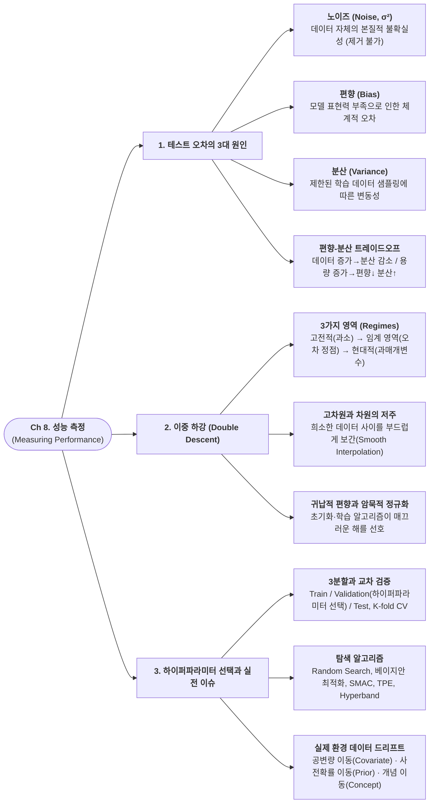

## 🗺️ Chapter 8 한눈에 보기 (Mindmap)

---

## 0. 왜 성능 측정(Measuring Performance)을 별도로 다루는가?
- 충분한 용량(은닉 유닛 수)을 가진 신경망은 **학습 데이터(Training data)에서는 오차 0%로 완벽하게 작동** 하는 경우가 흔함. 하지만 이것이 새로운 데이터에서도 잘 작동한다는(**일반화, Generalization**) 보장은 없음.
- 이번 챕터에서는 테스트 오차가 발생하는 **3가지 근본 원인(노이즈, 편향, 분산)** 을 수학적으로 분해하고, 고전적 통계학의 예측을 뒤집는 현대 딥러닝의 **이중 하강(Double descent)** 현상과 **검증 데이터셋(Validation set)을 통한 하이퍼파라미터 선택법** 을 다룸.

---

## 8.1 간단한 모델 학습과 테스트 손실의 역설 (Training a Simple Model, Figure 8.1 ~ 8.2)
- **MNIST-1D 실험:** 10개 숫자 클래스($0 \sim 9$), 입력 차원 $D_i = 40$, 학습 데이터 $I = 4,000$개, 테스트 데이터 $1,000$개에 대해 은닉층 2개(각 유닛 $100$개)인 신경망을 SGD로 6,000 스텝(150 에포크) 학습함.
- **학습 에러 vs 테스트 에러 (Figure 8.2a):**
  - 학습 에러와 학습 손실은 약 4,000 스텝 이후 **$0$에 수렴** 함(학습 데이터를 완벽히 외움).
  - 반면 **테스트 에러** 는 $40\%$ 수준까지만 떨어진 뒤 더 이상 개선되지 않고 정체됨(과대적합).
- **왜 후반부에 테스트 에러율은 일정한데 '테스트 손실(Test Loss)'은 다시 증가하는가? (Figure 8.2b):**
  - 1,500 스텝 이후 테스트 분류 에러율 자체는 약 $40\%$로 일정하지만, **테스트 교차 엔트로피 손실(NLL)은 오히려 다시 상승** 함.
  - **이유:** 학습 데이터의 정답 확률을 $1$에 가깝게 만들기 위해 소프트맥스 이전의 출력값(로짓)이 점점 더 극단적인 값으로 커지면서, 테스트 데이터에서 **틀린 예측을 점점 더 높은 확신(increasing confidence)을 가지고 틀리기 때문** 임! (정답 클래스에 부여하는 확률이 극도로 작아져 $-\log\Pr(y_{\text{true}}|x)$가 폭발함).

---

## 8.2 테스트 오차의 3가지 원인 (Sources of Error)

### ① 직관적 이해: 노이즈, 편향, 분산 (Figure 8.5)
1. **노이즈 (Noise):** 데이터 생성 과정 자체에 확률적 요소가 있거나, 잘못된 레이블링(mislabeled), 관측되지 않은 설명 변수가 있어서 **동일한 입력 $x$에 대해 여러 유효한 출력 $y$가 존재** 함으로써 발생하는 오차. 테스트 데이터에서 **절대 극복할 수 없는(insurmountable) 성능의 근본적 한계** 임 (단, 학습 데이터에서는 같은 $x$를 두 번 볼 일이 거의 없으므로 노이즈가 있어도 학습 손실은 $0$으로 만들 수 있음).
2. **편향 (Bias):** 모델 자체가 충분히 유연하지 못해, **최적의 파라미터를 선택하더라도 진짜 기저 함수(true underlying function)를 완벽하게 표현하지 못해서** 발생하는 체계적 오차(예: 선형 영역 3개짜리 모델로 복잡한 사인 곡선을 피팅할 때).
3. **분산 (Variance):** 우리가 가진 학습 데이터가 **제한된 수의 노이즈 섞인 샘플** 이기 때문에, 진짜 함수의 변화와 노이즈를 구별하지 못해 발생하는 오차. 서로 다른 학습 데이터셋 $\mathcal{D}$를 샘플링해 학습시킬 때마다 피팅된 함수가 매번 조금씩 달라지는 변동성을 의미함.

### ② 테스트 기대 손실의 수학적 분해 (Bias-Variance Decomposition)
1차원 최소제곱 회귀 문제에서 각 입력 $x$에 대한 진짜 출력 분포 $\Pr(y|x)$의 기댓값(진짜 평균 함수)을 $\mu[x] = \mathbb{E}_y[y[x]]$, 데이터 생성 노이즈 분산을 $\sigma^2 = \mathbb{E}_y[(\mu[x] - y[x])^2]$이라 하자.

1. **1단계: 테스트 데이터 $y[x]$에 대한 기댓값 (노이즈 분리)**
   - 위치 $x$에서의 손실 $L[x] = (f[x, \boldsymbol{\phi}] - y[x])^2$에 진짜 평균 $\mu[x]$를 빼고 더한 뒤 전개하여 기댓값 $\mathbb{E}_y[\bullet]$를 취함:
     $$L[x] = \big((f[x, \boldsymbol{\phi}] - \mu[x]) + (\mu[x] - y[x])\big)^2$$
   - 교차항 $2(f[x, \boldsymbol{\phi}] - \mu[x])(\mu[x] - \mathbb{E}_y[y[x]])$은 $\mathbb{E}_y[y[x]] = \mu[x]$이므로 $0$이 되어 사라지고 다음이 남음:
     $$\mathbb{E}_y\big[L[x]\big] = \big(f[x, \boldsymbol{\phi}] - \mu[x]\big)^2 + \sigma^2$$
2. **2단계: 학습 데이터셋 $\mathcal{D}$에 대한 기댓값 (편향과 분산 분리)**
   - 학습된 파라미터 $\boldsymbol{\phi}[\mathcal{D}]$는 어떤 학습 데이터셋 $\mathcal{D} = \{x_i, y_i\}$가 샘플링되었는지에 따라 달라지는 확률 변수임. 가능한 모든 학습 데이터셋에 대한 **평균 모델 예측값** 을 $f_\mu[x] = \mathbb{E}_{\mathcal{D}}\big[f[x, \boldsymbol{\phi}[\mathcal{D}]]\big]$라 정의함.
   - 첫 번째 항 $(f[x, \boldsymbol{\phi}[\mathcal{D}]] - \mu[x])^2$에 $f_\mu[x]$를 빼고 더한 뒤 전개하여 데이터셋에 대한 기댓값 $\mathbb{E}_{\mathcal{D}}[\bullet]$를 취하면 마찬가지로 교차항이 $0$이 되어 사라짐:
     $$\mathbb{E}_{\mathcal{D}}\Big[\big(f[x, \boldsymbol{\phi}[\mathcal{D}]] - \mu[x]\big)^2\Big] = \mathbb{E}_{\mathcal{D}}\Big[\big(f[x, \boldsymbol{\phi}[\mathcal{D}]] - f_\mu[x]\big)^2\Big] + \big(f_\mu[x] - \mu[x]\big)^2$$
3. **최종 분해 공식 (Equation 8.7):**
   $$\mathbb{E}_{\mathcal{D}}\Big[ \mathbb{E}_y\big[ L[x] \big] \Big] = \underbrace{\mathbb{E}_{\mathcal{D}}\Big[ \big(f[x, \boldsymbol{\phi}[\mathcal{D}]] - f_\mu[x]\big)^2 \Big]}_{\text{분산 (Variance)}} + \underbrace{\big(f_\mu[x] - \mu[x]\big)^2}_{\text{편향 (Bias)}} + \underbrace{\sigma^2}_{\text{노이즈 (Noise)}}$$
   - 최소제곱 회귀에서 테스트 기대 손실은 **분산 + 편향 + 노이즈** 의 세 가지 덧셈 항으로 정확히 분해됨.

---

## 8.3 오차 줄이기와 편향-분산 트레이드오프 (Reducing Error)
노이즈($\sigma^2$)는 줄일 수 없으므로 테스트 성능을 높이려면 **분산** 과 **편향** 을 줄여야 함.

1. **분산 줄이기 (Reducing Variance, Figure 8.6):**
   - 학습 데이터의 양($I$)을 늘리면 노이즈가 평균화되어 상쇄되고 입력 공간이 촘촘히 샘플링되므로, 어떤 데이터셋이 뽑히든 일관된 함수가 학습되어 **분산이 크게 줄어듦** (일반적으로 학습 데이터를 추가하면 테스트 성능은 거의 항상 향상됨).
2. **편향 줄이기 (Reducing Bias, Figure 8.7a–c):**
   - 모델의 유연성, 즉 **모델 용량(Capacity — 은닉 유닛 및 은닉층의 수)** 을 늘리면 더 많은 선형 영역으로 진짜 함수를 정교하게 따라갈 수 있어 **편향이 줄어듦**.
3. **편향-분산 트레이드오프 (Bias-Variance Trade-off, Figure 8.7d–f, 8.8, 8.9):**
   - **고정된 크기의 학습 데이터셋** 에서 모델 용량을 늘리면 편향은 줄어들지만, 여분의 표현력이 학습 데이터의 노이즈까지 피팅하는 데 쓰이면서(**과대적합, Overfitting**) **분산이 급격히 증가함**.
   - 따라서 고전적 이론에 따르면 **[편향 + 분산]** 의 합을 최소화하는 **최적의 중간 모델 용량(Optimal capacity)** 이 존재하며, 그 이상 용량을 키우면 테스트 오차가 다시 나빠짐.

---

## 8.4 이중 하강 (Double Descent)

### ① 고전적 예측을 깨는 이중 하강 현상 (Figure 8.10)
실제 현대 신경망(MNIST-1D, MNIST, CIFAR-100 ResNet18 등)에서 모델 용량(은닉 유닛/파라미터 수)을 계속 늘려가며 테스트 손실을 측정하면 놀라운 현상이 관찰됨:
- 레이블 노이즈가 적을 때는 용량이 학습 데이터 개수를 넘어서도 테스트 오차가 올라가지 않고 계속 감소함 (Figure 8.10a).
- 레이블에 $15\%$ 노이즈를 추가하면(Figure 8.10b), 모델이 학습 데이터를 막 완벽하게 외우는(memorize) 시점 근처까지는 편향-분산 트레이드오프대로 테스트 손실이 감소했다가 다시 **치솟아 정점(peak)** 을 찍음.
- **그러나 거기서 모델 용량을 더 크게 늘리면, 테스트 손실이 다시 감소하기 시작하여 첫 번째 골짜기보다도 더 낮은 최적의 테스트 성능을 달성함!** 이를 **이중 하강(Double descent)** 이라 부름.
- **3가지 영역 (Regimes):**
  1. **고전적 / 과소매개변수 영역 (Classical / Under-parameterized regime):** 첫 번째 U자 곡선 구간.
  2. **임계 영역 (Critical regime):** 모델 용량이 학습 데이터를 겨우 완벽히 암기할 수 있는 수준(파라미터 수 $\approx$ 데이터 수 근처)이 되어 테스트 오차가 급증하는 정점 구간.
  3. **현대적 / 과매개변수 영역 (Modern / Over-parameterized regime):** 파라미터 수가 데이터 수를 훨씬 초과함에도 용량을 늘릴수록 테스트 오차가 다시 꾸준히 감소하는 구간.

### ② 왜 이중 하강이 발생하는가? (차원의 저주와 매끄러운 보간)
모델이 이미 학습 데이터를 완벽히 맞추어 학습 손실이 $0$이 된 이후에 용량을 더 늘리면, 추가된 용량은 학습 데이터 포인트 위가 아니라 **학습 데이터 포인트들 '사이(between)'의 빈 공간을 어떻게 채울지** 만을 변화시킴.

- **귀납적 편향 (Inductive Bias):** 데이터가 없는 구간을 외삽/보간할 때 모델이 수많은 가능한 해 중 특정 형태의 해를 우선시하는 경향.
- **차원의 저주 (Curse of Dimensionality):** 고차원 공간에서는 부피가 지수적으로 커져서 학습 데이터가 극도로 희소(sparse)해짐. 예를 들어 $40$차원인 MNIST-1D에서 각 축을 단 $10$개 구간(bin)으로만 나누어도 전체 공간은 $10^{40}$개의 칸이 생기며, $10^5$개의 학습 데이터를 넣어도 **$10^{35}$개의 칸마다 겨우 1개의 데이터** 만 존재함.
- **매끄러운 보간 (Smooth Interpolation, Figure 8.11 ~ 8.12):**
  - **임계 영역에서 오차가 폭증하는 이유 (Figure 8.11b):** 파라미터 수가 데이터 수와 비슷해 노이즈 섞인 데이터를 '겨우' 다 통과해야 할 때는 모델이 모든 점을 억지로 지나가기 위해 심하게 뒤틀려(contort) 데이터 사이 구간에서 매우 불규칙하고 요동치는 예측을 내놓음.
  - **과매개변수 영역에서 오차가 다시 줄어드는 이유 (Figure 8.11c–f):** 은닉 유닛(용량)을 훨씬 많이 추가할수록 데이터 포인트들을 모두 통과하면서도 그 사이를 **점점 더 매끄럽게(smoothly) 보간할 수 있는 능력** 이 생김.
  - **암묵적 정규화 (Implicit Regularization, Figure 8.12):** 물론 50개의 은닉 유닛으로 학습 손실이 $0$이면서도 심하게 요동치는 함수도 만들 수 있지만, 신경망의 **가중치 초기화와 학습 알고리즘(SGD/Adam) 자체가 암묵적 정규화(Implicit regularizer)로 작용** 하여 데이터 사이를 가장 부드럽고 단순하게 잇는 매끄러운 해로 수렴하도록 유도하기 때문에 일반화 성능이 좋아짐 (Chapter 9에서 계속).

---

## 8.5 하이퍼파라미터 선택하기 (Choosing Hyperparameters)
실전에서는 진짜 함수를 모르므로 편향을 계산할 수 없고, 과매개변수 영역에서도 용량을 어디까지 늘려야 할지 미리 알 수 없음.

- **하이퍼파라미터 탐색 (Hyperparameter Search) / 신경망 아키텍처 탐색 (NAS):** 은닉층 수, 유닛 수, 학습률, 배치 크기 등의 하이퍼파라미터 조합을 실험적으로 찾아내는 과정.
- **왜 테스트 세트로 하이퍼파라미터를 고르면 안 되는가? $\rightarrow$ 검증 세트(Validation Set)의 도입:**
  - 여러 모델을 테스트 세트에서 평가해 가장 좋은 것을 고르면, 그 하이퍼파라미터가 우연히 해당 테스트 세트에만 잘 맞고 새로운 데이터에는 일반화되지 않는(테스트 세트에 과대적합되는) 문제가 발생함.
  - **표준 3분할 파이프라인:**
    1. **학습 세트 (Training set):** 모델의 파라미터($\boldsymbol{\phi}$)를 학습함.
    2. **검증 세트 (Validation set):** 여러 하이퍼파라미터로 학습된 모델들의 성능을 비교하여 **최적의 하이퍼파라미터(모델)를 선택** 함.
    3. **테스트 세트 (Test set):** 최종 선택된 단 하나의 모델에 대해 **실제 일반화 성능을 마지막에 단 한 번 추정** 함.
- **탐색의 어려움:** 하이퍼파라미터는 이산형(discrete, 예: 층 수)이거나 조건부(conditional, 예: 10번째 층 유닛 수는 전체 층이 10층 이상일 때만 존재)인 경우가 많아 그래디언트 기반 최적화를 쓸 수 없으며, 조합 하나를 평가할 때마다 모델 전체를 새로 학습해야 하므로 연산 비용이 매우 큼.

---

## 8.6 참고 노트 (Notes) 및 연습문제 핵심 포인트

### ① $K$-겹 교차 검증 ($K$-Fold Cross-Validation)
- 전체 데이터가 부족할 때 학습/검증 데이터를 따로 떼어내면 학습 데이터가 줄어들어 분산(Variance)이 커지는 문제가 발생함.
- 이를 해결하기 위해 학습+검증 데이터를 $K$개의 서로소 부분집합(예: $K=5$)으로 나눈 뒤, $K-1$개(4개)로 학습하고 나머지 $1$개로 검증하는 과정을 $K$번 교대로 반복하여 **평균 검증 성능** 으로 하이퍼파라미터를 선택함.

### ② 용량(Capacity)의 엄밀한 정의와 척도
- **표현 용량 (Representational Capacity) vs 유효 용량 (Effective Capacity):** 모델 구조가 모든 파라미터로 표현할 수 있는 전체 함수 공간이 '표현 용량'이라면, 특정 최적화 알고리즘과 학습 시간 내에 실제로 도달할 수 있는 함수 공간은 **유효 용량(Effective capacity)** 임.
- **이론적 척도:** 이진 분류기가 임의의 레이블 조합을 완벽히 분류할 수 있는 최대 데이터 개수인 **VC 차원(Vapnik-Chervonenkis dimension)** 과 무작위 레이블 데이터에 대한 적합 능력을 측정하는 **라데마허 복잡도(Rademacher complexity)** 가 있음.
- **에포크별 이중 하강 (Epoch-wise Double Descent, Nakkiran et al., 2021):** 모델 크기를 고정해 두어도 **학습 반복 횟수(에포크)** 를 늘려감에 따라 유효 용량이 커지면서 테스트 오차가 내려갔다가 올라간 뒤 다시 내려가는 이중 하강이 동일하게 나타남.
- **이중 하강의 기묘한 역설 (Problem 8.4):** 과매개변수 영역에 있던 모델에서 **학습 데이터를 더 추가** 하여 데이터 수가 파라미터 수와 비슷해지면, 모델이 오히려 **임계 영역(Critical regime, 정점)** 으로 밀려나면서 **학습 데이터를 늘렸는데도 테스트 성능이 나빠지는** 역설적인 현상이 발생할 수 있음!

### ③ 고차원 공간의 반직관적 성질 5가지 (Curse of Dimensionality & Typical Sets)
1~2차원 그림의 직관을 고차원에 그대로 적용하면 위험하며, 고차원 공간은 다음과 같은 놀라운 성질을 가짐:
1. **직교성 (Problem 8.6):** 고차원 표준 정규분포에서 무작위로 뽑은 두 벡터는 높은 확률로 원점 기준 거의 **직교(orthogonal, 내적 $\approx 0$)** 함.
2. **전형적 집합 (Typical Set — 껍질 집중 현상, Figure 8.13, Problem 8.9):** 표준 정규분포에서 확률 밀도가 가장 높은 지점은 원점(평균)이지만, 반지름 $r$이 커질수록 공간의 부피(표면적)가 기하급수적으로 커지기 때문에 두 효과가 상충하여 실제 샘플들은 원점 근처가 아니라 **원점에서 일정 거리($\approx \sqrt{D}$) 떨어진 얇은 구형 껍질(shell)** 에 모두 모여 있음(거리가 카이 분포 $\chi$를 따름).
3. **오렌지 껍질 비유 (Problem 8.8):** $D$차원 초구(hypersphere, 반지름 $1$)에서 바깥쪽 $1\%$ 두께의 껍질이 차지하는 부피 비율은 $1 - 0.99^D$이므로, 차원 $D \rightarrow \infty$일 때 **초구 부피의 거의 $100\%$가 표면 바로 아래 얇은 껍질에 집중** 됨.
4. **초구 부피의 소멸 (Problem 8.7):** 한 변의 길이가 $1$인 초입방체(부피 $1$) 안에 내접하는 지름 $1$(반지름 $0.5$)짜리 초구의 부피 $\text{Vol}[r] = \frac{r^D \pi^{D/2}}{\Gamma[D/2 + 1]}$는 차원 $D$가 커질수록 **$0$으로 수렴** 함(부피가 모두 입방체의 모서리/구석에 몰림).
5. **거리의 균일화:** 고차원 초입방체에서 균등 분포로 뽑은 점들 중 가장 가까운 점까지의 거리와 가장 먼 점까지의 거리의 비율이 $1$에 가까워짐.

### ④ 실제 배포 환경에서의 데이터 드리프트 (Data Drift) 3유형
테스트 세트 성능이 좋더라도 실제 세계의 데이터 통계가 달라지거나 시간에 따라 변하면(**데이터 드리프트**) 성능이 저하됨:
- **공변량 이동 (Covariate Shift):** 입력 데이터 $\Pr(\mathbf{x})$의 분포가 변하는 현상 (학습 때 희소했던 영역의 입력이 들어옴).
- **사전 확률 이동 (Prior Shift):** 출력 클래스 $\Pr(y)$의 빈도 분포가 변하는 현상 (학습 때 희귀했던 클래스가 실제로는 흔해짐).
- **개념 이동 (Concept Shift):** 입력과 출력 사이의 조건부 관계 $\Pr(y|\mathbf{x})$ 자체가 변하는 현상.

### ⑤ 하이퍼파라미터 최적화 알고리즘
- **무작위 탐색 (Random Search):** 격자 탐색(Grid search)보다 효율적인 기본 베이스라인.
- **베이지안 최적화 (Bayesian Optimization):** 가우시안 프로세스(GP)로 하이퍼파라미터에 따른 성능과 불확실성을 모델링하여 탐색(Exploration)과 활용(Exploitation)을 조절함.
- **SMAC & TPE (Tree-Parzen Estimators):** 랜덤 포레스트(SMAC)나 조건부 밀도 추정($\Pr(\text{HP}|\text{성능})$, TPE)을 사용하여 이산형·연속형·조건부 하이퍼파라미터를 모두 처리함.
- **Hyperband & BOHB:** 많은 무작위 설정을 적은 예산(짧은 에포크)으로 먼저 돌려본 뒤 상위 비율($\eta$)만 남기고 예산을 $1/\eta$배씩 늘려가는 조기 탈락 전략(**Hyperband**)과, 여기에 TPE의 지능적 샘플링을 결합한 **BOHB**.

### ⑥ 주요 연습문제 (Problems) 포인트
- **Problem 8.1 (교차 엔트로피 학습 손실은 0에 도달할 수 있는가?):** 소프트맥스 함수 $\frac{\exp[z_k]}{\sum \exp[z_{k'}]}$가 정확히 $1$이 되려면 정답 로짓이 $+\infty$가 되어야 하므로, 유한한 가중치에서는 학습 분류 에러율이 $0\%$가 되더라도 교차 엔트로피 손실은 $0$에 한없이 가까워질 뿐 **절대 정확히 $0$에 도달할 수 없음**.
- **Problem 8.5 (과매개변수 영역에서의 이분산 회귀 문제):** 모델 용량이 데이터 수를 초과해 모든 학습 데이터의 평균 예측 오차 $(y_i - f_1[x_i, \boldsymbol{\phi}])^2$를 $0$으로 만들 수 있게 되면, 이분산 회귀 모델은 각 학습 데이터 포인트 위치에서 예측 분산 $\sigma^2 = f_2[x_i, \boldsymbol{\phi}]^2$을 **$0$으로 수렴시켜 음의 로그 우도를 $-\infty$로 발산** 시키는 심각한 과대적합이 발생함 ($\rightarrow$ 평균 네트워크와 분산 네트워크의 용량을 다르게 제한하거나 분산에 하한/정규화를 두어 해결).
