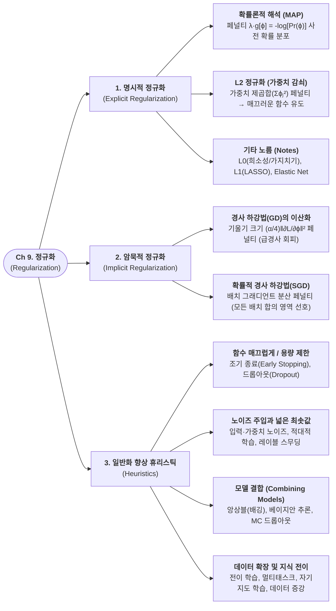

## 🗺️ Chapter 9 한눈에 보기 (Mindmap)

---

## 0. 정규화(Regularization)의 목적과 정의
- **일반화 격차 (Generalization Gap):** Chapter 8에서 보았듯 학습 데이터와 테스트 데이터 사이에 큰 성능 차이가 발생하는 이유는 ① 모델이 학습 데이터의 비전형적인 통계적 특이점(노이즈)에 **과대적합(Overfitting)** 되거나, ② 학습 데이터가 없는 빈 영역에서 모델이 아무런 제약을 받지 않아 엉뚱한 예측을 내놓기 때문임.
- **정규화 (Regularization):** 학습 성능과 테스트 성능 사이의 일반화 격차를 줄여 테스트 일반화 성능을 향상시키는 모든 기법.
  - *좁은 의미(엄밀한 정의):* 특정 파라미터 선택을 선호하도록 손실 함수에 **명시적인 페널티 항(explicit terms)** 을 추가하는 것.
  - *넓은 의미(머신러닝 관례):* 암묵적 정규화 및 조기 종료, 드롭아웃, 데이터 증강 등 일반화 성능을 높이는 모든 전략을 통칭.

---

## 9.1 명시적 정규화 (Explicit Regularization)

### ① 정식화와 확률론적 해석 (Probabilistic Interpretation)
- 원래의 손실 최소화 문제에 바람직하지 않은 파라미터에 큰 양수 값을 부여하는 페널티 함수 $g[\boldsymbol{\phi}]$를 추가함:
  $$\hat{\boldsymbol{\phi}} = \underset{\boldsymbol{\phi}}{\text{argmin}} \left[ \sum_{i=1}^{I} \ell_i[\mathbf{x}_i, \mathbf{y}_i] + \lambda \cdot g[\boldsymbol{\phi}] \right]$$
  - $\lambda > 0$: 원래 손실 함수와 정규화 항 사이의 상대적 중요도를 조절하는 정규화 계수(하이퍼파라미터).
  - 정규화 항이 더해지면 손실 표면의 형태가 바뀌어 지역 최솟값의 개수가 줄어들고 전역 최솟값의 위치가 이동함 (Figure 9.1).
- **확률론적 해석 (사전 확률, Prior $\Pr(\boldsymbol{\phi})$):**
  - 데이터를 관측하기 전 파라미터에 대한 사전 지식을 나타내는 **사전 확률 분포 $\Pr(\boldsymbol{\phi})$** 를 최대우도 기준에 곱한 **최대 사후 확률(MAP)** 추정으로 해석할 수 있음:
    $$\hat{\boldsymbol{\phi}} = \underset{\boldsymbol{\phi}}{\text{argmax}} \left[ \prod_{i=1}^{I} \Pr(\mathbf{y}_i | \mathbf{x}_i, \boldsymbol{\phi}) \Pr(\boldsymbol{\phi}) \right]$$
  - 여기에 음의 로그($-\log$)를 취하면 정규화 항은 정확히 **$\lambda \cdot g[\boldsymbol{\phi}] = -\log\big[\Pr(\boldsymbol{\phi})\big]$** 에 대응함!

### ② $L_2$ 정규화 ($L_2$ Regularization / Weight Decay)
- 가장 널리 쓰이는 정규화 항으로, 모든 파라미터 값들의 **제곱합($L_2$ norm squared)** 에 페널티를 부여함 (티호노프 정규화 Tikhonov regularization, 릿지 회귀 Ridge regression, 행렬의 경우 프로베니우스 노름 Frobenius norm 정규화라고도 부름):
  $$\hat{\boldsymbol{\phi}} = \underset{\boldsymbol{\phi}}{\text{argmin}} \left[ \sum_{i=1}^{I} \ell_i[\mathbf{x}_i, \mathbf{y}_i] + \lambda \sum_{j} \phi_j^2 \right]$$
  - *(확률론적으로는 각 파라미터의 사전 분포 $\Pr(\phi_j)$를 평균 $0$, 분산 $\sigma_\phi^2 = 1/(2\lambda)$인 정규분포로 가정한 것과 동치임 — Problem 9.1).*
- **가중치 감쇠 (Weight Decay):** 신경망에서는 보통 편향(biases)은 제외하고 **가중치(weights)에만 $L_2$ 정규화를 적용** 하므로 이를 **가중치 감쇠(Weight decay)** 라 부름.
- **왜 가중치가 작아지면 출력 함수가 매끄러워지는가? (Figure 9.2):**
  - 신경망의 출력은 마지막 은닉층 활성화 값들의 가중합이고, 각 은닉층 역시 이전 층의 가중합임. 가중치들의 크기가 작아지면 입력 변화에 따른 출력의 변화 폭(기울기)이 완만해져 전체 함수가 **매끄러워짐(smoother)** (극단적으로 $\lambda \rightarrow \infty$가 되어 모든 가중치가 $0$이 되면 출력은 마지막 편향값 하나로 고정된 수평 상수가 됨).
- **테스트 성능이 향상되는 2가지 이유:**
  1. *과대적합(Overfitting) 억제:* 노이즈가 섞인 데이터 포인트를 억지로 전부 통과하려는 성향과 매끄러운 함수를 유지하려는 성향 사이에서 타협하여, 편향(Bias)을 약간 늘리는 대신 **분산(Variance)으로 인한 오차를 크게 줄임**.
  2. *과매개변수(Over-parameterized) 영역 보간:* 학습 데이터가 없는 빈 구간에서 주변 데이터 포인트들 사이를 요동치지 않고 **부드럽게 보간(smoothly interpolate)** 하도록 유도함.

---

## 9.2 암묵적 정규화 (Implicit Regularization)
명시적인 페널티 항을 추가하지 않아도, **경사 하강법(GD)과 확률적 경사 하강법(SGD) 알고리즘 자체가 중립적으로 이동하지 않고 특정 해를 선호** 하는 현상.

### ① 경사 하강법(GD)의 암묵적 정규화 (Figure 9.3)
- 보폭이 무한소($\alpha \rightarrow 0$)인 연속 시간 경사 하강법은 미분방정식 $\frac{\partial \boldsymbol{\phi}}{\partial t} = -\frac{\partial L}{\partial \boldsymbol{\phi}}$를 따르지만, 실제 경사 하강법은 **유한한 보폭 $\alpha$를 갖는 이산 스텝(discrete steps)** $\boldsymbol{\phi}_{t+1} = \boldsymbol{\phi}_t - \alpha \frac{\partial L[\boldsymbol{\phi}_t]}{\partial \boldsymbol{\phi}}$으로 이동함.
- 이산화로 인해 연속 경로에서 벗어나는 편차를 테일러 전개(후방 오차 분석)로 유도하면, 이산 경사 하강법은 다음의 **수정된 손실 함수 $\tilde{L}_{\text{GD}}$** 위에서 연속 경사 하강법을 수행하는 것과 같음:
  $$\tilde{L}_{\text{GD}}[\boldsymbol{\phi}] = L[\boldsymbol{\phi}] + \frac{\alpha}{4} \left\Vert \frac{\partial L}{\partial \boldsymbol{\phi}} \right\Vert^2$$
- **의미:** 이산 경사 하강법은 **그래디언트 크기(노름 제곱)가 큰 가파른 경사 영역으로부터 밀려나며(repelled)** 완만한 경로를 선호함. 이 때문에 풀배치 경사 하강법에서도 **학습률 $\alpha$가 클수록** 이 암묵적 정규화 항이 커져서 더 평평한 최솟값으로 수렴해 테스트 일반화 성능이 좋아짐 (Figure 9.5a).

### ② 확률적 경사 하강법(SGD)의 암묵적 정규화 (Figure 9.4)
- 한 에포크 내 $B$개의 미니배치 손실 평균을 $L_b = \frac{1}{|\mathcal{B}|}\sum_{i \in \mathcal{B}_b} \ell_i$라 할 때, 무작위 SGD 업데이트들의 평균 경로와 일치하는 연속 손실 함수 $\tilde{L}_{\text{SGD}}$를 유도하면 추가적인 두 번째 정규화 항이 나타남:
  $$\tilde{L}_{\text{SGD}}[\boldsymbol{\phi}] = L[\boldsymbol{\phi}] + \underbrace{\frac{\alpha}{4} \left\Vert \frac{\partial L}{\partial \boldsymbol{\phi}} \right\Vert^2}_{\text{GD 기울기 크기 페널티}} + \underbrace{\frac{\alpha}{4B} \sum_{b=1}^{B} \left\Vert \frac{\partial L_b}{\partial \boldsymbol{\phi}} - \frac{\partial L}{\partial \boldsymbol{\phi}} \right\Vert^2}_{\text{SGD 배치 그래디언트 분산 페널티}}$$
- **의미:** SGD는 **배치별 그래디언트들의 분산(Variance of batch gradients)** 에 암묵적으로 페널티를 부여함!
  - 즉, 일부 데이터만 극단적으로 잘 맞고 다른 데이터는 덜 맞아 배치마다 기울기가 제각각인 영역을 피하고, **모든 배치가 기울기에 동의하는 안정적인 영역(모든 데이터가 고르게 잘 설명되는 해)** 으로 수렴하도록 유도함.
  - 배치 크기 $|\mathcal{B}|$가 작을수록(즉, 배치 개수 $B$나 분산 효과가 클수록) 이 정규화 효과가 강해져 **작은 배치 크기가 큰 배치 크기보다 더 뛰어난 일반화 성능** 을 보임 (Figure 9.5b).

---

## 9.3 일반화 성능 향상을 위한 8가지 휴리스틱 (Heuristics to Improve Performance)

### ① 조기 종료 (Early Stopping, Figure 9.6)
- **원리:** 학습이 완전히 수렴하기 전에 중간에 멈추는 기법. 모델이 기저 함수의 큰 윤곽(coarse structure)은 이미 파악했지만 노이즈에 과대적합될 시간은 갖지 못하게 막아줌.
  - *관점 1 ($L_2$ 정규화와의 유사성):* 작은 값으로 초기화된 가중치들이 너무 크게 자라기 전에 멈추므로 명시적 $L_2$ 정규화와 비슷한 효과를 냄 (2차 근사 하에서 유효 정규화 가중치 $\lambda \approx \frac{1}{\tau \alpha}$).
  - *관점 2 (유효 용량 감소):* 모델의 유효 복잡도를 낮추어 이중 하강 곡선의 임계 영역(정점)에서 앞쪽 골짜기로 내려오게 함.
- **장점:** 여러 모델을 학습할 필요 없이, **단 한 번만 학습** 하면서 매 $T$ 스텝마다 검증 세트(Validation set) 성능을 기록하고 체크포인트를 저장한 뒤 검증 성능이 가장 좋았던 시점의 모델을 선택하면 됨.

### ② 앙상블 (Ensembling, Figure 9.7)
- **원리:** 여러 개의 모델을 각각 학습시킨 뒤 추론 시 그 예측값들을 결합(회귀는 출력의 평균/중앙값, 분류는 소프트맥스 이전 로짓의 평균 또는 다수결 투표)하여 개별 모델의 독립적인 오차들이 서로 상쇄되게 하는 기법.
- **다양한 모델을 만드는 방법:**
  1. 서로 다른 **무작위 초기화 시드(Random initializations)** 사용 (데이터가 없는 영역에서의 예측 분산 감소).
  2. **배깅 (Bagging / Bootstrap Aggregating):** 원본 학습 데이터를 **복원 추출(re-sampling with replacement)** 하여 서로 다른 여러 데이터셋을 만들고 각각 모델을 학습시켜 이상치(outlier)의 영향을 완화함 (Figure 9.7).
  3. 서로 다른 하이퍼파라미터나 아키텍처 조합 사용.
  - *(주의: 독립적으로 학습된 모델들의 '출력 예측값'을 평균 내면 성능이 크게 오르지만, '가중치 파라미터 자체'를 단순 평균 내어 하나의 모델로 합치면 모델이 완전히 망가짐. 단, 한 학습 궤적 후반부의 가중치들을 평균 내는 **확률적 가중치 평균(SWA, Stochastic Weight Averaging)** 이나 **스냅샷 앙상블(Snapshot Ensembles)** 은 단일 학습으로 앙상블 효과를 냄.)*

### ③ 드롭아웃 (Dropout, Figure 9.8 ~ 9.9)
- **원리:** SGD의 매 학습 반복마다 은닉 유닛들의 무작위 부분집합(보통 $50\%$)을 **$0$으로 고정(clamping)** 하여 비활성화하는 기법.
- **작동 메커니즘:**
  - 네트워크가 특정 은닉 유닛 하나에 과도하게 의존하는 것을 막고 가중치 크기를 작게 유지하도록 유도함.
  - 특히 여러 은닉 유닛이 서로 공모(conspire)하여 학습 데이터가 없는 구간에서 기울기를 급격히 올렸다가 내리는 **불필요한 뾰족한 꺾임(kink)** 을 만들었을 때(Figure 9.9a), 드롭아웃으로 그중 한 유닛을 끄면 함수 전체가 크게 틀어지면서 다음 경사 하강법 스텝이 이를 보상하도록 가중치를 수정하여, **학습 손실에는 아무 영향을 주지 않던 데이터 사이의 불필요한 요동(kinks)을 점진적으로 제거** 함 (Figure 9.9b–c).
- **테스트(추론) 시의 2가지 보상 방법:**
  1. **가중치 스케일링 추론 규칙 (Weight Scaling Inference Rule):** 테스트 시에는 모든 은닉 유닛을 다 켜고 실행하되, 학습 때보다 활성 유닛 수가 많아졌으므로 각 가중치에 **$(1 - \text{드롭아웃 확률 } p)$** 를 곱해 스케일을 맞춰줌.
  2. **몬테카를로 드롭아웃 (Monte Carlo Dropout):** 테스트 시에도 학습 때처럼 무작위로 유닛을 끄면서 여러 번 추론을 실행한 뒤 결과를 평균 냄 (단일 네트워크로 추가 학습/저장 비용 없이 앙상블 및 베이지안 근사 효과를 얻음).

### ④ 노이즈 주입 (Applying Noise)과 레이블 스무딩 (Label Smoothing)
드롭아웃이 은닉 유닛 활성화에 베르누이 곱셈 노이즈를 가하는 것이라면, 네트워크의 다른 세 부분에도 노이즈를 주입해 강건성을 높일 수 있음:
1. **입력 데이터에 노이즈 추가 (Input Noise, Figure 9.10):** 매 SGD 스텝마다 입력 $\mathbf{x}$에 가우시안 노이즈를 더하면 학습된 함수가 매끄러워짐 (회귀에서는 입력에 대한 출력 미분값에 페널티를 주는 정규화와 동치임 — Problem 9.3). 이의 극단적인 형태가 출력을 가장 크게 바꾸는 최악의 작은 입력 섭동을 찾아 학습하는 **적대적 학습(Adversarial training)** 임.
2. **가중치에 노이즈 추가 (Weight Noise):** 가중치가 조금 흔들려도 안정적인 예측을 내도록 강제하여, 개별 가중치의 미세한 오차에 둔감한 **넓고 평평한 최솟값(Wide, flat minima)** 의 한가운데로 수렴하게 함.
3. **레이블에 노이즈 추가 — 레이블 스무딩 (Label Smoothing):**
   - 다중 클래스 분류에서 표준 최대우도(교차 엔트로피)는 정답 확률을 $1$로 만들기 위해 정답 로짓을 무한히 키우는 **과신(overconfidence)** 문제를 일으킴.
   - 학습 레이블 중 비율 $\rho$만큼이 오답일 수 있다고 가정하여, 정답 클래스에 확률 **$1 - \rho$** 를 부여하고 나머지 $D_o - 1$개의 오답 클래스들에 각각 **$\frac{\rho}{D_o - 1}$** 의 균등한 확률을 나누어 준 타깃 분포와의 교차 엔트로피를 최소화함 (Problem 9.4). 예측 확률의 보정(calibration)과 일반화를 크게 향상시킴.

### ⑤ 베이지안 추론 (Bayesian Inference, Figure 9.11)
- 가장 가능성 높은 단일 파라미터 점 추정치 $\hat{\boldsymbol{\phi}}$만 사용하는 최대우도법과 달리, 파라미터 $\boldsymbol{\phi}$를 불확실한 확률 변수로 취급하여 베이즈 정리로 **사후 확률 분포(Posterior distribution)** 를 계산함:
  $$\Pr(\boldsymbol{\phi} | \{\mathbf{x}_i, \mathbf{y}_i\}) = \frac{\prod_{i=1}^{I} \Pr(\mathbf{y}_i | \mathbf{x}_i, \boldsymbol{\phi})\Pr(\boldsymbol{\phi})}{\int \prod_{i=1}^{I} \Pr(\mathbf{y}_i | \mathbf{x}_i, \boldsymbol{\phi})\Pr(\boldsymbol{\phi}) d\boldsymbol{\phi}}$$
- 추론 시에는 가능한 모든 파라미터 값에 대해 사후 확률을 가중치로 곱해 적분하는 **무한 가중 앙상블(Infinite weighted ensemble)** 을 수행함:
  $$\Pr(\mathbf{y} | \mathbf{x}, \{\mathbf{x}_i, \mathbf{y}_i\}) = \int \Pr(\mathbf{y} | \mathbf{x}, \boldsymbol{\phi})\Pr(\boldsymbol{\phi} | \{\mathbf{x}_i, \mathbf{y}_i\}) d\boldsymbol{\phi}$$
- 이론적으로 매우 우아하고 예측의 불확실성까지 제공하지만, 심층 신경망에서는 고차원 적분이 불가능하므로 **변분 베이즈(Variational Bayes)** 나 **MCMC(마르코프 연쇄 몬테카를로)** 같은 복잡한 근사 기법이 필요함.

### ⑥ 전이 학습 (Transfer Learning)과 멀티태스크 학습 (Multi-Task Learning, Figure 9.12a–b)
- **전이 학습 (Transfer Learning):** 목표 태스크(예: 깊이 추정)의 학습 데이터가 부족할 때, 데이터가 풍부한 관련 **2차 태스크(Secondary task, 예: 이미지 분할, ImageNet 분류)** 로 네트워크를 먼저 **사전 학습(Pre-training)** 시킴. 이후 마지막 출력층만 목표 태스크에 맞는 새 층으로 교체하여 새 층만 학습하거나 전체 네트워크를 **미세 조정(Fine-tuning)** 함 (좋은 내부 표현을 재활용하거나 파라미터를 최적의 공간 근처에 초기화하는 효과).
- **멀티태스크 학습 (Multi-Task Learning):** 하나의 네트워크가 여러 관련 태스크(예: 장면 분할 + 깊이 추정 + 이미지 캡셔닝)를 **동시에(concurrently) 학습** 하게 하여 공통된 내부 표현의 품질과 각 태스크의 성능을 함께 높임.

### ⑦ 자기지도 학습 (Self-Supervised Learning, Figure 9.12c)
사전 학습에 쓸 레이블된 2차 데이터셋조차 없을 때, **레이블이 없는 대량의 원본 데이터로부터 '공짜' 정답 레이블을 스스로 만들어내어** 사전 학습을 수행하는 두 가지 패러다임:
1. **생성형 자기지도 학습 (Generative Self-Supervised Learning):** 데이터의 일부를 가리고(**마스킹, Masking**) 가려진 부분을 복원·예측하게 함 (예: 이미지의 가려진 영역 인페인팅, 텍스트에서 가려진 단어를 맞추는 BERT나 다음 단어를 예측하는 GPT).
2. **대조형 자기지도 학습 (Contrastive Self-Supervised Learning):** 공통점이 있는 데이터 쌍(Positive pair)과 무관한 데이터 쌍(Negative pair)을 비교하게 함 (예: **SimCLR** 처럼 같은 이미지를 다르게 변형한 두 뷰는 같은 표현으로 매핑하고 다른 이미지는 밀어내기, 두 문장이 원문에서 이어지는 문장인지 판별하기, 이미지 패치들의 상대 위치 맞추기).

### ⑧ 데이터 증강 (Data Augmentation, Figure 9.13)
- 각 학습 데이터 입력 $\mathbf{x}$에 대해 **정답 레이블 $y$가 변하지 않는 변환(transformation)** 을 가해 학습 데이터셋의 크기를 인위적으로 크게 확장하는 기법.
  - *이미지:* 회전, 좌우 반전, 블러링, 색상 변환, 무작위 영역 지우기(Random erasing), 두 이미지 섞기(Mixup) 등.
  - *텍스트:* 유의어 치환, 다른 언어로 번역했다가 다시 역번역(Round-trip translation) 등.
  - *오디오:* 주파수 대역 증폭/감쇠, 피치 이동(Pitch shifting), 시간 늘리기(Time stretching) 등.
- 모델이 본질과 무관한 변환에 둔감(불변, invariant)해지도록 가르치는 강력한 정규화 효과를 냄.

---

## 9.4 요약: 정규화 기법의 4대 작동 메커니즘 (Figure 9.14)
이 장에서 다룬 수많은 정규화 기법들은 결국 다음 **4가지 핵심 원리** 중 하나 이상을 통해 일반화 성능을 향상시킴:
1. **함수를 더 매끄럽게 만들기 (Smoother functions):** $L_2$ 정규화(가중치 감쇠), 조기 종료, 드롭아웃, 입력 노이즈 추가.
2. **유효 데이터의 양 늘리기 (More data):** 데이터 증강, 전이 학습, 멀티태스크 학습, 자기지도 학습, 레이블 스무딩.
3. **여러 모델을 결합하기 (Combine models):** 앙상블(배깅), 베이지안 추론, 몬테카를로 드롭아웃.
4. **더 넓은 최솟값 찾기 (Wider minima):** 가중치 노이즈 추가, 암묵적 정규화(큰 학습률 $\alpha$, 작은 배치 크기 SGD), 레이블 스무딩.
- *(5번째 방법: 태스크의 특성에 맞게 가중치를 공유하고 연결을 희소하게 만드는 **아키텍처 설계** $\rightarrow$ Chapters 10–13에서 계속!)*

---

## 9.5 참고 노트 (Notes) 및 연습문제 핵심 포인트

### ① $L_2$ 정규화 vs 가중치 감쇠(Weight Decay), 그리고 AdamW (Problem 9.5)
- 원래 **가중치 감쇠(Weight decay, Hanson & Pratt, 1988)** 는 손실 함수를 바꾸지 않고 파라미터 업데이트 식에서 가중치를 매번 $(1 - \lambda')$배만큼 줄이는 기법임:
  $$\boldsymbol{\phi} \longleftarrow (1 - \lambda')\boldsymbol{\phi} - \alpha \frac{\partial L}{\partial \boldsymbol{\phi}}$$
- **표준 SGD에서의 동치성:** 수정된 손실 함수 $\tilde{L}[\boldsymbol{\phi}] = L[\boldsymbol{\phi}] + \frac{\lambda'}{2\alpha}\sum_k \phi_k^2$ ($L_2$ 정규화 계수 $\lambda = \frac{\lambda'}{2\alpha}$)를 미분하여 표준 경사 하강법에 대입하면 위 가중치 감쇠 식과 **완전히 일치함**.
- **Adam에서의 차이점과 AdamW (Loshchilov & Hutter, 2019):** Adam에서는 각 파라미터마다 그래디언트가 제곱근 $\sqrt{\tilde{\mathbf{v}}_{t+1}}$로 나뉘어 유효 학습률이 파라미터별로 달라지므로, 손실 함수에 $L_2$ 항을 더하는 것과 순수 가중치 감쇠가 서로 다르게 작동함. 이를 분리하여 순수 가중치 감쇠를 올바르게 적용한 **AdamW** 가 훨씬 뛰어난 일반화 성능을 보임.

### ② 희소성을 유도하는 노름: $L_0$, $L_1$(LASSO), Elastic Net (Problem 9.6)
- **$L_0$ 정규화 ($\sum |\phi_d|^0$):** $0$이 아닌 가중치의 개수 자체에 일정한 페널티를 부여하여 불필요한 가중치나 은닉 유닛을 아예 제거(**가지치기, Pruning**)하지만, 미분이 불가능해 최적화가 매우 어려움.
- **$L_1$ 정규화 (LASSO, $\sum |\phi_d|^1$):** 가중치의 절댓값 합에 페널티를 부여함. $L_2$ 정규화는 가중치가 $0$에 가까워질수록 페널티의 기울기($2\phi_j$)가 $0$으로 줄어들어 가중치를 완전히 $0$으로 만들지 못하는 반면, **$L_1$ 정규화는 기울기가 상수($\pm 1$)로 유지되어 많은 가중치를 정확히 $0$으로 만드는 희소(Sparse)한 해** 를 유도함.
- **엘라스틱 넷 (Elastic Net):** $L_1$과 $L_2$ 정규화 항을 함께 결합한 페널티.

### ③ 암묵적 정규화 수식의 유도 원리 (Backward Error Analysis)
- 연속 미분방정식 $\frac{\partial \boldsymbol{\phi}}{\partial t} = \mathbf{g}[\boldsymbol{\phi}] + \alpha \mathbf{g}_1[\boldsymbol{\phi}]$ ($\mathbf{g}[\boldsymbol{\phi}] = -\frac{\partial L}{\partial \boldsymbol{\phi}}$)를 $\alpha$에 대해 2차 테일러 전개한 식 $\boldsymbol{\phi}[\alpha] \approx \boldsymbol{\phi}_0 + \alpha \mathbf{g}[\boldsymbol{\phi}_0] + \alpha^2\big(\mathbf{g}_1[\boldsymbol{\phi}_0] + \frac{1}{2}\frac{\partial \mathbf{g}}{\partial \boldsymbol{\phi}}\mathbf{g}[\boldsymbol{\phi}_0]\big)$가 이산 업데이트 $\boldsymbol{\phi}_1 = \boldsymbol{\phi}_0 + \alpha \mathbf{g}[\boldsymbol{\phi}_0]$와 $O(\alpha^2)$까지 일치하려면 보정항이 $\mathbf{g}_1[\boldsymbol{\phi}] = -\frac{1}{2}\frac{\partial \mathbf{g}}{\partial \boldsymbol{\phi}}\mathbf{g}[\boldsymbol{\phi}] = -\frac{1}{2}\left(\frac{\partial^2 L}{\partial \boldsymbol{\phi}^2}\right)\frac{\partial L}{\partial \boldsymbol{\phi}}$가 되어야 함.
- 이는 정확히 $\frac{\alpha}{4}\left\Vert\frac{\partial L}{\partial \boldsymbol{\phi}}\right\Vert^2$을 $\boldsymbol{\phi}$에 대해 미분한 음수 값과 같으므로 수정된 손실 함수 $\tilde{L}_{\text{GD}}[\boldsymbol{\phi}] = L[\boldsymbol{\phi}] + \frac{\alpha}{4}\left\Vert\frac{\partial L}{\partial \boldsymbol{\phi}}\right\Vert^2$이 도출됨.

### ④ 주요 연습문제 (Problems) 포인트
- **Problem 9.3 (입력 가우시안 노이즈 주입과 기울기 페널티의 동치성):** 1D 선형 회귀 $y = \phi_0 + \phi_1 x$에서 매 스텝 입력 $x_i$에 평균 $0$, 분산 $\sigma_x^2$인 노이즈 $\epsilon_i$를 더한 손실 $\tilde{L} = \sum (\phi_0 + \phi_1(x_i + \epsilon_i) - y_i)^2$의 기댓값을 구하면 $\mathbb{E}[\epsilon_i] = 0$, $\mathbb{E}[\epsilon_i^2] = \sigma_x^2$에 의해 교차항은 사라지고 **$\mathbb{E}[\tilde{L}] = L[\boldsymbol{\phi}] + I \sigma_x^2 \phi_1^2$** 이 되어, 기울기 파라미터 $\phi_1$에 대해 정확히 **$L_2$ 정규화(가중치 감쇠)** 를 적용한 것과 완전히 동일한 기대 그래디언트를 생성함!
- **Problem 9.4 (레이블 스무딩 손실 수식):** 정답 클래스 $y_i$에 $0.9$, 나머지 $D_o - 1$개 클래스에 $\frac{0.1}{D_o - 1}$을 부여한 다중 클래스 레이블 스무딩 손실 함수:
  $$L[\boldsymbol{\phi}] = -\sum_{i=1}^{I} \left( 0.9 \log\Big[\text{softmax}_{y_i}\big[\mathbf{f}[\mathbf{x}_i, \boldsymbol{\phi}]\big]\Big] + \sum_{k \neq y_i} \frac{0.1}{D_o - 1} \log\Big[\text{softmax}_k\big[\mathbf{f}[\mathbf{x}_i, \boldsymbol{\phi}]\big]\Big] \right)$$
