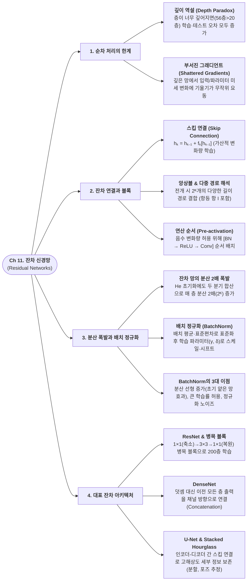

## 🗺️ Chapter 11 한눈에 보기 (Mindmap)

---

## 0. 왜 잔차 신경망(Residual Networks)이 등장했는가?
- Chapter 10에서 합성곱 신경망의 깊이를 8층(AlexNet)에서 19층(VGG)으로 늘렸을 때 이미지 분류 성능이 크게 향상됨을 확인했음.
- 그러나 단순히 층을 더 깊게(예: 20층 $\rightarrow$ 56층) 쌓았더니, 과대적합 때문이 아니라 **학습 데이터와 테스트 데이터 모두에서 오히려 성능이 나빠지는 기이한 현상** 이 발생함 (Figure 11.2).
- 이를 해결하기 위해 각 층이 표현을 직접 변환하는 대신 **현재 표현에 더할 변화량(additive change)만 계산** 하는 **잔차 블록(Residual blocks)** 과, 잔차 연결로 인한 활성화 크기 폭발을 억제하는 **배치 정규화(Batch normalization)** 가 결합되어 수백~수천 층의 초심층 네트워크 학습이 가능해짐.

---

## 11.1 순차 처리의 한계와 부서진 그래디언트 (Limitations of Sequential Processing)

### ① 전통적인 순차 처리 (Sequential Processing, Figure 11.1)
지금까지 다룬 모든 신경망은 이전 층의 출력이 곧바로 다음 층의 입력이 되는 중첩 함수(nested functions) 구조였음:
$$\mathbf{h}_1 = \mathbf{f}_1[\mathbf{x}, \boldsymbol{\phi}_1], \quad \mathbf{h}_2 = \mathbf{f}_2[\mathbf{h}_1, \boldsymbol{\phi}_2], \quad \mathbf{h}_3 = \mathbf{f}_3[\mathbf{h}_2, \boldsymbol{\phi}_3], \quad \mathbf{y} = \mathbf{f}_4[\mathbf{h}_3, \boldsymbol{\phi}_4]$$
$$\Longleftrightarrow \quad \mathbf{y} = \mathbf{f}_4\Big[\mathbf{f}_3\big[\mathbf{f}_2[\mathbf{f}_1[\mathbf{x}, \boldsymbol{\phi}_1], \boldsymbol{\phi}_2], \boldsymbol{\phi}_3\big], \boldsymbol{\phi}_4\Big]$$

### ② 부서진 그래디언트 현상 (Shattered Gradients Phenomenon, Figure 11.3)
- 왜 56층 CNN이 20층 CNN보다 학습 에러조차 더 높을까? (즉, 용량이 더 큰데도 왜 학습 자체가 실패할까?)
- **원인:** He 초기화를 통해 그래디언트의 평균적인 '크기(분산)'를 적당하게 맞추더라도(기울기 소실/폭주 방지), 미분은 무한소($\to 0$) 변화를 가정하는 반면 실제 경사 하강법은 **유한한 보폭(step size $\alpha$)** 으로 이동함.
- 순차 네트워크에서 첫 번째 층 $\mathbf{f}_1$에 대한 출력 $\mathbf{y}$의 미분은 연쇄 법칙에 의해 모든 층의 야코비안 곱으로 주어짐:
  $$\frac{\partial \mathbf{y}}{\partial \mathbf{f}_1} = \frac{\partial \mathbf{f}_4}{\partial \mathbf{f}_3} \frac{\partial \mathbf{f}_3}{\partial \mathbf{f}_2} \frac{\partial \mathbf{f}_2}{\partial \mathbf{f}_1}$$
  - $\mathbf{f}_1$의 파라미터를 조금만 바꿔도 뒤따르는 $\mathbf{f}_2, \mathbf{f}_3, \mathbf{f}_4$가 모두 바뀌므로 우변의 모든 미분 항들이 동시에 연쇄적으로 변함.
  - 그 결과, 층이 깊어질수록(예: 24층) 입력이나 파라미터를 아주 조금만 움직여도 **그래디언트가 전혀 예측할 수 없이 극심하게 요동치며 인접한 위치 간 그래디언트의 자기상관(autocorrelation)이 $0$으로 떨어짐** (Figure 11.3b–c).
  - 이를 **부서진 그래디언트(Shattered gradients)** 현상이라 부르며, 손실 표면이 매끄러운 계곡이 아니라 무수히 많은 미세한 뾰족산들이 솟아 있는 형태가 되어 경사 하강법이 전혀 전진하지 못하게 됨.

---

## 11.2 잔차 연결과 잔차 블록 (Residual Connections and Residual Blocks)

### ① 잔차(스킵) 연결의 정의와 네트워크 전개 (Unraveling, Figure 11.4)
- **잔차 연결 (Residual / Skip Connections):** 각 네트워크 층 $\mathbf{f}_k[\bullet]$를 우회하는 병렬 경로를 만들어, **층의 입력을 그 층의 출력에 다시 그대로 더해주는 구조** (Figure 11.4a):
  $$\mathbf{h}_1 = \mathbf{x} + \mathbf{f}_1[\mathbf{x}, \boldsymbol{\phi}_1]$$
  $$\mathbf{h}_2 = \mathbf{h}_1 + \mathbf{f}_2[\mathbf{h}_1, \boldsymbol{\phi}_2]$$
  $$\mathbf{h}_3 = \mathbf{h}_2 + \mathbf{f}_3[\mathbf{h}_2, \boldsymbol{\phi}_3]$$
  $$\mathbf{y} = \mathbf{h}_3 + \mathbf{f}_4[\mathbf{h}_3, \boldsymbol{\phi}_4]$$
  - 각 함수 $\mathbf{f}_k$는 현재 표현을 통째로 새로 만드는 대신 **현재 표현에 더해질 가산적 변화량(additive change / residual)** 만을 학습함 (단, 덧셈을 위해 입출력 차원이 같아야 함). 이 한 단위를 **잔차 블록(Residual block)** 이라 함.
- **수식 전개 (Unraveling)와 두 가지 해석 (Figure 11.4b):**
  위 식에서 $\mathbf{h}_1, \mathbf{h}_2, \mathbf{h}_3$를 차례로 대입해 하나의 식으로 풀어 쓰면:
  $$\begin{aligned}
  \mathbf{y} &= \mathbf{x} + \mathbf{f}_1[\mathbf{x}] \\
  &\quad + \mathbf{f}_2\big[\mathbf{x} + \mathbf{f}_1[\mathbf{x}]\big] \\
  &\quad + \mathbf{f}_3\Big[\mathbf{x} + \mathbf{f}_1[\mathbf{x}] + \mathbf{f}_2\big[\mathbf{x} + \mathbf{f}_1[\mathbf{x}]\big]\Big] \\
  &\quad + \mathbf{f}_4\Big[\mathbf{x} + \mathbf{f}_1[\mathbf{x}] + \mathbf{f}_2\big[\mathbf{x} + \mathbf{f}_1[\mathbf{x}]\big] + \mathbf{f}_3\big[\mathbf{x} + \mathbf{f}_1[\mathbf{x}] + \mathbf{f}_2[\mathbf{x} + \mathbf{f}_1[\mathbf{x}]]\big]\Big]
  \end{aligned}$$
  1. **작은 네트워크들의 앙상블 (Ensemble) 관점:** 최종 출력 $\mathbf{y}$는 입력 $\mathbf{x}$와 서로 다른 깊이를 가진 4개의 작은 네트워크들의 출력을 모두 더한 **앙상블** 로 볼 수 있음.
  2. **다양한 길이의 다중 경로 (Multiple Paths) 관점:** 입력에서 출력까지 총 **$2^4 = 16$개의 서로 다른 길이의 경로** 가 생성됨 ($K$개의 잔차 블록이 있으면 총 **$2^K$개의 경로** 생성 — Problem 11.2).

### ② 잔차 연결이 부서진 그래디언트를 해결하는 원리
첫 번째 층 $\mathbf{f}_1$은 16개 경로 중 8개 경로에 등장하며, $\mathbf{f}_1$에 대한 출력 $\mathbf{y}$의 미분은 이 8개 경로를 따른 미분들의 합이 됨:
$$\frac{\partial \mathbf{y}}{\partial \mathbf{f}_1} = \mathbf{I} + \frac{\partial \mathbf{f}_2}{\partial \mathbf{f}_1} + \left( \frac{\partial \mathbf{f}_3}{\partial \mathbf{f}_1} + \frac{\partial \mathbf{f}_3}{\partial \mathbf{f}_2}\frac{\partial \mathbf{f}_2}{\partial \mathbf{f}_1} \right) + \left( \frac{\partial \mathbf{f}_4}{\partial \mathbf{f}_1} + \frac{\partial \mathbf{f}_4}{\partial \mathbf{f}_2}\frac{\partial \mathbf{f}_2}{\partial \mathbf{f}_1} + \frac{\partial \mathbf{f}_4}{\partial \mathbf{f}_3}\frac{\partial \mathbf{f}_3}{\partial \mathbf{f}_1} + \frac{\partial \mathbf{f}_4}{\partial \mathbf{f}_3}\frac{\partial \mathbf{f}_3}{\partial \mathbf{f}_2}\frac{\partial \mathbf{f}_2}{\partial \mathbf{f}_1} \right)$$
- 우변의 첫 번째 항인 **항등 행렬 $\mathbf{I}$** 와 짧은 길이의 미분 체인들 덕분에, 첫 번째 층 $\mathbf{f}_1$의 파라미터 변화가 뒤쪽의 모든 층을 거치지 않고도 **출력 $\mathbf{y}$에 직접(또는 짧은 경로로) 전달** 됨!
- 짧은 경로를 통과하는 그래디언트는 매끄럽고 안정적이므로 **부서진 그래디언트(Shattered gradients) 현상이 크게 완화** 됨.

### ③ 잔차 블록 내부의 연산 순서 (Order of Operations, Figure 11.5)
- 일반적인 신경망 층처럼 **[선형 변환(합성곱) $\rightarrow$ ReLU]** 순서로 블록을 구성하면, ReLU의 출력은 항상 $0$ 이상(non-negative)이므로 **각 잔차 블록이 입력에 양수만 더할 수 있어서 값이 증가하기만 하는 문제** 가 발생함 (Figure 11.5a).
- 따라서 잔차 블록에서는 순서를 뒤집어 **[ReLU 활성화 $\rightarrow$ 선형 변환(합성곱)]** 으로 끝나도록 배치하여 양수와 음수 변화량을 모두 더할 수 있게 함 (**Pre-activation 구조**, Figure 11.5b–c).
- 단, 네트워크 맨 처음 입력 $\mathbf{x}$가 모두 음수이면 첫 ReLU에서 신호가 전부 $0$으로 잘려 버리므로, 네트워크의 가장 첫머리에는 잔차 블록이 아닌 **일반 선형 변환(합성곱) 층** 을 하나 배치함.

---

## 11.3 ~ 11.4 잔차 신경망의 분산 폭발과 배치 정규화 (Batch Normalization)

### ① 왜 잔차 신경망에서는 He 초기화를 써도 분산이 폭발하는가? (Figure 11.6a)
- 잔차 연결은 항등 경로 덕분에 기울기 소실(Vanishing gradient)은 원천 차단하지만, 반대로 **순전파 활성화 분산과 역전파 그래디언트가 지수적으로 폭발(Exploding)** 하는 새로운 문제를 일으킴.
- **이유:** 잔차 블록의 입력 $\mathbf{h}_{k-1}$의 분산이 $\sigma^2$일 때, 블록 내부의 함수 $\mathbf{f}_k[\mathbf{h}_{k-1}]$에 He 초기화를 적용하면 그 출력의 분산 역시 $\sigma^2$으로 유지됨.
- 그런데 잔차 블록 끝에서 **두 분기를 다시 더할 때($\mathbf{h}_k = \mathbf{h}_{k-1} + \mathbf{f}_k[\mathbf{h}_{k-1}]$)**, 두 신호는 서로 상관관계가 없으므로(uncorrelated) **합의 분산은 각 분산의 합이 되어 매 블록마다 분산이 정확히 2배($\sigma^2 + \sigma^2 = 2\sigma^2$)가 됨!** (Problem 11.4).
- 결과적으로 $K$개의 잔차 블록을 거치면 분산이 **$2^K$배로 기하급수적 폭발** 을 일으켜 부동소수점 한계를 초과하게 됨.
- *(해결법 1:* 매 블록 끝에서 합산 결과를 $1/\sqrt{2}$배로 스케일링하여 분산을 $1$로 유지할 수도 있으나(Figure 11.6b), 실전에서는 더 많은 이점을 가진 **배치 정규화** 를 주로 사용함).*

### ② 배치 정규화 (Batch Normalization / BatchNorm) 알고리즘
미니배치 $\mathcal{B}$ 내에서 각 은닉 유닛(또는 CNN에서는 각 채널의 모든 배치 및 공간 위치)의 활성화 값 $h_i$의 평균과 표준편차를 구해 표준화한 뒤, 학습 가능한 파라미터로 다시 스케일과 시프트를 적용하는 3단계 연산:

1. **배치 내 경험적 평균($m_h$)과 표준편차($s_h$) 계산:**
   $$m_h = \frac{1}{|\mathcal{B}|} \sum_{i \in \mathcal{B}} h_i, \quad s_h = \sqrt{\frac{1}{|\mathcal{B}|} \sum_{i \in \mathcal{B}} (h_i - m_h)^2}$$
2. **평균 $0$, 분산 $1$로 표준화 (Standardization):**
   $$h_i \longleftarrow \frac{h_i - m_h}{s_h + \epsilon} \quad (\forall i \in \mathcal{B}, \text{ 단 }\epsilon\text{은 }0\text{ 나눗셈 방지 상수})$$
3. **학습 가능한 스케일($\gamma$) 및 오프셋($\delta$) 적용:**
   $$h_i \longleftarrow \gamma h_i + \delta \quad (\forall i \in \mathcal{B})$$
   - 결과적으로 배치 내 활성화 값들은 **평균 $\delta$, 표준편차 $\gamma$** 를 갖게 되며, $\gamma$와 $\delta$는 역전파를 통해 다른 가중치들과 함께 학습됨 (은닉 유닛당 2개, CNN에서는 **채널당 2개** 의 파라미터만 추가됨).
- **테스트(추론) 시의 처리:** 테스트 시에는 단일 샘플만 들어올 수도 있어 배치 통계를 구할 수 없으므로, 학습이 끝난 후 **전체 학습 데이터셋에 대해 계산해 둔 평균 $m_h$와 표준편차 $s_h$를 상수로 고정(frozen)** 하여 사용함.

### ③ 배치 정규화의 비용과 3대 핵심 이점 (Costs and Benefits)
- **비용:** 직전 층의 가중치와 편향을 2배로 키워도 표준화 과정에서 상쇄되므로 파라미터에 중복성(redundancy)이 생기고, 유닛/채널마다 $\gamma, \delta$ 파라미터가 추가됨.
- **3대 핵심 이점:**
  1. **안정적인 순전파 및 유효 깊이 자동 조절 (Figure 11.6c):**
     - 잔차 블록의 **맨 첫 단계** 에 BatchNorm을 배치하고($\delta=0, \gamma=1$ 초기화) 블록 내부에 He 초기화를 쓰면, 입력 분산이 얼마든 상관없이 잔차 분기 $\mathbf{f}_k$의 출력 분산은 항상 **$1$** 이 됨!
     - 따라서 주 경로에 더해질 때 분산이 매 층마다 2배씩($2^K$, 지수적) 커지는 대신 **매 층마다 $1$씩($1 \rightarrow 2 \rightarrow 3 \dots \rightarrow K$, 선형적)만 완만하게 증가** 함.
     - *초기화 시점의 부수 효과:* $k$번째 후반부 층에서는 주 경로의 분산($k$)에 비해 잔차 분기의 분산($1$)이 상대적으로 작아 후반부 층들이 사실상 항등 함수(identity)에 가깝게 작동함 ($\rightarrow$ **학습 초기에는 얕은 네트워크처럼 쉽게 학습을 시작하고, 학습이 진행되면서 후반부 층의 $\gamma$를 키워 네트워크 스스로 유효 깊이를 깊게 확장함**).
  2. **더 큰 학습률 허용 (Higher Learning Rates):** 손실 표면과 그래디언트를 훨씬 매끄럽게 만들어(부서진 그래디언트 완화) 더 큰 학습률로 빠르고 일반화가 잘 되는 학습을 가능하게 함.
  3. **정규화 효과 (Regularization):** 특정 데이터의 정규화 결과가 같은 미니배치에 우연히 함께 뽑힌 다른 데이터들의 통계량($m_h, s_h$)에 따라 매번 미세하게 달라지므로, 활성화 값에 노이즈를 주입하는 정규화 효과를 냄.

---

## 11.5 대표적인 잔차 아키텍처들 (Common Residual Architectures)

### ① ResNet과 병목 잔차 블록 (Bottleneck Residual Block, Figure 11.7 ~ 11.8)
- **표준 ResNet 블록 (Pre-activation / ResNet v2, Figure 11.7a):**
  $$\text{Input} \longrightarrow \big[\text{BatchNorm} \rightarrow \text{ReLU} \rightarrow \text{Conv } 3\times 3\big] \times 2 \longrightarrow (+ \text{ Input})$$
- **병목 잔차 블록 (Bottleneck Residual Block, Figure 11.7b):**
  - 층이 매우 깊어질 때 파라미터와 연산량을 줄이기 위해 3개의 합성곱을 연속 배치함:
    1. **$1 \times 1$ 합성곱:** 채널 수를 줄임 (예: $512 \rightarrow 128$ 채널).
    2. **$3 \times 3$ 합성곱:** 줄어든 낮은 채널 차원($128 \rightarrow 128$)에서 $3 \times 3$ 공간 정보를 가볍게 통합함.
    3. **$1 \times 1$ 합성곱:** 원래 입력과 더할 수 있도록 채널 수를 다시 원래대로 복원함 ($128 \rightarrow 512$ 채널).
  - *(예: 512채널에서 $3 \times 3$ 합성곱 1개만 써도 약 236만 개 파라미터가 필요하지만, $512 \to 128 \to 128 \to 512$ 병목 블록은 합성곱 3개를 합쳐도 약 **28만 개** 로 파라미터가 $1/8$ 이하로 줄어듦 — Problem 11.8).*
- **ResNet-200 (Figure 11.8):** 200개 층을 쌓아 ImageNet Top-5 에러율을 **$4.8\%$** 까지 낮추며 인간 수준($5.1\%$)을 돌파함 (주기적으로 Stride 2 합성곱으로 해상도를 줄이고 $1 \times 1$ 합성곱이나 제로 패딩으로 채널을 늘리며, 마지막에는 거대한 FC 층 대신 **전역 평균 풀링 Global Average Pooling** 후 단일 FC 층만 사용).

### ② DenseNet (Figure 11.9)
- 잔차 블록처럼 변환된 신호를 원본 입력에 **더하는(Addition)** 대신, 채널 방향으로 **연결(Concatenation)** 하는 아키텍처.
- 각 층은 **이전에 등장한 모든 층들의 출력을 전부 이어 붙인 텐서** 를 입력으로 받아 새 특징(예: 32채널)을 만든 뒤 다시 기존 텐서에 이어 붙임 ($3 \rightarrow 35 \rightarrow 67 \rightarrow 99$ 채널...).
- 모든 이전 층의 특징을 유연하게 재사용할 수 있어 비슷한 파라미터 수로 ResNet과 대등하거나 더 나은 성능을 내며, 채널 수가 너무 커지는 것을 막기 위해 $3 \times 3$ 합성곱 전에 **$1 \times 1$ 병목 합성곱** 으로 채널을 줄이고 다운샘플링 시점마다 연결 체인을 새로 시작함.

### ③ U-Net과 스택형 모래시계 네트워크 (U-Nets & Stacked Hourglass Networks, Figure 11.10 ~ 11.12)
- **기존 인코더-디코더(Ch 10)의 한계:** 한가운데의 저해상도 병목 층이 원본 이미지의 고해상도 세부 경계 정보까지 모두 기억해야 해서 정밀한 픽셀 분할이 어려움.
- **U-Net (Ronneberger et al., 2015 — Figure 11.10):**
  - 인코더(다운샘플링 경로)의 각 해상도 단계에서 마지막 표현을 **장거리 잔차(스킵) 연결** 을 통해 디코더(업샘플링 경로)의 동일한 해상도 단계로 직접 넘겨주어 **연결(Concatenation)** 함.
  - 이를 통해 인코더는 전역적인 문맥(무엇이 있는가) 파악에 집중하고, 고해상도의 세밀한 위치 정보(어디에 있는가)는 스킵 연결로 직접 전달받아 의료 영상 분할(3D 전자현미경 세포 분할 등)과 이미지 변환, **확산 모델(Diffusion Models, Ch 18)** 의 핵심 백본으로 쓰임.
  - 완전 연결(FC) 층이 전혀 없는 **완전 합성곱 네트워크(Fully Convolutional Network)** 이므로 학습 후 **임의 크기의 이미지** 에도 그대로 실행할 수 있음.
- **스택형 모래시계 네트워크 (Stacked Hourglass Network, Figure 11.12):**
  - U-Net과 유사한 인코더-디코더(모래시계) 블록을 여러 개 직렬로 쌓고, 스킵 연결 내부에도 추가적인 잔차 블록 연산을 수행한 뒤 디코더에 연결 대신 **덧셈(Addition)** 으로 결합함.
  - 국소(Local) 정보와 전역(Global) 정보의 통합을 여러 번 반복하여 인체 관절 위치마다 가우시안 피크를 갖는 **히트맵(Heatmap)을 회귀 예측** 하는 **인체 포즈 추정(Human Pose Estimation)** 에 널리 사용됨.

---

## 11.6 잔차 연결 네트워크는 왜 그렇게 잘 작동하는가? (Why Do Residual Nets Perform So Well?)
처음에는 단순히 "네트워크를 1,000층까지 깊게 쌓을 수 있게 해 주었기 때문"이라고 생각했으나, 두 가지 반증이 발견됨:
1. 비슷한 파라미터 수일 때 깊고 좁은 ResNet보다 층 수는 적고 채널이 넓은 **Wide ResNet(예: 16층)** 이 더 뛰어난 성능을 내는 경우가 많음.
2. 전개된 다중 경로 그래프(Figure 11.4b)에서 실제 학습 중 그래디언트가 흐르는 경로를 분석해 보면(Veit et al., 2016), 매우 긴 경로에서는 여전히 그래디언트가 소실되며 **전체 그래디언트 업데이트의 거의 전부가 5~17블록 길이의 비교적 짧은 경로들(전체 경로의 $0.45\%$)에서 발생** 함. 즉, 깊은 ResNet은 진짜로 깊은 단일 체인이 아니라 **수많은 얕은 네트워크들의 병렬 앙상블** 처럼 작동함.
- **현대의 결론 (Figure 11.13):** 잔차 연결의 가장 본질적인 가치는 깊이를 늘려주는 것 자체뿐만 아니라, 스킵 연결이 없을 때의 험준하고 불규칙한 손실 표면을 **최솟값 주변에서 훨씬 매끄럽고 완만한 그릇 모양의 손실 표면(Smoother loss surface)으로 바꾸어 주어** 최적화가 잘 되고 파라미터 미세 오차에 강건한(일반화가 잘 되는) 해를 찾게 해 주는 데 있음!

---

## 11.7 참고 노트 (Notes) 및 연습문제 핵심 포인트

### ① 다양한 정규화(Normalization) 기법 총정리 (Figure 11.14)
배치 정규화(BatchNorm)는 배치 크기가 너무 작거나(통계 불안정), 순환 신경망(RNN, 시퀀스 길이 가변), 대규모 분산 학습(전체 배치 공유 어려움)에서 한계가 있어 다양한 변형이 개발됨 (단, 모든 기법에서 학습 파라미터 $\gamma, \delta$는 채널별로 존재함):
| 정규화 기법 | 평균($m_h$)과 표준편차($s_h$)를 계산하는 범위 | 주요 특징 및 활용처 |
| :--- | :--- | :--- |
| **BatchNorm** | **배치 전체 $\times$ 공간 위치 $(H \times W)$** (채널별 독립) | CNN의 표준. 배치 통계 변동으로 인한 정규화 효과 보유 |
| **Ghost BatchNorm** | **배치의 일부 부분집합** $\times$ 공간 위치 | 대용량 배치 학습 시 의도적으로 노이즈(정규화 효과)를 높임 |
| **LayerNorm** | 개별 데이터 샘플 내에서 **모든 채널 $\times$ 공간 위치** | 배치 크기에 무관함. **트랜스포머(Ch 12)** 와 RNN의 표준 |
| **GroupNorm** | 개별 데이터 샘플 내에서 **채널 그룹 $\times$ 공간 위치** | 배치 크기가 매우 작은 비전 태스크(객체 탐지/분할)에서 강건함 |
| **InstanceNorm** | 개별 데이터 샘플의 **각 단일 채널 내 공간 위치** 만 | 스타일 변환(Style transfer) 등 개별 이미지 대비 정규화에 활용 |

### ② 왜 BatchNorm이 효과적인가에 대한 진실 (Internal Covariate Shift 논쟁)
- 원래 BatchNorm 논문(Ioffe & Szegedy, 2015)은 앞쪽 층이 업데이트될 때 뒤쪽 층 입력의 분포가 흔들리는 **내부 공변량 이동(Internal Covariate Shift)** 을 줄여주기 때문이라고 주장했음.
- 그러나 **Santurkar et al. (2018)** 이 BatchNorm 이후에 인위적으로 심한 공변량 이동 노이즈를 주입해도 성능이 여전히 뛰어난 것을 실험으로 보이며 이 가설을 반박함. 진짜 이유는 BatchNorm이 **손실 함수와 그래디언트의 립시츠 상수(변화율)를 줄여 손실 표면을 훨씬 매끄럽게 만들고**, 가중치 행렬의 스케일에 불변성을 부여해 큰 학습률과 빠른 수렴을 가능하게 하기 때문임.

### ③ BatchNorm 없이 깊은 ResNet을 학습시키는 초기화 기법들
- **SkipInit (De & Smith, 2020) / Stable ResNet:** 각 잔차 분기 끝에 학습 가능한 스칼라 곱셈 계수 $\alpha$를 두고 이를 $0$ 또는 $\sqrt{1/K}$ 미만으로 작게 초기화함.
- **FixUp (Zhang et al., 2019):** 모든 층에 He 초기화를 쓰되, **각 잔차 블록의 마지막 선형/합성곱 층 가중치를 $0$으로 초기화** 하여 학습 시작 시점에는 모든 잔차 블록이 $0$을 출력(전체 네트워크가 완전한 항등 함수)하게 만들어 BatchNorm 없이도 분산 폭발을 막음.

### ④ 잔차 신경망 전용 드롭아웃 변형
- **Stochastic Depth / ResDrop / RandomDrop:** 개별 은닉 유닛을 끄는 대신, 학습 중 무작위로 **잔차 블록 전체를 통째로 건너뛰어(drop)** 다중 경로 중 일부를 제거하는 정규화 기법.
- **Shake-Shake / ShakeDrop:** 잔차 블록 내 여러 병렬 분기들의 결합 가중치를 순전파와 역전파 때마다 무작위로 다르게 흔들어 노이즈를 주입하는 기법.

### ⑤ 주요 연습문제 (Problems) 포인트
- **Problem 11.2 ($K$개의 잔차 블록이 만드는 경로의 수):** 각 블록마다 주 경로(길이 $+0$) 또는 잔차 함수 분기(길이 $+1$) 중 하나를 선택하므로, 길이가 $k$개 층인 경로의 개수는 이항 계수 **$\binom{K}{k}$** 개이며 전체 경로의 총합은 **$\sum_{k=0}^K \binom{K}{k} = 2^K$개** 임.
- **Problem 11.7 (BatchNorm 직전 합성곱 가중치에 $L_2$ 정규화를 적용할 때의 현상):** BatchNorm은 입력의 스케일 변화에 완전히 불변(invariant)이므로, 직전 합성곱 가중치 $\boldsymbol{\Omega}$에 $L_2$ 페널티(가중치 감쇠)를 걸면 네트워크의 실제 출력 함수는 전혀 변하지 않으면서 가중치 $\boldsymbol{\Omega}$의 크기만 계속 작아짐! (단, 가중치가 작아질수록 상대적으로 유효 학습률이 커지는 부수 효과가 나타남).
- **Problem 11.9 (왜 U-Net은 임의 크기 이미지로 추론할 수 있는데 학습할 때는 같은 크기로 잘라서 쓰는가?):** GPU에서 여러 이미지를 **하나의 4D 미니배치 텐서(`Batch × Channel × Height × Width`)로 묶어 병렬 연산** 을 수행하려면 배치 내 모든 이미지의 가로·세로 크기가 동일해야 하기 때문임.
