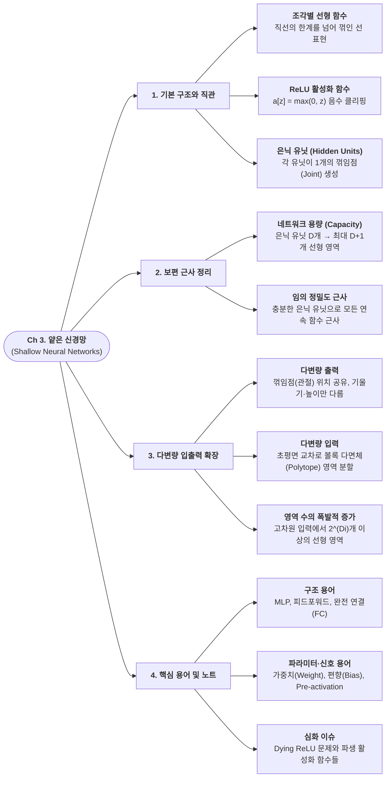

## 🗺️ Chapter 3 한눈에 보기 (Mindmap)

---

## 0. 왜 얕은 신경망(Shallow Neural Networks)인가?
- **선형 회귀의 한계:** Chapter 2의 선형 회귀 모델은 입출력 관계를 오직 '직선(평면)'으로만 묘사할 수 있음.
- **얕은 신경망의 역할:** 하나의 은닉층(hidden layer)을 도입하여 **조각별 선형 함수(piecewise linear functions)**를 표현하며, 다차원 입출력 사이의 임의로 복잡한 비선형 관계까지 근사할 수 있음.

---

## 3.1 신경망 예제와 작동 직관 (Neural Network Example & Intuition)

### ① 1D 입출력 신경망 수식 (은닉 유닛 3개)
스칼라 입력 $x$를 받아 스칼라 출력 $y$를 예측하고, 10개의 파라미터 $\boldsymbol{\phi} = \{\phi_0, \phi_1, \phi_2, \phi_3, \theta_{10}, \theta_{11}, \theta_{20}, \theta_{21}, \theta_{30}, \theta_{31}\}$를 갖는 신경망:
$$y = f[x, \boldsymbol{\phi}] = \phi_0 + \phi_1 a[\theta_{10} + \theta_{11}x] + \phi_2 a[\theta_{20} + \theta_{21}x] + \phi_3 a[\theta_{30} + \theta_{31}x]$$

- **계산의 3단계 흐름:**
  1. 입력 데이터에 대해 3개의 선형 함수($\theta_{10} + \theta_{11}x$, $\theta_{20} + \theta_{21}x$, $\theta_{30} + \theta_{31}x$)를 계산함.
  2. 세 결과를 비선형 **활성화 함수(Activation function)** $a[\bullet]$에 통과시킴.
  3. 활성화된 세 결과에 가중치 $\phi_1, \phi_2, \phi_3$를 곱해 더한 뒤, 전체 높이 오프셋(절편) $\phi_0$를 더함.

### ② ReLU 활성화 함수 (Rectified Linear Unit)
가장 널리 쓰이고 이해하기 쉬운 활성화 함수로, 입력이 양수면 그대로 반환하고 음수면 $0$으로 잘라냄(clipping):
$$a[z] = \text{ReLU}[z] = \begin{cases} 0 & z < 0 \\ z & z \ge 0 \end{cases}$$

### ③ 조각별 선형 함수가 만들어지는 원리 (Figure 3.3)
위 수식을 두 단계로 나누어 중간 변수인 **은닉 유닛(Hidden units, $h_1, h_2, h_3$)**을 정의하면 직관적으로 이해할 수 있음:
1. **은닉 유닛 계산:**
   $$h_1 = a[\theta_{10} + \theta_{11}x], \quad h_2 = a[\theta_{20} + \theta_{21}x], \quad h_3 = a[\theta_{30} + \theta_{31}x]$$
   - 각 선형 직선이 $0$과 교차하는 지점에서 ReLU에 의해 꺾이면서 최종 출력 함수에 **꺾임점(관절, Joint)**을 하나씩 만듦.
   - 값이 $0$으로 잘린 구간에서는 해당 유닛이 **비활성(inactive)** 상태이고, 양수인 구간에서는 **활성(active)** 상태가 됨.
2. **출력 결합:**
   $$y = \phi_0 + \phi_1 h_1 + \phi_2 h_2 + \phi_3 h_3$$
   - 꺾인 직선들에 $\phi_\bullet$를 곱해 스케일을 조절(뒤집기 포함)하고 모두 더하면, 최대 **3개의 꺾임점(joints)**과 **4개의 선형 영역(linear regions)**을 가진 연속적인 조각별 선형 함수가 완성됨.
   - **각 선형 영역의 특징:** 각 영역은 어떤 은닉 유닛들이 활성화되었는지(**활성화 패턴, activation pattern**)에 대응함. 예를 들어 $h_1, h_3$만 활성화된 영역의 기울기는 $\theta_{11}\phi_1 + \theta_{31}\phi_3$가 됨.
   - *(주의: 은닉 유닛 3개로 4개의 선형 영역이 생기지만, 독립적인 기울기는 3개뿐이며 나머지 1개 영역의 기울기는 $0$이거나 다른 영역 기울기들의 합으로 종속됨.)*

---

## 3.2 보편 근사 정리 (Universal Approximation Theorem)
- **일반화 ($D$개의 은닉 유닛):**
  $$h_d = a[\theta_{d0} + \theta_{d1}x], \quad y = \phi_0 + \sum_{d=1}^{D} \phi_d h_d$$
- **네트워크 용량 (Capacity):** 얕은 신경망에서 은닉 유닛의 개수 $D$는 모델의 표현 능력(용량)을 나타내는 척도임.
  - ReLU 사용 시 $D$개의 은닉 유닛은 최대 $D$개의 꺾임점(joints)과 최대 **$D + 1$개의 선형 영역**을 생성함.
- **보편 근사 정리 (Universal Approximation Theorem):**
  - 은닉 유닛을 추가할수록 선형 구간이 더 잘게 쪼개져 복잡한 곡선을 정교하게 따라갈 수 있음 (Figure 3.5).
  - **핵심 내용:** 충분한 수의 은닉 유닛(용량)이 주어진다면, 단 하나의 은닉층을 가진 얕은 신경망만으로도 실수 공간의 유계 닫힌 집합(compact subset of $\mathbb{R}^{D_i}$) 위에서 정의된 **그 어떤 연속 함수라도 원하는 임의의 정밀도(arbitrary precision)로 근사할 수 있음**이 수학적으로 증명되어 있음.

---

## 3.3 다변량 입력과 출력 (Multivariate Inputs and Outputs)

### ① 다변량 출력 (Multivariate Outputs)
- 하나의 스칼라 입력 $x$와 $D$개의 은닉 유닛으로 여러 개의 출력 $\mathbf{y} = [y_1, y_2, \dots, y_{D_o}]^T$를 예측할 때:
  - 은닉 유닛 $h_1, \dots, h_D$는 모든 출력이 **공유**하고, 각 출력 $y_j$마다 서로 다른 선형 결합 가중치($\phi_{j0}, \phi_{jd}$)를 사용함.
- **기하학적 의미 (Figure 3.6):** 꺾임점(joints)은 은닉 유닛에서 ReLU가 클리핑되는 위치에서 결정되므로, **모든 출력 함수 $y_1[x], y_2[x]$의 꺾임점 $x$좌표 위치는 동일하게 고정**되며 각 구간의 기울기와 높이만 서로 달라짐.

### ② 다변량 입력 (Multivariate Inputs)
- 입력이 다차원 벡터 $\mathbf{x} = [x_1, x_2, \dots, x_{D_i}]^T$인 경우 (예: 2차원 입력 $x_1, x_2$):
  $$h_d = a[\theta_{d0} + \theta_{d1}x_1 + \theta_{d2}x_2]$$
- **기하학적 의미 (Figure 3.8):**
  - 2차원 입력 공간에서 각 은닉 유닛의 선형 함수는 기울어진 **평면(oriented plane)**을 형성함.
  - ReLU 함수는 이 평면이 $0$보다 작은 영역을 평평하게 잘라내며, 평면이 $0$과 만나는 경계선(접히는 선)이 1차원의 '꺾임점' 역할을 함.
  - 잘린 평면들을 가중합하면 입력 공간을 여러 개의 **볼록 다각형(convex polygonal regions)**으로 나누는 연속적인 조각별 선형 곡면(surface)이 만들어짐.
- **고차원 일반화 ($D_i > 2$):**
  - 각 은닉 유닛은 $D_i$차원 입력 공간에서 활성 영역과 비활성 영역을 가르는 **초평면(Hyperplane)** 하나를 정의함.
  - 이 초평면들의 교차에 의해 입력 공간은 수많은 **볼록 다면체(Convex polytopes)** 영역으로 분할되며, 각 다면체 영역마다 고유한 선형 함수가 할당됨.
- **선형 영역 개수의 폭발적 증가 (Figure 3.9, 3.10):**
  - 입력 차원이 $D_i$일 때, 좌표축에 정렬된 은닉 유닛 $D_i$개만 있어도 공간을 $2^{D_i}$개의 사분면/팔분면(orthants)으로 나눔.
  - 일반적으로 은닉 유닛 수 $D > D_i$이므로 생성되는 선형 영역의 수는 $2^{D_i}$개보다 훨씬 많아짐 (예: 입력 차원 $D_i=100$, 은닉 유닛 $D=500$개인 작은 신경망도 최대 $10^{107}$개 이상의 선형 영역을 만들 수 있음).

---

## 3.4 얕은 신경망의 일반식 (General Case)
입력 $\mathbf{x} \in \mathbb{R}^{D_i}$를 받아 $D$개의 은닉 유닛 $\mathbf{h} \in \mathbb{R}^D$를 거쳐 출력 $\mathbf{y} \in \mathbb{R}^{D_o}$를 계산하는 일반적인 얕은 신경망 방정식:

1. **은닉 유닛 계산 ($d = 1, \dots, D$):**
   $$h_d = a\left[ \theta_{d0} + \sum_{i=1}^{D_i} \theta_{di} x_i \right]$$
2. **출력 계산 ($j = 1, \dots, D_o$):**
   $$y_j = \phi_{j0} + \sum_{d=1}^{D} \phi_{jd} h_d$$

- **비선형 활성화 함수의 필수성:** 만약 활성화 함수 $a[\bullet]$가 없거나 선형 함수라면, 두 선형 함수의 합성 역시 단순한 선형 함수($\mathbf{y} = \mathbf{A}\mathbf{x} + \mathbf{b}$)로 축약되어 신경망을 쌓는 의미가 사라짐.

---

## 3.5 신경망 핵심 용어 정리 (Terminology)
- **층 (Layers):** 입력층(Input layer), 은닉층(Hidden layer), 출력층(Output layer)으로 구성.
  - **얕은 신경망 (Shallow Neural Network):** 은닉층이 **1개**인 신경망.
  - **심층 신경망 (Deep Neural Network):** 은닉층이 **2개 이상(여러 개)**인 신경망.
  - **다층 퍼셉트론 (Multi-Layer Perceptron, MLP):** 역사적 이유로 최소 1개 이상의 은닉층을 가진 신경망을 통칭하는 용어.
- **뉴런 (Neurons):** 은닉층 내부의 개별 은닉 유닛(hidden units)을 부르는 다른 이름.
- **활성화 전/후 값:**
  - **활성화 전 값 (Pre-activations):** 활성화 함수(ReLU 등)가 적용되기 직전, 은닉 유닛으로 들어가는 선형 계산 값.
  - **활성화 값 (Activations):** 활성화 함수가 적용된 후 은닉 유닛이 출력하는 값.
- **연결 구조:**
  - **피드포워드 네트워크 (Feed-forward network):** 연결 그래프에 루프(순환)가 없이 입력에서 출력 방향으로만 계산이 흐르는(acyclic graph) 신경망.
  - **완전 연결 네트워크 (Fully connected network, FC):** 한 층의 모든 변수가 다음 층의 모든 변수와 빠짐없이 연결된 구조.
- **파라미터 명칭:**
  - **가중치 (Weights):** 변수 간 연결 화살표에 해당하는 **기울기(slope)** 파라미터들 ($\theta_{di}, \phi_{jd}$).
  - **편향 (Biases):** 각 유닛에 더해지는 **절편/오프셋(offset/intercept)** 파라미터들 ($\theta_{d0}, \phi_{j0}$).

---

## 3.6 참고 노트 (Notes) 및 심화 개념

### ① 왜 '신경망(Neural Network)'이라 부르는가?
- 노드들이 촘촘하게 연결된 모습이 포유류 뇌의 뉴런 연결망과 겉보기에 비슷하여 붙여진 이름일 뿐, 실제 뇌의 연산 방식과 같다는 증거는 거의 없음. 앞으로 딥러닝을 공부할 때는 생물학적 비유를 잊고 **순수한 수학 함수**로 바라보는 것이 훨씬 유익함.

### ② 신경망의 간략한 역사
- **McCulloch & Pitts (1943):** 최초의 인공 뉴런 개념 제안 (학습 알고리즘 부재).
- **Rosenblatt (1958):** 입력의 선형 결합 후 임계값으로 예/아니오를 결정하는 **퍼셉트론(Perceptron)** 및 가중치 학습 알고리즘 개발.
- **Minsky & Papert (1969):** 단일 선형 함수의 한계를 지적하고 비선형 은닉층의 필요성(MLP)을 언급했으나, 당시 알고리즘으로는 다층 구조 학습이 불가능하다고 결론지음.
- **1980년대 중반:** **역전파(Backpropagation, Ch 7)** 알고리즘이 정립되면서 다층 신경망 학습이 본격화됨.

### ③ 죽은 ReLU 문제 (Dying ReLU Problem)와 대안 활성화 함수들 (Figure 3.13)
- **ReLU의 장점:** 초기 신경망에서 쓰던 Sigmoid나 $\tanh$ 함수는 입력의 절댓값이 커지면 기울기가 $0$에 수렴하는 **포화(Saturation)** 현상이 발생해 학습이 느렸던 반면, ReLU는 양수 구간($z > 0$)에서 미분값(기울기)이 항상 $1$이어서 학습 안정성과 효율성이 매우 뛰어남.
- **죽은 ReLU 문제 (Dying ReLU):** 음수 구간($z < 0$)에서는 ReLU의 기울기가 완전히 $0$이 됨. 만약 모든 학습 데이터에 대해 특정 은닉 유닛의 입력이 음수가 되면, 경사 하강법의 기울기가 평평해져 해당 유닛으로 들어오는 가중치가 영원히 업데이트되지 못하고 죽어버리는 현상.
- **다양한 대안 활성화 함수:**
  - **Leaky ReLU / Parametric ReLU (PReLU):** 음수 구간에도 아주 작은 기울기(예: $0.1$ 또는 학습 가능한 파라미터)를 부여하여 기울기가 $0$이 되는 것을 방지.
  - **부드러운(Smooth) 함수 계열:** SoftPlus, **GELU**(Gaussian Error Linear Unit), **SiLU / Swish**($x / (1 + e^{-\beta x})$), **ELU / SELU**, 계산 속도를 높인 **HardSwish** 등.
  - 특정 상황에서 소폭의 성능 향상이 있으나, 이 책에서는 선형 영역의 개수로 함수를 명확히 분석할 수 있는 기본 **ReLU**를 중심으로 설명함.

### ④ 선형 영역의 최대 개수 (Zaslavsky's Theorem)
- $D_i$차원 입력 공간에서 $D$개의 은닉 유닛(초평면 $D$개)이 교차하여 만들 수 있는 최대 선형 영역의 개수는 이항 계수의 합으로 주어짐:
  $$\text{최대 영역 수} = \sum_{j=0}^{D_i} \binom{D}{j}$$
- 일반적으로 $D \ge D_i$인 얕은 신경망은 $2^{D_i}$개에서 $2^D$개 사이의 선형 영역을 생성함.

### ⑤ 선형(Linear) vs 아핀(Affine) 함수
- 수학적으로 엄밀한 **선형 변환**은 중첩의 원리($f[a+b]=f[a]+f[b]$, $f[2a]=2f[a]$)를 만족해야 하므로 절편(bias)이 없는 $\phi_1 h_1 + \phi_2 h_2$ 형태만을 의미하며, 절편 $\phi_0$가 더해진 $\phi_0 + \phi_1 h_1 + \dots$는 **아핀 함수(Affine function)**라고 부르는 것이 정확함.
- 하지만 머신러닝 분야에서는 관례적으로 아핀 함수도 모두 '선형 함수(Linear function)'라고 통칭함.

---

## 3.7 주요 연습문제 (Problems) 핵심 포인트
- **Problem 3.1 (선형 활성화 함수의 무의미성):** 활성화 함수가 선형($a[z] = \psi_0 + \psi_1 z$)이거나 항등 함수($a[z] = z$)이면, 전체 신경망 수식을 전개했을 때 결국 단일 직선 방정식 $y = \alpha_0 + \alpha_1 x$로 정리되어 은닉층의 효과가 완전히 사라짐.
- **Problem 3.5 ~ 3.7 (ReLU의 양의 동차성과 비유일성):**
  - 양수 $\alpha > 0$에 대해 $\text{ReLU}[\alpha z] = \alpha \cdot \text{ReLU}[z]$가 성립함 (**Non-negative homogeneity**).
  - 따라서 은닉 유닛으로 들어가는 가중치/편향($\theta_{10}, \theta_{11}$)에 양수 $\alpha$를 곱하고, 나가는 가중치($\phi_1$)를 $\alpha$로 나누어도 신경망의 출력 함수는 **완전히 동일함**.
  - 즉, 신경망의 손실 함수는 **유일한 최솟값(unique minimum)을 갖지 않으며**, 동일한 최적 함수를 만드는 무수히 많은 파라미터 조합이 존재함.
- **Problem 3.11 ~ 3.12 (파라미터 개수 세기 공식):**
  - 입력 차원 $D_i$, 은닉 유닛 $D$, 출력 차원 $D_o$인 완전 연결 얕은 신경망의 총 파라미터 개수:
    $$\text{총 파라미터 수} = \underbrace{(D_i \times D + D)}_{\text{은닉층 가중치 + 편향}} + \underbrace{(D \times D_o + D_o)}_{\text{출력층 가중치 + 편향}}$$
