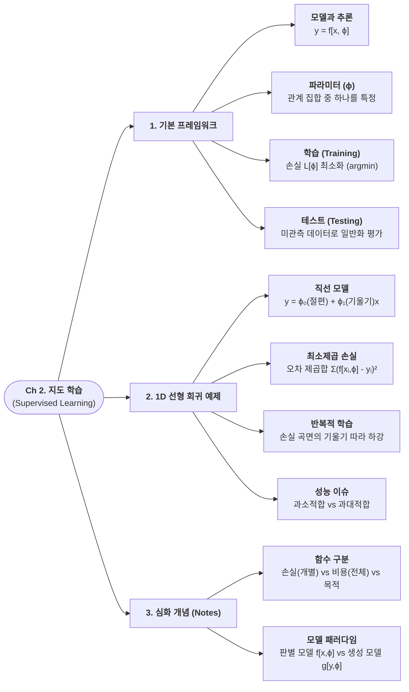

## 🗺️ Chapter 2 한눈에 보기 (Mindmap)

---

## 0. 지도 학습(Supervised Learning)의 핵심 개념
- **정의:** 하나 이상의 입력($\mathbf{x}$)을 하나 이상의 출력($\mathbf{y}$)으로 매핑(mapping)하는 수학적 방정식(모델)을 정의하고 학습하는 방법론.
  - *예시:* 중고차(토요타 프리우스)의 '연식'과 '주행거리'를 입력받아 '예상 가격(달러)'을 출력.
- **추론 (Inference):** 입력 데이터를 모델 방정식에 통과시켜 출력 예측값을 계산하는 과정.
- **파라미터 (Parameters, $\boldsymbol{\phi}$):** 모델 방정식 내부에 포함된 변수들.
  - 모델 방정식 자체는 입출력 간의 **가능한 관계들의 집합(family of possible relationships)** 을 정의하며, 파라미터의 값이 그중 **특정한 하나의 관계(particular relationship)** 를 결정함.
- **학습 (Training / Learning):** 입출력 쌍으로 이루어진 학습 데이터셋(training set)을 사용하여, 입력이 실제 정답 출력에 최대한 가깝게 예측되도록 최적의 파라미터를 찾아내는 과정.

---

## 2.1 지도 학습 개요 (Supervised Learning Overview)

### ① 모델과 추론의 수학적 표기
- 입력 $\mathbf{x}$와 출력 $\mathbf{y}$를 고정된 크기와 정해진 순서를 가진 벡터(정형/테이블 데이터, structured or tabular data)라고 가정할 때, 모델 $f[\bullet]$는 다음과 같이 표현됨:
  $$\mathbf{y} = f[\mathbf{x}]$$
- 모델의 구체적인 입출력 관계를 결정하는 **파라미터 $\boldsymbol{\phi}$** 를 명시하면 다음과 같이 표기함:
  $$\mathbf{y} = f[\mathbf{x}, \boldsymbol{\phi}]$$

### ② 학습 데이터와 손실 함수 (Loss Function)
- **학습 데이터셋 (Training Dataset):** $I$개의 입출력 예제 쌍 $\{\mathbf{x}_i, \mathbf{y}_i\}_{i=1}^I$로 구성됨.
- **손실 (Loss, $L$):** 현재 파라미터 $\boldsymbol{\phi}$로 모델이 학습 데이터의 정답($\mathbf{y}_i$)을 얼마나 ** 못 맞추는지(불일치 정도, degree of mismatch)**를 하나의 스칼라(단일 숫자) 값으로 요약한 지표.
- **모델 학습의 목표:** 손실 함수 $L[\boldsymbol{\phi}]$를 최소화하는 최적의 파라미터 $\hat{\boldsymbol{\phi}}$를 찾는 것:
  $$\hat{\boldsymbol{\phi}} = \underset{\boldsymbol{\phi}}{\text{argmin}} \big[ L[\boldsymbol{\phi}] \big]$$
  - 손실 $L$이 충분히 작아졌다면, 학습 입력 $\mathbf{x}_i$로부터 정답 출력 $\mathbf{y}_i$를 정확하게 예측하는 파라미터를 찾았다는 의미임.

### ③ 일반화와 테스트 (Generalization & Testing)
- 학습이 끝난 후에는 학습 과정에서 **보지 못했던 별도의 테스트 데이터(test data)** 에 모델을 실행하여 성능을 평가함.
- 새로운 데이터에 대해서도 예측이 얼마나 잘 들어맞는지를 **일반화(Generalization)** 능력이라고 하며, 성능이 충분할 때 실제 환경에 배포(deploy)함.

---

## 2.2 선형 회귀 예제 (Linear Regression Example)
지도 학습의 핵심 요소(모델, 손실 함수, 학습, 테스트)를 가장 직관적으로 보여주는 1차원 선형 회귀 예제.

### ① 1D 선형 회귀 모델 (1D Linear Regression Model)
- 단일 스칼라 입력 $x$와 단일 스칼라 출력 $y$ 사이의 관계를 **직선(straight line)** 으로 묘사하는 모델:
  $$y = f[x, \boldsymbol{\phi}] = \phi_0 + \phi_1 x$$
- **파라미터 구성:** $\boldsymbol{\phi} = [\phi_0, \phi_1]^T$
  - $\phi_0$: $y$절편 (y-intercept)
  - $\phi_1$: 직선의 기울기 (slope)
- 모델 방정식 $\phi_0 + \phi_1 x$는 '모든 가능한 직선들의 집합'을 정의하며, $\phi_0$와 $\phi_1$의 선택이 특정 직선 하나를 결정함 (Figure 2.1).

### ② 손실 함수: 최소제곱 손실 (Least-Squares Loss)
- $I$개의 학습 데이터 쌍 $\{x_i, y_i\}$가 주어졌을 때, 각 데이터 포인트에서의 오차(deviation)는 모델의 예측값 $f[x_i, \boldsymbol{\phi}]$와 실제 정답 $y_i$ 사이의 차이임.
- 전체 불일치 정도(Loss)를 모든 데이터 포인트의 **오차 제곱합(sum of squares of deviations)** 으로 정의함:
  $$L[\boldsymbol{\phi}] = \sum_{i=1}^{I} (f[x_i, \boldsymbol{\phi}] - y_i)^2 = \sum_{i=1}^{I} (\phi_0 + \phi_1 x_i - y_i)^2$$
- **제곱을 하는 이유:** 오차의 방향(직선이 데이터보다 위에 있는지 아래에 있는지, 즉 부호 $+$/$-$)을 무시하고 크기만 반영하기 위함 (이론적 배경은 Chapter 5에서 최대우도추정과 연결됨).
- **최적 파라미터 탐색:** 이 수식을 최소화하므로 ** 최소제곱 손실(Least-squares loss)**이라 부르며, 학습 목표는 다음과 같음:
  $$\hat{\boldsymbol{\phi}} = \underset{\boldsymbol{\phi}}{\text{argmin}} \left[ \sum_{i=1}^{I} (\phi_0 + \phi_1 x_i - y_i)^2 \right]$$
- **손실 표면 (Loss Surface):** 파라미터가 $\phi_0, \phi_1$ 두 개뿐이므로 모든 조합에 대해 손실 $L[\boldsymbol{\phi}]$를 계산하면 3차원 곡면(surface)이나 등고선 히트맵(heatmap)으로 시각화할 수 있으며, 이 곡면의 ** 가장 낮은 지점(minimum)**이 최적의 파라미터임 (Figure 2.3).

### ③ 학습 (Training / Model Fitting)
- 손실 함수를 최소화하는 파라미터를 찾는 과정.
- **반복적 최적화 (Iterative Method - 경사 하강법의 직관):**
  1. 초기 파라미터 $\boldsymbol{\phi} = [\phi_0, \phi_1]^T$를 무작위로 선택함.
  2. 현재 위치에서 손실 곡면의 **기울기(gradient)** 를 측정하여 가장 가파르게 내려가는 방향(steepest downhill)을 찾음.
  3. 그 방향으로 일정 보폭(step)만큼 이동함.
  4. 기울기가 평평해져(flat) 더 이상 손실을 줄일 수 없을 때까지(바닥에 도달할 때까지) 2~3 과정을 반복함 (Figure 2.4).
  - *(참고: 선형 회귀는 미분값을 0으로 두어 한 번에 해를 구하는 닫힌 형태(closed-form)의 해가 존재하지만, 신경망처럼 복잡하고 파라미터가 많은 모델은 닫힌 해가 없으므로 이러한 반복적 하강 방식을 사용함.)*

### ④ 테스트와 과소적합/과대적합 (Testing, Underfitting & Overfitting)
- 학습된 모델이 실제 세계에서 얼마나 잘 작동하는지 확인하기 위해 별도의 **테스트 데이터(Test data)** 에서 손실을 계산함.
- 일반화 성능을 좌우하는 두 가지 요인:
  1. **학습 데이터의 대표성과 완전성:** 학습 데이터가 실제 세계를 얼마나 잘 대변하는가?
  2. **모델의 표현력 (Expressiveness / Capacity):**
     - **과소적합 (Underfitting):** 직선처럼 모델이 너무 단순해서 입출력 간의 진짜 복잡한 관계를 포착하지 못하는 현상.
     - **과대적합 (Overfitting):** 모델의 표현력이 지나치게 높아서 학습 데이터에만 존재하는 비전형적인 통계적 특이점(노이즈)까지 외워버려, 새로운 데이터에서 비정상적인 예측을 내놓는 현상.

---

## 2.3 요약 및 이후 챕터와의 연결 (Summary & Roadmap)
- 선형 회귀는 입출력 관계를 오직 '직선'으로만 표현할 수 있다는 명확한 한계가 있음.
- **이후 챕터 확장 흐름 (Chapters 3–9):**
  - **Chapter 3 (얕은 신경망):** 선형 회귀보다 약간 더 복잡하지만, 조각별 선형(piecewise linear) 함수를 통해 훨씬 넓은 범위의 입출력 관계를 묘사함.
  - **Chapter 4 (심층 신경망):** 얕은 신경망만큼 표현력이 뛰어나면서도, 더 적은 파라미터로 복잡한 함수를 표현하고 실제 학습에서 훨씬 잘 작동함.
  - **Chapter 5 (손실 함수):** 다양한 태스크를 위한 손실 함수들과 최소제곱 손실의 이론적 배경을 다룸.
  - **Chapters 6–7 (모델 학습 및 그래디언트):** 경사 하강법을 비롯한 구체적인 학습 알고리즘과 초기화 기법.
  - **Chapter 8 (성능 측정):** 모델의 일반화 성능을 측정하는 방법.
  - **Chapter 9 (정규화):** 과대적합을 줄이고 일반화 성능을 높이는 기법.

---

## 2.4 참고 노트 (Notes) 핵심 개념

### ① 손실 함수 vs 비용 함수 vs 목적 함수
머신러닝과 이 책에서는 흔히 혼용하지만, 엄밀한 구분은 다음과 같음:
- **손실 함수 (Loss Function):** 개별 데이터 포인트 하나에 연관된 오차 항 (예: $(f[x_i, \boldsymbol{\phi}] - y_i)^2$).
- **비용 함수 (Cost Function):** 최소화하려는 전체 수식 (예: 모든 데이터의 손실 합 $\sum_{i=1}^I (\dots)^2$ + 데이터와 무관한 정규화 항 등).
- **목적 함수 (Objective Function):** 최대화하거나 최소화하려는 모든 일반적인 함수를 통칭.

### ② 판별 모델 vs 생성 모델 (Discriminative vs. Generative Models)
- **판별 모델 (Discriminative Models):** 실세계 관측값 $\mathbf{x}$로부터 출력 예측값 $\mathbf{y}$를 직접 계산하는 모델 ($\mathbf{y} = f[\mathbf{x}, \boldsymbol{\phi}]$).
  - *장점:* 추론이 직접적이고 직관적이며, 대량의 학습 데이터와 유연한 모델(딥러닝)을 결합했을 때 성능이 압도적이어서 현대 지도 학습의 주류를 이룸.
- **생성 모델 (Generative Models):** 출력(원인) $\mathbf{y}$로부터 실세계 관측값 $\mathbf{x}$가 어떻게 생성되는지를 함수로 모델링하는 접근 ($\mathbf{x} = g[\mathbf{y}, \boldsymbol{\phi}]$).
  - *장점:* 데이터가 생성되는 방식에 대한 **사전 지식(Prior knowledge)** (예: 자동차의 3D 형상, 기하학, 빛의 이동 원리 등)을 모델에 직접 반영할 수 있음.
  - *단점:* $\mathbf{y}$를 직접 예측하지 않으므로, 추론을 위해서는 역함수 $\mathbf{y} = g^{-1}[\mathbf{x}, \boldsymbol{\phi}]$를 구해야 하는데 이 과정이 매우 어려울 수 있음.

---

## 2.5 연습문제 (Problems) 핵심 포인트
- **Problem 2.1 (편미분 계산):** 최소제곱 손실 함수 $L[\boldsymbol{\phi}] = \sum_{i=1}^I (\phi_0 + \phi_1 x_i - y_i)^2$를 내려가기 위해 각 파라미터에 대한 기울기(편미분) 계산하기:
  $$\frac{\partial L}{\partial \phi_0} = \sum_{i=1}^{I} 2(\phi_0 + \phi_1 x_i - y_i)$$
  $$\frac{\partial L}{\partial \phi_1} = \sum_{i=1}^{I} 2x_i(\phi_0 + \phi_1 x_i - y_i)$$
- **Problem 2.2 (닫힌 해, Closed-form Solution):** 위 두 편미분 식을 $0$으로 두고 연립방정식을 풀면 반복 학습 없이도 한 번에 최적의 $\hat{\phi}_0, \hat{\phi}_1$을 구할 수 있음 (단, 비선형 신경망에서는 불가능하므로 경사 하강법을 사용함).
- **Problem 2.3 (생성 모델로서의 선형 회귀):** $x = g[y, \boldsymbol{\phi}] = \phi_0 + \phi_1 y$로 두고 $x$ 방향의 오차 제곱합을 최소화하여 학습한 뒤 역함수 $y = (x - \phi_0)/\phi_1$로 추론하면, 기존 판별 모델($y$ 방향 오차 최소화)과 ** 서로 다른 직선(예측값)**이 도출됨을 확인하는 문제.
