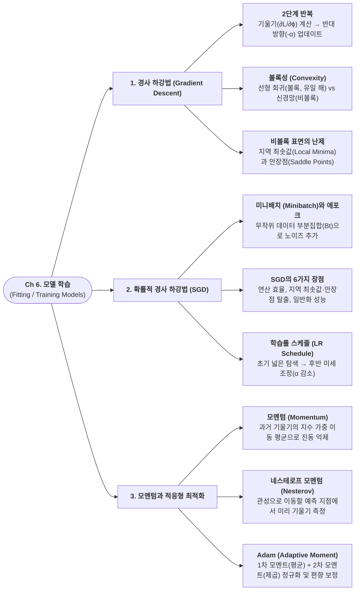

## 🗺️ Chapter 6 한눈에 보기 (Mindmap)

---

## 0. 모델 학습(Fitting / Training Models)의 목표
- **문제 정의:** 학습 데이터셋 $\{\mathbf{x}_i, \mathbf{y}_i\}$에 대해 네트워크의 예측값과 실제 정답 사이의 불일치를 나타내는 손실 함수 $L[\boldsymbol{\phi}]$를 **최소화하는 최적의 파라미터 $\hat{\boldsymbol{\phi}}$** 를 찾는 과정:
  $$\hat{\boldsymbol{\phi}} = \underset{\boldsymbol{\phi}}{\text{argmin}}\big[ L[\boldsymbol{\phi}] \big]$$
- **반복적 최적화 (Iterative Optimization)의 2단계:**
  1. 현재 파라미터 위치에서 파라미터에 대한 손실 함수의 미분값(**그래디언트, Gradients**)을 계산함 *(구체적인 계산법은 Chapter 7 역전파에서 다룸)*.
  2. 손실이 감소하도록 그래디언트에 기반해 파라미터를 조금씩 조정함 *(이번 Chapter 6의 핵심 주제)*.

---

## 6.1 경사 하강법 (Gradient Descent)

### ① 경사 하강법의 기본 알고리즘
초기 파라미터 $\boldsymbol{\phi} = [\phi_0, \phi_1, \dots, \phi_N]^T$를 설정한 뒤 다음 두 단계를 반복함:
- **Step 1. 각 파라미터에 대한 손실의 편미분(그래디언트 벡터) 계산:**
  $$\frac{\partial L}{\partial \boldsymbol{\phi}} = \begin{bmatrix} \frac{\partial L}{\partial \phi_0} \\ \frac{\partial L}{\partial \phi_1} \\ \vdots \\ \frac{\partial L}{\partial \phi_N} \end{bmatrix}$$
  - 그래디언트 벡터 $\frac{\partial L}{\partial \boldsymbol{\phi}}$는 현재 위치에서 손실 함수가 **가장 가파르게 증가하는 오르막(uphill) 방향** 을 가리킴.
- **Step 2. 내리막(downhill) 방향으로 파라미터 업데이트:**
  $$\boldsymbol{\phi} \longleftarrow \boldsymbol{\phi} - \alpha \cdot \frac{\partial L}{\partial \boldsymbol{\phi}}$$
  - 양의 스칼라 $\alpha$는 이동할 보폭의 크기를 결정함.
  - $\alpha$를 고정된 상수로 쓸 때는 **학습률(Learning rate)** 이라 부르며, 매 스텝마다 여러 $\alpha$ 값을 시도해 손실을 가장 많이 줄이는 보폭을 찾는 방식을 **선 탐색(Line search)** 이라 함.
- **종료 조건:** 손실 함수의 최솟값(바닥)에서는 곡면이 평평하여 기울기가 $0$($\frac{\partial L}{\partial \boldsymbol{\phi}} = \mathbf{0}$)이 되므로 파라미터 변화가 멈춤. 실제로는 그래디언트의 크기를 모니터링하다가 충분히 작아지면 알고리즘을 종료함.

### ② 선형 회귀 예제와 볼록성 (Convexity, Figure 6.1)
- 전체 손실 $L[\boldsymbol{\phi}] = \sum_{i=1}^I \ell_i$의 미분은 각 데이터 포인트의 개별 손실 $\ell_i = (\phi_0 + \phi_1 x_i - y_i)^2$의 미분 합으로 분해됨:
  $$\frac{\partial L}{\partial \boldsymbol{\phi}} = \sum_{i=1}^{I} \frac{\partial \ell_i}{\partial \boldsymbol{\phi}}, \quad \text{where } \frac{\partial \ell_i}{\partial \boldsymbol{\phi}} = \begin{bmatrix} 2(\phi_0 + \phi_1 x_i - y_i) \\ 2x_i(\phi_0 + \phi_1 x_i - y_i) \end{bmatrix}$$
- **볼록 함수 (Convex Function):** 선형 회귀의 손실 표면은 곡면 위의 어떤 두 점을 잇는 선분(현, chord)도 곡면과 교차하지 않는 매끄러운 그릇 모양의 **볼록(convex)** 함수임.
  - 볼록 함수는 **전역 최솟값(Global minimum)이 단 하나뿐** 이며 지역 최솟값이나 안장점이 존재하지 않으므로, 어디서 출발하든 내리막으로만 걸어가면 반드시 최적해에 도달함(학습이 실패할 수 없음).

### ③ 비선형 모델(가보르 모델)과 지역 최솟값·안장점 (Figure 6.2 ~ 6.4)
- 얕은 신경망과 심층 신경망을 포함한 대부분의 비선형 모델의 손실 함수는 **비볼록(Non-convex)** 함수임.
- 이를 2차원 파라미터 공간에서 시각화하기 위해 두 개의 파라미터 $\boldsymbol{\phi} = [\phi_0, \phi_1]^T$를 가진 비선형 **가보르 모델(Gabor model)** 을 살펴보면:
  $$f[x, \boldsymbol{\phi}] = \sin[\phi_0 + 0.06 \cdot \phi_1 x] \cdot \exp\left( -\frac{(\phi_0 + 0.06 \cdot \phi_1 x)^2}{32.0} \right)$$
  - $\phi_0$: 함수 중심의 좌우 위치 이동 / $\phi_1$: $x$축 방향의 폭(수축/팽창) 조절.
- **비볼록 손실 표면의 두 가지 장애물 (Figure 6.4):**
  1. **지역 최솟값 (Local Minima):** 기울기가 $0$이고 어느 방향으로 움직여도 손실이 증가하는 '국소적인 골짜기 바닥'이지만, 전체 함수에서 손실이 가장 낮은 **전역 최솟값(Global minimum)** 은 아닌 지점들. 무작위 위치에서 경사 하강법을 시작하면 잘못된 골짜기에 빠져 지역 최솟값에 갇힐 위험이 매우 큼.
  2. **안장점 (Saddle Points):** 기울기가 국소적으로 $0$이지만, **어떤 방향으로는 함수가 증가(최솟값 형태)하고 다른 방향으로는 감소(최댓값 형태)** 하는 말안장 모양의 지점. 안장점 근처는 표면이 매우 평평해서 기울기 크기가 작아졌을 때 학습이 수렴했다고 착각하고 조기 종료할 위험이 있음.

---

## 6.2 확률적 경사 하강법 (Stochastic Gradient Descent, SGD)
수백만 개의 파라미터를 가진 신경망에서는 모든 공간을 전수 조사하거나 여러 번 재시작하는 것이 불가능하며, 일반 경사 하강법은 **출발점이 최종 도착지를 완전히 결정해 버린다** 는 한계가 있음.

### ① SGD의 핵심 아이디어: 그래디언트에 노이즈 추가하기 (Figure 6.5b)
- 매 스텝마다 그래디언트에 약간의 무작위 노이즈(noise)를 추가함.
- 평균적으로는 내리막으로 이동하지만, 특정 순간에는 일시적으로 **오르막(uphill)** 으로 이동할 수도 있어 **잘못된 골짜기(지역 최솟값)에서 다른 골짜기로 점프하여 탈출** 할 가능성을 열어줌.

### ② 미니배치(Minibatch)와 에포크(Epoch)
- **무작위성 부여 메커니즘:** 매 반복(iteration) $t$마다 전체 학습 데이터 중 무작위 부분집합인 **미니배치(Minibatch 또는 Batch, $\mathcal{B}_t$)** 만 뽑아 그 데이터들만으로 그래디언트를 계산함:
  $$\boldsymbol{\phi}_{t+1} \longleftarrow \boldsymbol{\phi}_t - \alpha \cdot \sum_{i \in \mathcal{B}_t} \frac{\partial \ell_i[\boldsymbol{\phi}_t]}{\partial \boldsymbol{\phi}}$$
  - 여기서 $\alpha$는 시작 시점에 정하는 **학습률(Learning rate)** 로, 국소 기울기 크기와 함께 이동 거리를 결정함.
- **비복원 추출과 에포크:**
  - 일반적으로 미니배치는 전체 데이터셋에서 **비복원 추출(without replacement)** 로 뽑으며, 전체 데이터를 한 번 다 소진하면 다시 전체 데이터를 섞어 새로 추출함.
  - 전체 학습 데이터셋을 한 바퀴 완전히 통과하는 단위를 **1 에포크(Epoch)** 라고 함.
  - 배치 크기가 데이터 전체 크기와 같으면 일반 경사 하강법과 동일한 **풀배치 경사 하강법(Full-batch gradient descent)** 이 됨.
- **SGD에 대한 대안적 관점 (Figure 6.6):** 매 스텝마다 선택된 배치에 따라 **조금씩 모양이 바뀌는 손실 함수** 위에서 결정론적 경사 하강법을 수행하는 것으로 볼 수 있음. 현재 배치 손실 함수 기준으로는 내리막으로 가더라도, 전체(global) 손실 함수 기준으로는 오르막으로 움직여 지역 최솟값을 탈출할 수 있음.

### ③ 확률적 경사 하강법(SGD)의 6가지 매력적인 특성
1. 노이즈가 추가되지만 매 스텝마다 실제 데이터 부분집합에 대한 적합도를 개선하므로 업데이트 방향이 합리적임.
2. 비복원 추출로 순회하므로 모든 학습 데이터가 여전히 동등하게 기여함.
3. 전체 데이터가 아닌 일부만 사용하므로 **매 스텝의 그래디언트 계산 비용이 훨씬 저렴함**.
4. 원리적으로 **지역 최솟값(Local minima)을 탈출** 할 수 있음.
5. 전체 손실 표면의 안장점에서도 특정 배치들은 유의미한 기울기를 가질 가능성이 높아 **안장점(Saddle points) 근처에 갇힐 확률을 줄여줌**.
6. 실제 신경망에서 새로운 테스트 데이터에 대해 **더 일반화(Generalization)가 잘 되는 파라미터** 를 찾아낸다는 경험적 증거가 있음.

### ④ 학습률 스케줄 (Learning Rate Schedule)
- SGD는 전통적인 의미로 완전히 한 점에 수렴하지 않고 최솟값 주변에서 미세하게 흔들릴 수 있음.
- 따라서 실전에서는 초기 학습률 $\alpha$를 크게 시작하여 여러 골짜기를 넘나들며 빠르게 좋은 영역을 탐색(explore)하게 하고, 이후 매 $N$ 에포크마다 $\alpha$를 일정 비율로 줄여나가며 정밀하게 미세 조정(fine-tuning)하는 **학습률 스케줄(Learning rate schedule)** 을 함께 사용함.

---

## 6.3 모멘텀 (Momentum)

### ① 표준 모멘텀 (Standard Momentum, Figure 6.7)
- **아이디어:** 현재 배치에서 계산된 그래디언트와 **직전 스텝에서 이동했던 방향(관성, $\mathbf{m}_t$)** 의 가중 평균(선형 결합)으로 파라미터를 업데이트함:
  $$\mathbf{m}_{t+1} \longleftarrow \beta \cdot \mathbf{m}_t + (1 - \beta) \sum_{i \in \mathcal{B}_t} \frac{\partial \ell_i[\boldsymbol{\phi}_t]}{\partial \boldsymbol{\phi}}$$
  $$\boldsymbol{\phi}_{t+1} \longleftarrow \boldsymbol{\phi}_t - \alpha \cdot \mathbf{m}_{t+1}$$
  - $\mathbf{m}_t$: 모멘텀 벡터 / $\beta \in [0, 1)$: 시간에 따른 그래디언트 평활화(smoothing) 정도를 조절하는 하이퍼파라미터.
- **효과:** 재귀적 수식을 전개하면 $\mathbf{m}_{t+1}$은 **과거의 모든 그래디언트에 지수적으로 감소하는 가중치를 곱한 무한 가중합** 이 됨.
  - 여러 스텝 동안 그래디언트 방향이 일관되게 정렬되어 있으면 유효 학습률(속도)이 빨라지고, 좁은 협곡에서 그래디언트 방향이 위아래로 계속 반전되면 서로 상쇄되어 **불필요한 지그재그 진동(oscillation)이 줄어들고 수렴 궤적이 매끄러워짐**.

### ② 네스테로프 가속 모멘텀 (Nesterov Accelerated Momentum, Figure 6.8)
- 모멘텀 항 $-\alpha \cdot \mathbf{m}_t$는 다음 스텝에 알고리즘이 대략 어디로 이동할지에 대한 '예측'으로 볼 수 있음.
- **핵심 차이:** 현재 위치 $\boldsymbol{\phi}_t$에서 그래디언트를 구하는 대신, **모멘텀만으로 먼저 이동했다고 가정한 예측 지점($\boldsymbol{\phi}_t - \alpha \cdot \mathbf{m}_t$)에서 그래디언트를 측정** 하여 경로를 보정함:
  $$\mathbf{m}_{t+1} \longleftarrow \beta \cdot \mathbf{m}_t + (1 - \beta) \sum_{i \in \mathcal{B}_t} \frac{\partial \ell_i[\boldsymbol{\phi}_t - \alpha \cdot \mathbf{m}_t]}{\partial \boldsymbol{\phi}}$$
  $$\boldsymbol{\phi}_{t+1} \longleftarrow \boldsymbol{\phi}_t - \alpha \cdot \mathbf{m}_{t+1}$$

---

## 6.4 Adam (Adaptive Moment Estimation)

### ① 고정 학습률 경사 하강법의 딜레마 (Figure 6.9a–b)
- 이동 거리가 그래디언트 크기에 비례하므로, 오히려 조심스럽게 움직여야 할 **급경사 방향(큰 그래디언트)에서는 너무 크게 이동** 하고, 더 과감하게 탐색해야 할 **완만한 경사 방향(작은 그래디언트)에서는 너무 조금씩 이동** 하는 문제가 있음.
- 손실 표면이 한 방향(예: 수직)으로는 매우 가파르고 다른 방향(예: 수평)으로는 완만할 때:
  - 가파른 방향에 맞춰 작은 학습률을 쓰면 완만한 방향으로 수렴하는 데 너무 오랜 시간이 걸림 (Figure 6.9a).
  - 완만한 방향에 맞춰 큰 학습률을 쓰면 가파른 방향에서 최솟값을 뛰어넘어 발산(불안정)해 버림 (Figure 6.9b).

### ② 그래디언트 정규화 (Normalized Gradients, Figure 6.9c)
- 각 파라미터 성분별로 그래디언트 $\mathbf{m}_{t+1}$을 그 제곱근 $\sqrt{\mathbf{v}_{t+1}} = \sqrt{(\partial L / \partial \boldsymbol{\phi})^2}$으로 원소별(pointwise) 나눗셈하여 정규화하면:
  $$\boldsymbol{\phi}_{t+1} \longleftarrow \boldsymbol{\phi}_t - \alpha \cdot \frac{\mathbf{m}_{t+1}}{\sqrt{\mathbf{v}_{t+1}} + \epsilon}$$
  - 기울기의 크기는 약분되고 부호($+$/$-$)만 남아서 모든 좌표축 방향으로 일정한 거리 $\alpha$만큼씩 내리막으로 전진함 (단, $\epsilon$은 $0$으로 나누는 것을 방지하는 작은 상수).
  - *한계:* 양방향 모두 빠르게 전진하지만, 최솟값에 정확히 수렴하지 못하고 최솟값 주변에서 $\alpha$ 보폭으로 끝없이 앞뒤로 진동함.

### ③ Adam 알고리즘의 3단계 수식 (Figure 6.9d)
**Adam** 은 위 정규화 아이디어에 **1차 모멘트(그래디언트 자체)** 와 **2차 모멘트(원소별 제곱 그래디언트)** 양쪽 모두에 **모멘텀(지수 이동 평균)** 을 적용하여 매끄럽게 수렴하도록 만든 알고리즘임:

1. **1차 및 2차 모멘트의 모멘텀 업데이트 (미니배치 버전):**
   $$\mathbf{m}_{t+1} \longleftarrow \beta \cdot \mathbf{m}_t + (1 - \beta) \sum_{i \in \mathcal{B}_t} \frac{\partial \ell_i[\boldsymbol{\phi}_t]}{\partial \boldsymbol{\phi}}$$
   $$\mathbf{v}_{t+1} \longleftarrow \gamma \cdot \mathbf{v}_t + (1 - \gamma) \sum_{i \in \mathcal{B}_t} \left( \frac{\partial \ell_i[\boldsymbol{\phi}_t]}{\partial \boldsymbol{\phi}} \right)^2$$
   - 여기서 $\beta, \gamma \in [0, 1)$는 두 통계량에 대한 각각의 모멘텀 계수임.
2. **초기 편향 보정 (Bias Correction):**
   - 학습 초기($t=0, 1, \dots$)에는 과거 측정값들이 모두 $0$으로 초기화되어 있어 $\mathbf{m}_{t+1}$과 $\mathbf{v}_{t+1}$이 실제보다 비현실적으로 작게 추정됨. 이를 보정하기 위해 $1 - \beta^{t+1}$과 $1 - \gamma^{t+1}$로 나누어 줌:
     $$\tilde{\mathbf{m}}_{t+1} \longleftarrow \frac{\mathbf{m}_{t+1}}{1 - \beta^{t+1}}, \quad \tilde{\mathbf{v}}_{t+1} \longleftarrow \frac{\mathbf{v}_{t+1}}{1 - \gamma^{t+1}}$$
   - 시간 $t$가 커질수록 $\beta^{t+1}, \gamma^{t+1} \rightarrow 0$이 되어 분모가 $1$에 수렴하므로 보정 효과는 자연스럽게 사라짐.
3. **최종 파라미터 업데이트:**
   $$\boldsymbol{\phi}_{t+1} \longleftarrow \boldsymbol{\phi}_t - \alpha \cdot \frac{\tilde{\mathbf{m}}_{t+1}}{\sqrt{\tilde{\mathbf{v}}_{t+1}} + \epsilon}$$

- **Adam의 실용적 장점:**
  - 신경망의 층(depth)에 따라 그래디언트 크기가 크게 달라지는 현상(Ch 7)을 자동으로 보상하여 모든 층의 파라미터가 균형 있게 업데이트되도록 돕고, 초기 학습률 설정에 덜 민감하여 복잡한 학습률 스케줄 없이도 빠르게 초기 수렴을 달성함.

---

## 6.5 학습 알고리즘의 하이퍼파라미터 (Training Algorithm Hyperparameters)
- 최적화 알고리즘의 종류(SGD vs Adam), 배치 크기(Batch size), 학습률($\alpha$) 및 스케줄, 모멘텀 계수($\beta, \gamma$) 등은 모두 모델 파라미터와는 구별되는 **학습 알고리즘의 하이퍼파라미터** 임.
- 이들은 최종 모델 성능에 직접적인 영향을 미치며, 여러 하이퍼파라미터 조합으로 모델을 학습시켜 가장 좋은 것을 고르는 과정을 **하이퍼파라미터 탐색(Hyperparameter search, Ch 8)** 이라 함.

---

## 6.6 참고 노트 (Notes) 및 연습문제 핵심 포인트

### ① 헤시안 행렬(Hessian Matrix)과 볼록성·극점 판별
- 손실 함수의 2차 편미분들로 이루어진 대칭 행렬을 **헤시안 행렬(Hessian matrix, $\mathbf{H}[\boldsymbol{\phi}]$)** 이라 함:
  $$\mathbf{H}[\boldsymbol{\phi}] = \begin{bmatrix} \frac{\partial^2 L}{\partial \phi_0^2} & \frac{\partial^2 L}{\partial \phi_0 \partial \phi_1} & \cdots & \frac{\partial^2 L}{\partial \phi_0 \partial \phi_N} \\ \frac{\partial^2 L}{\partial \phi_1 \partial \phi_0} & \frac{\partial^2 L}{\partial \phi_1^2} & \cdots & \frac{\partial^2 L}{\partial \phi_1 \partial \phi_N} \\ \vdots & \vdots & \ddots & \vdots \\ \frac{\partial^2 L}{\partial \phi_N \partial \phi_0} & \frac{\partial^2 L}{\partial \phi_N \partial \phi_1} & \cdots & \frac{\partial^2 L}{\partial \phi_N^2} \end{bmatrix}$$
- **볼록성 판별:** 모든 파라미터 값에 대해 $\mathbf{H}[\boldsymbol{\phi}]$가 **양의 정부호(Positive definite, 모든 고윳값 eigenvalue이 양수)** 이면 그 손실 함수는 **볼록(Convex)** 함수임.
- **정류점(기울기가 0인 점)의 분류:** 그래디언트가 $\mathbf{0}$인 지점에서 헤시안 행렬의 고윳값들이
  1. **모두 양수($>0$):** 극솟값 (Local/Global Minimum)
  2. **모두 음수($<0$):** 극댓값 (Maximum)
  3. **양수와 음수가 섞여 있음:** 안장점 (Saddle point - 양수 고유벡터 방향으로는 극소, 음수 고유벡터 방향으로는 극대)
- **뉴턴 방법 (Newton's Method)의 한계:** 역행렬 $\mathbf{H}^{-1}$을 곱해 곡률(curvature)까지 반영하면 선 탐색이나 진동 없이 단번에 극점으로 이동할 수 있지만, ① 극솟값이 아닌 극댓값으로 끌려갈 수 있고, ② 파라미터가 $10^6$개면 헤시안 행렬의 크기가 **$10^6 \times 10^6 = 10^{12}$개 원소** 가 되어 계산 및 역행렬 연산이 현실적으로 불가능(intractable)함 (Problem 6.11).

### ② SGD의 배치 크기 대 학습률 비율과 일반화
- SGD에서 **학습률 대비 배치 크기 비율(Batch size to learning rate ratio)** 이 낮을수록(즉, 배치가 작거나 학습률이 클수록 노이즈가 커져) 더 **넓고 평평한 최솟값(Wide / Flat minima)** 을 찾으며 테스트 일반화 성능이 향상된다는 이론적·실험적 연구들이 있음 (Ch 20에서 상세히 다룸).

### ③ 적응형 알고리즘의 계보와 SGD vs Adam 논쟁
- **계보:** **AdaGrad** (누적 제곱 그래디언트로 학습률 감쇠 $\rightarrow$ 시간이 지나면 학습이 멈추는 단점) $\longrightarrow$ **RMSProp / AdaDelta** (지수 이동 평균으로 제곱 그래디언트 갱신) $\longrightarrow$ **Adam** (RMSProp + 1차 그래디언트 모멘텀 결합).
- **초기 분산 문제와 Warm-up:** 학습 극초기에는 샘플이 적어 누적 통계량의 노이즈가 크므로, 처음 수천 스텝 동안 학습률을 $0$에서부터 서서히 올리는 **학습률 웜업(Learning rate warm-up)** 이나 **RAdam(Rectified Adam)** 을 사용함.
- **SGD vs Adam:** 일부 연구에서 모멘텀 SGD가 Adam보다 일반화 성능이 더 좋은 해를 찾는다고 보고되었으나, 이는 기본 하이퍼파라미터 설정이나 $L_2$ 정규화 결합 방식 차이 때문인 경우가 많으며, 이를 개선한 **AdamW** 나 하이퍼파라미터를 튜닝한 Adam은 빠른 수렴과 높은 일반화 성능을 모두 달성함.

### ④ 주요 연습문제 (Problems) 포인트
- **Problem 6.7 (선 탐색 경사 하강법의 직각 지그재그 진동 이유):** 선 탐색(Line search)은 현재 이동 방향 벡터 $\mathbf{d}_t = -\frac{\partial L}{\partial \boldsymbol{\phi}_t}$ 위에서 손실이 가장 작은 지점에서 멈춤. 그 멈춘 지점에서는 현재 방향 $\mathbf{d}_t$에 대한 방향 도함수(기울기 성분)가 정확히 $0$이 되어야 하므로(등고선에 접함), 다음 스텝의 그래디언트 벡터는 반드시 직전 이동 방향과 **수직(직각, orthogonal)** 이 되어 협곡을 따라 직각으로 지그재그 진동하게 됨.
- **Problem 6.9 (반복 횟수와 에포크 계산):** 데이터셋 크기 $I = 100$, 배치 크기 $B = 20$일 때 $1$ 에포크당 $100 / 20 = 5$번의 반복(iterations)이 필요함. 따라서 $1,000$번의 반복(iterations)을 수행했다면 총 **$1,000 / 5 = 200$ 에포크(Epochs)** 동안 학습한 것임.
- **Problem 6.10 (모멘텀의 무한 가중합 전개):**
  $$\mathbf{m}_{t+1} = (1 - \beta)\sum_{k=0}^{t} \beta^k \mathbf{g}_{t-k}$$
  과거 $k$ 스텝 전의 그래디언트 $\mathbf{g}_{t-k}$에 $(1-\beta)\beta^k$의 지수 감쇠 가중치가 곱해진 무한 급수 형태임.
