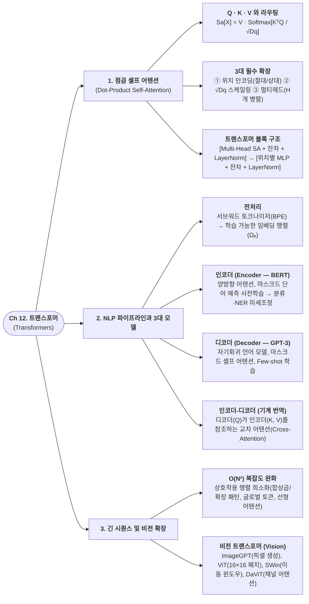

## 🗺️ Chapter 12 한눈에 보기 (Mindmap)

---

## 0. 왜 텍스트(및 시퀀스) 데이터를 처리할 때 트랜스포머가 필요한가?
자연어 텍스트 데이터를 신경망으로 처리할 때는 이미지(CNN)와 비슷하면서도 다른 **3가지 핵심 요구사항** 이 존재함 (섹션 12.1):
1. **거대한 입력 차원:** 37단어로 된 짧은 문단조차 각 단어를 1,024차원 임베딩 벡터로 표현하면 입력 크기가 $37 \times 1024 = 37,888$차원이 되며, 실제 문서는 수백~수천 단어에 달하므로 완전 연결(FC) 네트워크는 사용 불가능함.
2. **가변적인 시퀀스 길이 (Variable length):** 이미지와 달리 문장이나 문단은 입력마다 길이가 제각각이며 쉽게 리사이즈할 수 없음 $\rightarrow$ **위치에 상관없이 모든 단어에 동일한 파라미터를 공유(parameter sharing)** 해야 함.
3. **모호성과 장거리 문맥 의존성 (Ambiguity & Long-range dependencies):**
   - 예문: *"The restaurant refused to serve me a ham sandwich because **it** only cooks vegetarian food... **Their** ambiance was just as good..."*
   - 대명사 *it* 이나 *their* 가 '햄 샌드위치'가 아니라 문장 멀리 떨어진 '식당(*restaurant*)'을 가리킨다는 것을 파악하려면, **단어들 사이에 장거리 연결이 존재해야 하며 그 연결 강도가 입력 단어들의 내용 자체에 따라 동적으로 결정(어텐션, Attention)** 되어야 함!

---

## 12.2 점곱 셀프 어텐션 (Dot-Product Self-Attention)

### ① 값(Values)의 계산과 라우팅(Routing)으로서의 셀프 어텐션 (Figure 12.1 ~ 12.2)
셀프 어텐션 블록 $\mathbf{sa}[\bullet]$는 $D \times 1$ 차원의 입력 벡터 $N$개($\mathbf{x}_1, \dots, \mathbf{x}_N$)를 받아 동일한 크기의 출력 벡터 $N$개($\mathbf{sa}_1, \dots, \mathbf{sa}_N$)를 반환함:
1. **값(Value) 벡터 계산:** 모든 입력 $\mathbf{x}_m$에 **동일한 가중치 행렬 $\boldsymbol{\Omega}_v \in \mathbb{R}^{D \times D}$와 편향 $\boldsymbol{\beta}_v \in \mathbb{R}^D$** 를 독립적으로 적용함:
   $$\mathbf{v}_m = \boldsymbol{\beta}_v + \boldsymbol{\Omega}_v \mathbf{x}_m$$
2. **어텐션 가중합:** $n$번째 출력 $\mathbf{sa}_n[\mathbf{x}_1, \dots, \mathbf{x}_N]$은 모든 $N$개의 값 벡터 $\mathbf{v}_1, \dots, \mathbf{v}_N$들의 선형 가중합으로 계산됨:
   $$\mathbf{sa}_n[\mathbf{x}_1, \dots, \mathbf{x}_N] = \sum_{m=1}^{N} a[\mathbf{x}_m, \mathbf{x}_n] \mathbf{v}_m$$
   - 스칼라 가중치 $a[\mathbf{x}_m, \mathbf{x}_n]$은 **$n$번째 출력이 $m$번째 입력에 기울이는 어텐션(주의력)** 이며, 각 출력 $n$에 대해 $N$개의 가중치는 모두 **비음수($\ge 0$)이고 총합이 $1$** 임 ($\rightarrow$ $N$개의 값 벡터들을 서로 다른 비율로 배분하는 **라우팅 메커니즘**).
   - 파라미터($\boldsymbol{\Omega}_v, \boldsymbol{\beta}_v$)가 모든 위치에서 공유되므로 시퀀스 길이 $N$과 무관하며, 어텐션 가중치는 입력 쌍 $(\mathbf{x}_m, \mathbf{x}_n)$마다 단 1개씩 총 **$N^2$개** 만 존재함 (Problem 12.1).

### ② 어텐션 가중치 계산: 쿼리(Queries)와 키(Keys) (Figure 12.3)
어텐션 가중치 $a[\mathbf{x}_m, \mathbf{x}_n]$이 입력 단어들 자체에 의존하도록 만들기 위해 두 개의 선형 변환을 추가로 적용하여 **쿼리(Query, $\mathbf{q}_n$)** 와 **키(Key, $\mathbf{k}_m$)** 벡터를 생성함:
$$\mathbf{q}_n = \boldsymbol{\beta}_q + \boldsymbol{\Omega}_q \mathbf{x}_n, \quad \mathbf{k}_m = \boldsymbol{\beta}_k + \boldsymbol{\Omega}_k \mathbf{x}_m$$
- **점곱과 소프트맥스:** $n$번째 쿼리 $\mathbf{q}_n$과 모든 키 $\mathbf{k}_1, \dots, \mathbf{k}_N$ 사이의 **점곱(Dot product — 두 벡터의 유사도 척도)** 을 계산한 뒤 **소프트맥스(Softmax)** 함수에 통과시킴:
  $$a[\mathbf{x}_m, \mathbf{x}_n] = \text{softmax}_m\big[\mathbf{k}_\bullet^T \mathbf{q}_n\big] = \frac{\exp[\mathbf{k}_m^T \mathbf{q}_n]}{\sum_{m'=1}^{N} \exp[\mathbf{k}_{m'}^T \mathbf{q}_n]}$$
- **정보 검색(Information Retrieval) 비유 및 특징:**
  - 쿼리(검색어)와 키(색인)의 점곱이 클수록 유사도가 높으며, 소프트맥스를 통해 모든 키들이 최종 출력에 기여하기 위해 서로 경쟁함.
  - 내적을 해야 하므로 **쿼리($\mathbf{q}_n$)와 키($\mathbf{k}_m$)의 차원($D_q$)은 반드시 같아야 하지만**, 값($\mathbf{v}_m$)의 차원과는 달라도 됨 (보통 값 벡터의 차원은 다음 층과의 잔차 연결을 위해 입력 차원 $D$와 같게 맞춤 — Problem 12.2).
  - ReLU 같은 별도의 활성화 함수가 없지만, 입력에서 파생된 쿼리와 키의 **점곱(곱셈) 및 소프트맥스 연산 덕분에 전체 연산은 비선형(nonlinear)** 이며, 한 분기가 다른 분기의 가중치를 계산하는 **하이퍼네트워크(Hypernetwork)** 구조임.

### ③ 행렬 표기법 (Matrix Form, Figure 12.4)
$N$개의 입력 벡터 $\mathbf{x}_n \in \mathbb{R}^D$를 열(column)로 모아 놓은 행렬을 $\mathbf{X} \in \mathbb{R}^{D \times N}$이라 하면($\mathbf{1}$은 $N \times 1$크기의 $1$벡터):
$$\mathbf{V}[\mathbf{X}] = \boldsymbol{\beta}_v \mathbf{1}^T + \boldsymbol{\Omega}_v \mathbf{X}, \quad \mathbf{Q}[\mathbf{X}] = \boldsymbol{\beta}_q \mathbf{1}^T + \boldsymbol{\Omega}_q \mathbf{X}, \quad \mathbf{K}[\mathbf{X}] = \boldsymbol{\beta}_k \mathbf{1}^T + \boldsymbol{\Omega}_k \mathbf{X}$$
$$\mathbf{Sa}[\mathbf{X}] = \mathbf{V}[\mathbf{X}] \cdot \text{Softmax}\big[ \mathbf{K}[\mathbf{X}]^T \mathbf{Q}[\mathbf{X}] \big] \quad \Longleftrightarrow \quad \mathbf{Sa}[\mathbf{X}] = \mathbf{V} \cdot \text{Softmax}\big[\mathbf{K}^T \mathbf{Q}\big]$$
- 여기서 $\text{Softmax}[\bullet]$는 $N \times N$ 행렬의 **각 열(column)에 대해 독립적으로** 소프트맥스를 수행함.

---

## 12.3 실전을 위한 셀프 어텐션의 3가지 확장 (Extensions to Dot-Product Self-Attention)

### ① 위치 인코딩 (Positional Encoding, Figure 12.5)
- **순열 등변성 문제 (Permutation Equivariance — Problem 12.3):** 기본 셀프 어텐션은 입력 토큰들의 순서(열 순서)를 뒤섞어도 출력의 순서만 똑같이 뒤섞일 뿐($\mathbf{Sa}[\mathbf{X}\mathbf{P}] = \mathbf{Sa}[\mathbf{X}]\mathbf{P}$), **단어의 위치(순서) 정보를 완전히 무시함** (*"The woman ate the raccoon"* 과 *"The raccoon ate the woman"* 을 구별하지 못함).
- **해결책 1 — 절대 위치 인코딩 (Absolute Positional Encodings):** 각 열(위치)마다 고유한 값을 가진 위치 인코딩 행렬 $\boldsymbol{\Pi} \in \mathbb{R}^{D \times N}$(미리 정의된 다양한 주파수의 사인/코사인 파형 또는 학습 가능한 파라미터)을 입력 행렬 $\mathbf{X}$에 **더해줌($\mathbf{X} + \boldsymbol{\Pi}$)**.
- **해결책 2 — 상대 위치 인코딩 (Relative Positional Encodings):** 문장이 문서의 어디서 시작하든 두 단어 사이의 **상대적 거리(offset)** 가 더 중요하므로, 쿼리 위치 $a$와 키 위치 $b$ 사이의 오프셋마다 파라미터 $\pi_{a,b}$를 학습하여 어텐션 행렬을 직접 수정함.

### ② 스케일드 점곱 셀프 어텐션 (Scaled Dot-Product Self-Attention)
- 쿼리와 키의 차원 $D_q$가 크면 점곱 $\mathbf{k}_m^T \mathbf{q}_n$의 절댓값이 매우 커져서, 소프트맥스 함수에서 가장 큰 값 하나가 확률 $1$을 독점하고 나머지는 전부 $0$이 되는 포화 영역으로 들어감.
- 이 영역에서는 소프트맥스의 미분값(기울기)이 거의 **$0$으로 소실** 되어 학습이 불가능해짐 (Problem 12.4).
- 이를 방지하기 위해 점곱 결과를 **쿼리/키 차원의 제곱근 $\sqrt{D_q}$로 나누어 분산을 일정하게 스케일링** 함:
  $$\mathbf{Sa}[\mathbf{X}] = \mathbf{V} \cdot \text{Softmax}\left[ \frac{\mathbf{K}^T \mathbf{Q}}{\sqrt{D_q}} \right]$$

### ③ 멀티헤드 셀프 어텐션 (Multi-Head Self-Attention, Figure 12.6)
- 단일 셀프 어텐션만 쓰는 대신, 서로 다른 독립적인 파라미터 $\{\boldsymbol{\beta}_{vh}, \boldsymbol{\Omega}_{vh}, \boldsymbol{\beta}_{qh}, \boldsymbol{\Omega}_{qh}, \boldsymbol{\beta}_{kh}, \boldsymbol{\Omega}_{kh}\}$를 가진 **$H$개의 셀프 어텐션(헤드, Heads)을 병렬로 수행** 함:
  $$\mathbf{Sa}_h[\mathbf{X}] = \mathbf{V}_h \cdot \text{Softmax}\left[ \frac{\mathbf{K}_h^T \mathbf{Q}_h}{\sqrt{D_q}} \right] \quad (h = 1, \dots, H)$$
- 입력 차원이 $D$이고 헤드가 $H$개일 때, 보통 각 헤드의 쿼리·키·값 차원을 **$D_q = D / H$** 로 설정하여 전체 연산량과 파라미터 수를 단일 헤드(차원 $D$)일 때와 비슷하게 유지함 (Problem 12.5).
- $H$개 헤드의 출력들을 수직으로 전부 이어 붙인(vertically concatenated) 뒤, 마지막 선형 변환 행렬 $\boldsymbol{\Omega}_c \in \mathbb{R}^{D \times D}$를 곱해 결합함:
  $$\mathbf{MhSa}[\mathbf{X}] = \boldsymbol{\Omega}_c \Big[ \mathbf{Sa}_1[\mathbf{X}]^T, \mathbf{Sa}_2[\mathbf{X}]^T, \dots, \mathbf{Sa}_H[\mathbf{X}]^T \Big]^T$$

---

## 12.4 트랜스포머 층의 전체 구조 (Transformers, Figure 12.7)
하나의 완전한 **트랜스포머 층(Transformer layer)** 은 다음 두 개의 잔차 서브블록과 **LayerNorm** (각 토큰/샘플 내에서 채널에 걸쳐 정규화)이 결합된 형태임:
1. **멀티헤드 셀프 어텐션 서브블록 (단어 간 상호작용):**
   $$\mathbf{X} \longleftarrow \mathbf{X} + \mathbf{MhSa}[\mathbf{X}]$$
   $$\mathbf{X} \longleftarrow \text{LayerNorm}[\mathbf{X}]$$
2. **위치별 완전 연결 네트워크 서브블록 (각 단어별 독립 비선형 변환):** 모든 $N$개의 각 열(단어 표현 $\mathbf{x}_n$)에 대해 **동일한 다층 퍼셉트론 $\text{mlp}[\bullet]$** 을 개별적으로 적용함:
   $$\mathbf{x}_n \longleftarrow \mathbf{x}_n + \text{mlp}[\mathbf{x}_n] \quad (\forall n \in \{1, \dots, N\})$$
   $$\mathbf{X} \longleftarrow \text{LayerNorm}[\mathbf{X}]$$
- 실제 트랜스포머 모델은 이 트랜스포머 층을 $K$개 직렬로 쌓아서 구성함.

---

## 12.5 ~ 12.8 NLP 파이프라인과 3대 트랜스포머 아키텍처

### ① NLP 전처리: 서브워드 토큰화(Tokenization)와 임베딩(Embeddings)
1. **서브워드 토크나이저 (Sub-word Tokenizer — BPE 등, Figure 12.8):**
   - 단어 단위 토큰화는 미등록 단어(이름 등), 구두점 처리, 어미 변화(*walk, walks, walked, walking*)를 연결하지 못하는 문제가 있고, 글자(문자) 단위 토큰화는 시퀀스가 너무 길어지는 문제가 있음.
   - 이를 절충하여 초기 문자/공백에서 출발해 **가장 빈번하게 인접해 나타나는 문자/조각 쌍을 탐욕적으로 병합(greedy merge)** 하는 **바이트 페어 인코딩(Byte Pair Encoding, BPE)** 등을 사용해 흔한 단어는 통째로, 희귀한 단어는 단어 조각(sub-word)으로 구성된 어휘 사전 $\mathcal{V}$(예: $|\mathcal{V}| = 30,000$)를 구축함.
2. **단어 임베딩 (Word Embeddings, Figure 12.9):**
   - 어휘 사전의 각 토큰을 길이 $|\mathcal{V}| \times 1$인 원-핫 벡터들의 행렬 $\mathbf{T} \in \mathbb{R}^{|\mathcal{V}| \times N}$으로 나타낸 뒤, 학습 가능한 임베딩 행렬 $\boldsymbol{\Omega}_e \in \mathbb{R}^{D \times |\mathcal{V}|}$를 곱해 입력 임베딩 행렬 **$\mathbf{X} = \boldsymbol{\Omega}_e \mathbf{T} \in \mathbb{R}^{D \times N}$** 을 생성함.

### ② 아키텍처 1: 인코더 모델 — BERT (섹션 12.6, Figure 12.10 ~ 12.11)
- **목적:** 양방향 문맥을 모두 통합한 풍부한 텍스트 표현을 구축한 뒤, 다양한 다운스트림 태스크에 **전이 학습(미세 조정, Fine-tuning)** 하기 위한 모델.
- **BERT 제원:** 어휘 크기 $30,000$, 임베딩 차원 $D = 1024$, 트랜스포머 층 $K = 24$개, 헤드 수 $H = 16$개($D_q = 64$), MLP 은닉층 차원 $4096$, 총 파라미터 약 **3억 4,000만 개**.
- **자기지도 사전 학습 (Pre-training — 마스크드 언어 모델링, Figure 12.10):**
  - 입력 토큰 중 일부 비율을 무작위로 **`<mask>` 토큰** 으로 치환하고, 출력 임베딩으로부터 가려진 원래 단어를 다중 클래스 교차 엔트로피로 예측하게 함 (33억 단어 코퍼스에서 약 50 에포크 학습).
  - *장점:* 가려진 단어를 맞히기 위해 **왼쪽과 오른쪽의 양방향 문맥(bidirectional context)** 을 모두 활용함.
  - *단점:* 마스킹된 소수의 토큰만 손실 함수에 기여하므로 데이터 활용 효율이 다소 낮음.
- **미세 조정 (Fine-tuning, Figure 12.11):** 사전 학습된 인코더 끝에 간단한 선형 층이나 MLP만 덧붙여 지도 학습 수행:
  - *문장 분류 (감성 분석 등):* 문장 맨 앞에 넣은 특수 토큰 **`<cls>`** 의 최종 출력 임베딩을 단일 스칼라 + 시그모이드로 매핑해 이진 분류.
  - *단어 분류 (개체명 인식, NER):* 각 단어의 출력 임베딩마다 소프트맥스를 적용해 인물/장소/기관 등을 분류.
  - *텍스트 구간 예측 (SQuAD 질의응답):* 질문과 위키피디아 본문을 이어 붙여 넣은 뒤, 각 토큰이 정답 구간의 **시작점(start)** 일 확률과 **끝점(end)** 일 확률 두 가지를 예측.

### ③ 아키텍처 2: 디코더 모델 — GPT-3 (섹션 12.7, Figure 12.12)
- **목적:** 시퀀스의 **다음 토큰(Next token)을 예측** 하여 텍스트를 생성하는 **자기회귀 언어 모델(Autoregressive Language Model)** (이 책에서 처음 등장하는 **생성 모델 Generative model**).
- **자기회귀 확률 분해:** 전체 시퀀스 $(t_1, t_2, \dots, t_N)$의 결합 확률을 이전 토큰들이 주어졌을 때 다음 토큰이 나타날 조건부 확률들의 곱으로 분해함:
  $$\Pr(t_1, t_2, \dots, t_N) = \Pr(t_1) \prod_{n=2}^{N} \Pr(t_n | t_1, \dots, t_{n-1})$$
- **마스크드 셀프 어텐션 (Masked Self-Attention, Figure 12.12):**
  - 학습 시 문장 전체를 한 번에 입력하면 $n$번째 위치에서 다음 단어 $t_{n+1}$을 예측할 때 정답과 미래(오른쪽) 단어들을 미리 컨닝(cheat)해 버리는 문제가 발생함.
  - 이를 막기 위해 셀프 어텐션의 점곱 행렬 $\mathbf{K}^T \mathbf{Q}$에서 **현재 위치보다 뒤에 있는(미래의) 모든 토큰들과의 점곱 값을 소프트맥스 통과 전에 $-\infty$로 설정** 하여 어텐션 가중치가 정확히 **$0$** 이 되도록 마스킹함!
  - *장단점 (BERT와 정반대):* 오직 왼쪽(과거) 문맥만 사용할 수 있다는 단점이 있으나, **모든 토큰 위치가 손실 함수에 기여하므로 데이터 학습 효율이 매우 뛰어남**.
- **텍스트 생성과 디코딩 전략 (Decoding Strategies):**
  - 생성된 토큰을 다시 입력 뒤에 붙여 반복 실행하며, 과거 임베딩은 미래 토큰에 의존하지 않으므로 **이전 계산값(K, V 캐시)을 그대로 재활용** 해 빠르게 생성할 수 있음 (Problem 12.7).
  - 단순 탐욕적(Greedy) 선택이나 순수 무작위 샘플링의 단점을 보완하기 위해 여러 후보 시퀀스를 유지하는 **빔 서치(Beam search)**, 상위 $K$개 후보에서만 샘플링하는 **Top-$k$ 샘플링**, 누적 확률 질량 상위 비율에서만 샘플링하는 **뉴클리어스 샘플링(Nucleus / Top-$p$ sampling)** 등을 사용함.
- **GPT-3와 퓨샷 학습 (Few-Shot Learning):** 시퀀스 길이 $2048$, 임베딩 차원 $12288$, $96$개 층, $96$개 헤드, 총 **1,750억 개 파라미터** (3,000억 토큰 학습) 규모의 초거대 모델이 되면, 가중치 미세 조정(Fine-tuning) 없이 프롬프트 맥락에 몇 개의 입출력 예시만 적어주어도 새로운 태스크(문법 교정, 코딩, 번역 등)를 수행하는 **퓨샷 학습(Few-shot learning / In-context learning)** 능력이 창발됨.

### ④ 아키텍처 3: 인코더-디코더 모델 — 기계 번역 (섹션 12.8, Figure 12.13 ~ 12.14)
- 영어 문장을 프랑스어 문장으로 바꾸는 시퀀스-투-시퀀스(Sequence-to-Sequence) 번역 태스크에서는 **인코더** (원문 영어 문장 이해)와 **디코더** (타깃 프랑스어 단어 자기회귀 생성)를 결합함.
- **교차 어텐션 (Cross-Attention / Encoder-Decoder Attention, Figure 12.14):**
  - 디코더의 각 트랜스포머 층 내부에서 [마스크드 셀프 어텐션]과 [위치별 MLP] 사이에 새로운 어텐션 층인 **교차 어텐션** 을 삽입함.
  - 여기서 **쿼리($\mathbf{Q}$)는 디코더 임베딩 $\mathbf{X}_{\text{dec}}$(프랑스어)** 에서 계산하고, **키($\mathbf{K}$)와 값($\mathbf{V}$)은 인코더의 최종 출력 임베딩 $\mathbf{X}_{\text{enc}}$(영어)** 에서 계산하여, 번역할 각 단어가 원문의 모든 단어들을 참조할 수 있게 함!

---

## 12.9 ~ 12.10 긴 시퀀스를 위한 트랜스포머와 비전 트랜스포머 (Vision Transformers)

### ① 긴 시퀀스와 $O(N^2)$ 복잡도 문제 완화 (Figure 12.15)
- 셀프 어텐션은 모든 토큰이 서로 상호작용하므로 연산량과 메모리가 시퀀스 길이 $N$의 제곱(**$O(N^2)$**)으로 증가함.
- **해결 전략 1 — 상호작용 행렬의 희소화 (Sparsifying Interaction Matrix, Figure 12.15c–h):**
  - *합성곱/지역 어텐션 패턴:* 인접한 이웃 토큰들과만 어텐션을 수행(대각 띠 행렬)하거나 확장(Dilated) 패턴을 적용함.
  - *선택된 토큰 / 글로벌 토큰 (Global Tokens):* 문장 첫 토큰이나 특수 글로벌 토큰 몇 개만 전체 토큰과 모두 상호작용하게 하여 장거리 정보 통로 역할을 하게 함 (예: BigBird, Longformer).
- **해결 전략 2 — 커널 근사 / 선형 어텐션 (Problem 12.10):** $\exp[\mathbf{k}_m^T \mathbf{q}_n]$을 비선형 특징 매핑의 내적 $\mathbf{g}[\mathbf{k}_m]^T \mathbf{g}[\mathbf{q}_n]$으로 근사하면 행렬 곱셈의 결합법칙을 이용해 $\sum_m \mathbf{v}_m \mathbf{g}[\mathbf{k}_m]^T$를 먼저 계산할 수 있어 복잡도를 **$O(N)$ (선형)** 으로 줄일 수 있음 (Linear Transformer, Performer).

### ② 이미지를 위한 트랜스포머 (Transformers for Images)
이미지는 픽셀 수($N$)가 너무 많아 $O(N^2)$ 어텐션이 치명적이고 CNN과 달리 2D 평행이동 등변성이라는 귀납적 편향도 없지만, **초대형 데이터셋 사전 학습** 을 통해 현재 CNN의 성능을 추월함:
1. **ImageGPT (Figure 12.16):** $64 \times 64$ 저해상도 이미지(9비트 512개 색상 토큰)의 픽셀들을 1차원으로 나열해 디코더로 다음 픽셀을 자기회귀 생성함.
2. **비전 트랜스포머 (Vision Transformer, ViT — Dosovitskiy et al., 2021, Figure 12.17):**
   - 이미지를 **$16 \times 16$ 크기의 비겹침 패치(Patches) 격자** 로 쪼갠 뒤, 각 패치를 선형 변환을 통해 하나의 '패치 임베딩(토큰)'으로 변환하여 토큰 수 $N$을 획기적으로 줄임.
   - 학습 가능한 1D 위치 인코딩과 `<cls>` 토큰을 더해 표준 트랜스포머 인코더에 통과시킴.
   - *핵심 특징:* CNN의 강한 귀납적 편향이 없으므로 중소규모 데이터셋에서는 CNN보다 못하지만, **3억 장(JFT-300M) 이상의 초대형 이미지 데이터셋에서 사전 학습** 하면 CNN을 능가함.
3. **다중 스케일 비전 트랜스포머 (Multi-Scale Vision Transformers):**
   - **SWin 트랜스포머 (Shifted-Window, Figure 12.18):** 이미지를 작은 윈도우들로 나누어 **윈도우 내부의 패치들끼리만 셀프 어텐션** 을 수행(연산량 대폭 절감)하고, **홀수/짝수 층마다 윈도우 격자를 대각선으로 절반씩 이동(Shifted window)** 시켜 윈도우 경계를 넘어 정보가 흐르게 함. 또한 층이 깊어질수록 $2 \times 2$ 인접 패치를 병합해 CNN처럼 해상도는 줄이고 채널 수는 2배씩 늘려감.
   - **DaViT (Dual Attention Vision Transformer):** ① 모든 채널을 사용해 윈도우 내 **공간 패치들 간 어텐션** 을 수행하는 층과, ② 모든 공간 패치를 사용해 **채널들 간에 어텐션(Channel attention)** 을 수행하는 층을 교대로 배치하여 국소 공간 정보와 전역 공간 정보를 모두 효율적으로 통합함 (Problem 12.9).

---

## 12.11 참고 노트 (Notes) 및 연습문제 핵심 포인트

### ① RNN에서 트랜스포머로의 진화와 타 모델과의 관계
- **순환 신경망 (RNN / LSTM / GRU, Figure 12.19):** 트랜스포머 이전의 표준 시퀀스 모델로, 단어를 한 타임스텝씩 순차적으로 입력받으며 이전 은닉 상태를 다음 스텝으로 전달함. 시퀀스가 길어지면 앞쪽 정보를 잊어버리는 장기 의존성 문제와 **순차 처리로 인해 GPU 병렬화가 불가능하다** 는 한계가 있었으며, 이를 어텐션(Bahdanau et al., 2015)만으로 완전히 대체한 것이 트랜스포머(Vaswani et al., 2017)임.
- **타 아키텍처와의 연결:** 셀프 어텐션은 입력이 가중치를 결정하는 **하이퍼네트워크(Hypernetwork)** 이자 **라우팅 네트워크** (캡슐 네트워크와 유사하나 입력들이 경쟁함)이며, 모든 노드가 서로 연결된 완전 그래프 위에서의 **그래프 신경망(GNN, Ch 13)** 및 현대 홉필드 네트워크(Hopfield networks)의 메모리 인출과도 수학적으로 밀접하게 연결됨.

### ② 트랜스포머 학습의 불안정성과 Learning Rate Warm-up이 필수인 이유
- 트랜스포머는 SGD로는 학습이 거의 되지 않으며 반드시 **Adam(또는 AdamW)** 과 **학습률 웜업(Learning rate warm-up)** 을 함께 써야 함.
- **이유:** ① 잔차 블록 바깥에 LayerNorm이 위치하는 기본 구조(Post-LN)에서는 역전파 시 그래디언트가 작아지고, ② 쿼리·키 파라미터($\boldsymbol{\Omega}_q, \boldsymbol{\Omega}_k$)의 그래디언트 크기가 값 파라미터($\boldsymbol{\Omega}_v$)의 그래디언트보다 훨씬 작아서 층별/파라미터별 스케일을 맞춰주는 Adam이 필수적이며, 학습 극초기 불안정한 통계로 인한 발산을 막기 위해 Warm-up(또는 LayerNorm을 잔차 분기 안으로 넣는 Pre-LN, TFixup 초기화 등)이 필요함.

### ③ 주요 연습문제 (Problems) 포인트
- **Problem 12.1 (셀프 어텐션 vs 완전 연결 층 파라미터 비교):** 길이 $D$인 입력 $N$개를 처리할 때,
  - **셀프 어텐션:** $\mathbf{Q}, \mathbf{K}, \mathbf{V}$ 계산에 쓰이는 가중치는 $3D^2$개, 편향은 $3D$개로 **$N$과 무관** 하며, 동적으로 생성되는 어텐션 가중치 $a[\bullet,\bullet]$는 **$N^2$개** 임.
  - **완전 연결(FC) 네트워크:** 입력 $DN$개를 출력 $DN$개로 연결하므로 가중치만 **$D^2 N^2$개**, 편향은 $DN$개가 필요함.
- **Problem 12.5 (멀티헤드 어텐션에서 각 헤드 차원을 $D/H$로 두는 이유):** $H$개 헤드의 가중치 행렬 $\boldsymbol{\Omega}_{qh} \in \mathbb{R}^{(D/H) \times D}$들을 수직으로 쌓으면 하나의 큰 정방 행렬 $\boldsymbol{\Omega}_q \in \mathbb{R}^{D \times D}$가 되므로, **$H$개 헤드의 쿼리·키·값 선형 투영을 단 한 번의 거대한 행렬 곱셈으로 병렬 처리** 한 뒤 텐서 모양(reshape)만 나누어 어텐션을 계산할 수 있어 연산 효율이 극대화됨.
- **Problem 12.7 (자기회귀 디코더 생성 시 KV 캐싱 연산량):** 이미 $N$개 토큰에 대해 계산이 끝난 상태에서 $(N+1)$번째 새 토큰 1개가 추가되면, 마스크드 어텐션 덕분에 이전 $N$개 토큰의 쿼리·키·값과 어텐션 출력은 전혀 변하지 않음! 따라서 **새 토큰 1개에 대한 $\mathbf{q}_{N+1}, \mathbf{k}_{N+1}, \mathbf{v}_{N+1}$만 계산** 하고 기존에 저장해 둔 $\mathbf{k}_1, \dots, \mathbf{k}_N$과 내적하면 되므로 토큰 생성 시 연산량이 $O(N^2)$에서 $O(N)$으로 줄어듦 (**KV Caching**).
- **Problem 12.9 (DaViT에서 패치 간 어텐션 vs 채널 간 어텐션 크기 비교):** $16 \times 16$ 패치 격자(총 패치 수 $N = 256$)이고 채널(임베딩) 차원이 $D = 512$일 때,
  - **패치 간 어텐션:** $256 \times 256$ 어텐션 행렬 생성 (차원 $512$짜리 벡터들의 내적).
  - **채널 간 어텐션:** $512 \times 512$ 어텐션 행렬 생성 (차원 $256$짜리 벡터들의 내적 — 특히 고해상도 이미지에서 패치 수 $N$이 매우 커져도 어텐션 행렬 크기가 $D \times D$로 고정되는 장점이 있음).
